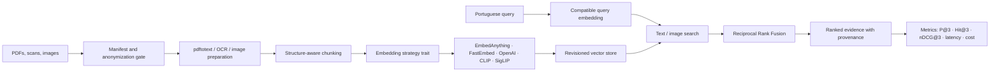

# CognitionLab

**An applied AI engineering lab: retrieval, multimodal embeddings, privacy-preserving document pipelines, and LLM agent harnesses, built in Rust and Python.**

[](https://github.com/aquental/CognitionLab/actions/workflows/embeddings-fundamentals.yml)
[](https://github.com/aquental/CognitionLab/actions/workflows/anonymizer.yml)


I use this repository to study how AI systems behave once they leave the notebook. I pick one hard, realistic problem: searching Portuguese medical exams, which arrive as PDFs, scans, and images, without leaking patient data. Then I build every layer it needs: extraction, embeddings, retrieval, evaluation, anonymization, classification, and agent tooling.

Every subproject follows the same rules. **Write the specification first. Measure before claiming. Make each failure observable. Keep the evidence reproducible.**

---

## What I am studying

| Topic | Where it shows up | What I practise |
|---|---|---|
| **Semantic search and RAG retrieval** | [`embeddings-fundamentals`](embeddings-fundamentals/) | Structure-aware chunking, token budgets, exact cosine search, embedding-space compatibility checks |
| **Multimodal retrieval** | [`embeddings-fundamentals`](embeddings-fundamentals/) | Text-to-image search with CLIP and multilingual SigLIP, plus Reciprocal Rank Fusion |
| **Evaluating models** | [`reports/phase-4/comparison.md`](embeddings-fundamentals/reports/phase-4/comparison.md) | Frozen queries and labels, Precision@3, Hit@3, nDCG@3, latency, RAM, cost, error analysis per query |
| **Comparing embedding engines** | EmbedAnything (candle), FastEmbed (ONNX Runtime), OpenAI | A strategy trait that keeps engine and model as separate variables |
| **LLM classification under privacy limits** | [`src/classifier/`](embeddings-fundamentals/src/classifier/) | PII masking before any remote call, opt-in sending, confidence thresholds, an HTTP adapter for TypeSafe's Jev |
| **Porting between languages with exact parity** | [classifier spec](embeddings-fundamentals/spec/CLASSIFIER.md), [`mini-rust-swe-agent`](mini-rust-swe-agent/) | Byte-for-byte conformance vectors, Python-vs-Rust differential tests, Unicode and regex semantics |
| **Data privacy engineering** | [`anonymizer`](anonymizer/) | PII detection and redaction, an independent leak verifier that reads six places in each file, no network by default |
| **How agents work** | [`mini-rust-swe-agent`](mini-rust-swe-agent/) | A study of the mini-swe-agent loop: models, environments, limits, trajectories, and a plan to port it to Rust |
| **Reliable pipelines** | [`embeddings-fundamentals`](embeddings-fundamentals/) | Idempotent ingestion, atomic revision publishing, bounded retries, vector validation, failure injection |

---

## Projects

### 1. `embeddings-fundamentals`: Medical Document Embedding Lab (Rust)

> How reliably can embeddings find a lab result in a Portuguese medical report, a scanned table, or an X-ray image?

A Rust 2024 pipeline goes from raw documents to ranked, traceable evidence. It reads searchable PDFs, scanned PDFs (OCR on each page), and images. It embeds them with local and remote models and answers Portuguese queries such as *"Onde está o resultado da hemoglobina?"* Each answer is a ranked passage or image that points back to its source page.



**Status:** all four milestones are implemented, and the 35 required acceptance scenarios pass. The current results come from a synthetic corpus: 3 PDFs, 3 images, and 10 Portuguese queries.

| Configuration | Mode | Precision@3 | Hit@3 | nDCG@3 |
|---|---|---:|---:|---:|
| MiniLM · FastEmbed | text | 0.333 | 0.500 | 0.409 |
| E5-base · FastEmbed | text | **0.433** | 0.700 | 0.540 |
| SigLIP multilingual | image | 0.167 | 0.300 | 0.270 |
| E5-base + SigLIP (RRF) | combined | 0.400 | **0.800** | **0.545** |

The report also says where the evidence is weak. In the combined runs, every fused tie is decided by a fixed `record_id` tie-break. As a result, the gain in precision over text-only search is within tie-break noise. Only the gain in Hit@3 holds up. → [Full comparison](embeddings-fundamentals/reports/phase-4/comparison.md) · [Acceptance evidence](embeddings-fundamentals/reports/ACCEPTANCE.md) · [PRD](embeddings-fundamentals/spec/PRD.md) · [Plan](embeddings-fundamentals/spec/PLAN.md)

### 2. Exam-type classifier: a Python classifier ported to Rust (inside `embeddings-fundamentals`)

A port of an existing Python classifier that sorts a medical exam into one of nine types. It masks the PII locally, asks an LLM classifier (TypeSafe's Jev) a structured question, and returns the chosen type with the weights of every alternative.

- **Parity on two levels.** The Rust code must reproduce the reference conformance vectors **byte for byte**. Differential tests then run the original Python (3.14) side by side: 3,000 synthetic documents through the masking and state-building code, and 22 hand-translated regexes against Python's `re` on 1,510 texts.
- **Semantics that are easy to miss.** The port pins Unicode 16 tables. It matches Python's `\b`, `$`, and `İ`/`ı` behavior, and Python's unbounded regex backtracking. Generated character-class tables carry the hash of their generator.
- **Privacy built into the design.** The remote call sits behind a cargo feature *and* a runtime opt-in. A binary built without the feature cannot send anything.
- **Integration.** Its result becomes a column of the anonymizer's report: exam type and weights for each anonymized copy.

→ [Specification and phased plan](embeddings-fundamentals/spec/CLASSIFIER.md)

### 3. `anonymizer`: Medical document anonymization and leak verification (Python)

Tools that build the anonymized corpus the lab evaluates. Everything runs on the local machine.

- **`verify`** counts the identifiers left in a file, in **six places**: file name, metadata (PDF info, XMP, EXIF, IPTC), text layer, OCR of the rendered page, OCR of embedded images, and raw bytes. The raw-byte search decodes compressed PDF streams and text drawn one glyph at a time. It catches the classic failed redaction: a black box drawn over text that is still in the file.
- **`batch`** detects identifiers three ways: the owner's term list, validated patterns (CPF and CNS with check digits, phone, e-mail, CEP, date), and field labels (`Paciente:`, `Médico:`…). It then redacts by **rasterizing** each page, so no text layer survives, and runs `verify` again on every copy through a separate code path.
- Reports hold counts and kinds only, never the matched text. The tool refuses to read a terms file that git could commit.
- **Next:** a Rust rewrite, name recognition (NER), barcode and QR detection, and an encrypted PII vault with a human approval flow. → [SPEC](anonymizer/docs/SPEC.md) · [PLAN](anonymizer/docs/PLAN.md)

### 4. `mini-rust-swe-agent`: Studying an LLM agent harness

A study of the [mini-swe-agent](https://github.com/SWE-agent/mini-swe-agent) harness: the software between an LLM and a shell. It covers the agent loop, how actions are parsed, limits, control flow driven by exceptions, sandboxing the environment, and the trajectory format. It ends with a plan to port the harness to Rust with traits, enums, and structural parity tests against the Python reference.

**Status:** analysis and migration plan are written; the Rust crate does not exist yet. → [Study](mini-rust-swe-agent/spec/STUDY.md) · [Plan](mini-rust-swe-agent/spec/PLAN.md) (in Portuguese)

---

## How I work

These practices are visible throughout the commit history, not just described here.

- **Specification before code.** Each project starts with a PRD, a phased plan, and Gherkin acceptance scenarios. The BDD suite (Cucumber for Rust) reads its list of scenarios from the PRD and fails if a scenario is skipped, ambiguous, or missing.
- **Several kinds of tests.** Unit, property-based (`proptest`), BDD, opt-in integration tests against real models and tools, differential tests against a reference implementation, and mutation checks that prove the tests catch real bugs.
- **Adversarial review by several models.** Each phase goes through independent review loops with Grok, Codex, and Antigravity, one reviewer after another. Each finding is either fixed with a regression test or refuted with evidence. Every finding is logged ([`REVISION.md`](embeddings-fundamentals/REVISION.md), [`reports/reviews/`](embeddings-fundamentals/reports/reviews/)).
- **Honest reporting.** Weak results, noise, and outstanding work are stated plainly: the live OpenAI run, the real anonymized corpus, the Rust port of the agent.
- **Privacy by default.** No real patient data ever enters the repository, CI, or a review. Fixtures are invented from scratch, and any remote processing needs explicit permission.
- **CI on every change:** `cargo fmt`, a clippy matrix over every engine feature, the full Rust test suite, a byte-identical fixture regeneration check, `ruff`, and `pytest` with poppler and Tesseract.

## Tech stack

**Rust:** tokio, clap, serde, thiserror, reqwest, lopdf, fancy-regex, cucumber, proptest · **ML runtimes:** EmbedAnything (candle), FastEmbed (ONNX Runtime), Hugging Face Hub · **Models:** multilingual MiniLM, multilingual E5-base, CLIP ViT-B/32, multilingual SigLIP, OpenAI embeddings, TypeSafe Jev · **Python:** uv, pytest, ruff · **Document tools:** poppler, Tesseract OCR (Portuguese) · **Infra:** GitHub Actions, Cloudflare R2

## Repository layout

```text
CognitionLab/
├── embeddings-fundamentals/   # Rust: embedding and retrieval lab + exam-type classifier
│   ├── spec/                  # PRD, PLAN, CLASSIFIER spec
│   ├── src/                   # extraction, chunking, embedding, retrieval, fusion, evaluation, classifier
│   ├── tests/                 # BDD, integration, differential, property tests
│   └── reports/               # comparison, acceptance evidence, progress log, reviews
├── anonymizer/              # Python: PII detection, redaction, leak verification
├── mini-rust-swe-agent/       # Study of an LLM agent harness and plan to port it to Rust
└── .github/workflows/         # CI for each subproject
```

## About me

I am looking for **AI Engineering / Applied AI** roles, especially in semantic search, retrieval infrastructure for RAG, document intelligence, multimodal evaluation, and LLM systems in production. I like the unglamorous parts: evaluation design, reliability, and making a model's behavior measurable and explainable.

📫 Reach me through my GitHub profile: [@aquental](https://github.com/aquental).

---

<sub>Licensed under the [MIT License](LICENSE). The `mini-swe-agent` reference copy keeps its [original license](mini-rust-swe-agent/mini-swe-agent/LICENSE.md).</sub>
