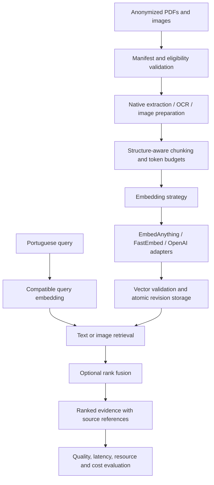

# Embeddings Fundamentals

**Medical Document Embedding Lab · Applied AI engineering in Rust**

A project to investigate how reliably embeddings can retrieve information from Portuguese medical reports, scanned laboratory tables, and images. The planned pipeline connects document extraction, local and remote embedding models, semantic search, and reproducible evaluation.

I am building this project as part of my portfolio for **AI engineering roles**, with a focus on information retrieval, multimodal systems, and the engineering needed to make model outputs measurable and traceable.

> **Current stage: Phase 1 (text baseline) implemented.** Searchable and scanned PDFs are ingested through native extraction or per-page OCR (poppler, Tesseract). A structure-aware chunker keeps each lab row with its header, embeddings come from EmbedAnything (multilingual MiniLM, pinned revision), revisions are published atomically to a filesystem store, and traceable text search is available from the CLI. The 18 `@m1` acceptance scenarios pass. Engine comparison, image retrieval, and fusion are not implemented yet, and all evidence so far comes from the **synthetic** fixture corpus. See `reports/progress/PROGRESS.md`.

[Product requirements](spec/PRD.md) · [Implementation plan](spec/PLAN.md) · [Current source](src/main.rs)

## The problem I am exploring

Finding a laboratory result requires preserving its meaning through several transformations: PDF extraction or OCR, chunking, tokenization, embedding, and ranking. A useful search result must keep the test name, value, unit, and reference range together—and point back to the original page.

The lab will use approximately **10–20 anonymized documents** and **10 frozen Portuguese queries** to study questions such as:

- “Onde está o resultado da hemoglobina?”
- “Qual intervalo de referência aparece para a creatinina?”
- “Mostre a radiografia de tórax presente no conjunto de exames.”

The intended output is a ranked set of source passages or image references, with provenance and relevance assessments. The scope is extraction and retrieval; medical diagnosis, model training, and fine-tuning are outside this experiment.

## AI engineering skills reflected in the design

The specifications provide a concrete view of how I approach an AI system: define the evaluation first, isolate model-specific behavior, and make failures observable.

| Area | Design decision | Evidence to explore |
|---|---|---|
| **Semantic search and retrieval foundations for RAG** | Structure-aware chunks, model-specific token budgets, query/document preprocessing, and cosine retrieval | [PRD §6](spec/PRD.md#6-functional-requirements) |
| **Multimodal retrieval** | Separate text and image search paths, compatible text-to-image embeddings, and Reciprocal Rank Fusion (RRF) | [PRD §6.6](spec/PRD.md#66-retrieval-modes) |
| **Model integration and architecture** | A Rust strategy trait separates engines, models, capabilities, and preprocessing from orchestration | [PLAN §2](spec/PLAN.md#2-core-contracts) |
| **Experimental evaluation** | Frozen relevance labels, Precision@3, Hit@3, nDCG@3, and explicit controls for comparison | [PRD §9–10](spec/PRD.md#9-evaluation-plan) |
| **Reliable AI pipelines** | Idempotent ingestion, atomic revision publication, bounded retries, and vector validation | [PLAN §4](spec/PLAN.md#4-reliability--data-handling-design) |
| **Reproducibility and testing** | Configuration fingerprints, retained source revisions, deterministic BDD, and separate real-provider integration evidence | [PLAN §5](spec/PLAN.md#5-testing-layers) |
| **Data handling** | Anonymization eligibility checks, metadata removal, and explicit permission before remote processing | [PRD §11](spec/PRD.md#11-data-handling-requirements) |

## Planned architecture



**Rust 2024** is the implementation language. The plan uses traits to isolate extraction, OCR, chunking, embedding, storage, and measurement. EmbedAnything is the first planned integration, followed by FastEmbed and OpenAI.

For the small corpus, the storage design uses revisioned JSONL files and exact cosine search. This keeps rankings inspectable and provides a baseline before introducing approximate search or a dedicated vector database.

### Decisions that matter for model quality

- **Engine and model are separate variables.** The text baseline is planned around multilingual E5 through EmbedAnything and FastEmbed, with OpenAI as a remote comparison. Different runtimes and weight formats are recorded; observed differences will be reported as configuration comparisons, without attributing them solely to the engine.
- **Matching dimensions do not make embeddings compatible.** Each space has an identity derived from its model, engine, preprocessing, and related configuration. Search must reject incompatible query vectors.
- **Document structure survives chunking.** Laboratory rows stay attached to their headers and units. Token budgets account for model prefixes and special tokens; truncation must be explicit.
- **Image search needs cross-modal alignment.** CLIP is the planned baseline. A multilingual SigLIP candidate requires an integration spike before inclusion, and Portuguese retrieval quality must be measured.
- **Fusion operates on ranks.** RRF combines text and image rankings without assuming their raw similarity scores are comparable.

## How I plan to evaluate the system

Each configuration will be evaluated against the same frozen corpus, queries, and relevance labels. Reports will include the top three results per query, source references, scores, and notes explaining successes and failures.

| Question | Planned evidence |
|---|---|
| Does search retrieve relevant information? | Precision@3, Hit@3, nDCG@3, and per-query error analysis |
| Was the source information preserved? | Field-level extraction accuracy for test names, values, units, and reference ranges |
| What does retrieval cost? | Ingestion throughput, median/p95 query latency, peak local RAM, index size, and estimated provider cost |
| Can a result be reproduced? | Corpus and configuration fingerprints, model provenance, saved revision snapshots, and separate cold/warm measurements |
| Does the pipeline fail safely? | Failure-injection evidence for retries, interrupted updates, invalid vectors, and incomplete runs |

Unknown provider costs and unobservable remote memory will be reported as unavailable. Low relevance is a valid experimental finding; the goal is to publish reproducible evidence and explain the limitations.

**No benchmark results are available yet.** The final evidence package is planned to include comparison reports, actual indexed-record examples, saved experiment configurations, and reproduction instructions.

## Reliability is part of the experiment

A comparison is only useful if its inputs and index state can be trusted. The acceptance contract therefore requires unchanged inputs to produce no duplicate active records, and failed updates to leave the previously committed revision searchable.

The planned **Cucumber for Rust** suite maps Gherkin scenarios to `#[given]`, `#[when]`, and `#[then]` steps. Deterministic fixtures will exercise orchestration and failure recovery; separate integration runs will test real extraction tools and embedding providers. Passing simulated provider responses will not count as evidence of real model quality or a working provider integration.

## Roadmap and current evidence

| Stage | Deliverable | Status |
|---|---|---|
| Specification | Requirements, architecture, acceptance scenarios, and implementation plan | Documented in `spec/` |
| Phase 0 | Library/CLI structure, deterministic adapter, BDD harness, and CI | Implemented (see `reports/progress/PROGRESS.md`) |
| Milestone 1 | PDF extraction, OCR, text embeddings, and traceable search | Implemented (synthetic corpus) |
| Milestone 2 | Provider comparisons, retrieval metrics, and resource/cost reports | Planned |
| Milestone 3 | Text-to-image retrieval and Portuguese query evaluation | Planned |
| Milestone 4 | Rank fusion and publication of reproducible comparisons | Planned |

The current repository contains:

```text
embeddings-fundamentals/
├── src/
│   ├── ids.rs, domain.rs   # Canonical-JSON hashing, validated IDs, shared enums
│   ├── corpus.rs           # Manifest, checksums, anonymization gate
│   ├── extraction/         # pdftotext / per-page OCR (pdftoppm + tesseract TSV), fixture replay
│   ├── chunking.rs         # structure-aware-v1: sections, lab rows with headers, token budgets
│   ├── embedding/          # Strategy trait, validation, deterministic + EmbedAnything adapters
│   ├── storage.rs          # Revisioned filesystem store, atomic pointer publish, snapshots
│   ├── pipeline.rs         # Validation, per-source state machine, retries, run report
│   ├── retrieval.rs        # Exact cosine search with space guard and deterministic ties
│   ├── adapters.rs, config.rs, anonymization.rs, cli.rs
│   └── main.rs             # Thin binary: parse, run, map to exit code
├── tests/
│   ├── bdd.rs              # Cucumber suite; inventory derived from spec/PRD.md
│   ├── bdd_selftest.rs     # Proves the runner fails on skipped/ambiguous/missing scenarios
│   ├── integration.rs      # Real tools and engines (RUN_INTEGRATION=1)
│   ├── pipeline.rs         # Pipeline properties (idempotent skip, append-only snapshots)
│   └── fixtures/           # Synthetic corpus, captured extraction, frozen rankings
├── examples/gen_fixtures.rs
├── config/                 # Acceptance milestone and saved experiment configurations
├── reports/                # Progress records and adversarial review reports
└── spec/                   # PRD, PLAN, execution prompt
```

```bash
cargo test                 # unit, pipeline, fixtures, BDD, and runner self-tests
cargo run -- doctor        # check poppler and tesseract
cargo run --features engine-embed-anything -- ingest \
  --manifest tests/fixtures/corpus/manifest.toml \
  --config config/experiments/baseline-text-embed-anything.toml --store store --experiment demo-1
cargo run --features engine-embed-anything -- search \
  --config config/experiments/baseline-text-embed-anything.toml --store store \
  --query "Onde está o resultado da hemoglobina?" --limit 3
```

On the synthetic corpus, the hemoglobin, glycemia, and creatinine queries rank the matching lab row first, from both the native and the OCR copy of the report. The "achados" (findings) query does not reach the findings paragraph of the ultrasound report. Low relevance is recorded as an experimental finding, not hidden. These are smoke observations; the formal evaluation arrives in Milestone 2.

There is no ingestion or search demo to run yet. For a technical review, start with the [strategy contracts](spec/PLAN.md#2-core-contracts), [evaluation protocol](spec/PRD.md#9-evaluation-plan), and [reliability design](spec/PLAN.md#4-reliability--data-handling-design).

## Professional focus

I am seeking opportunities in **AI Engineering / Applied AI**, particularly in semantic search, retrieval infrastructure for RAG, document intelligence, and multimodal evaluation. This project is where I am developing and documenting that work, from testable requirements to implementation and measured results.
