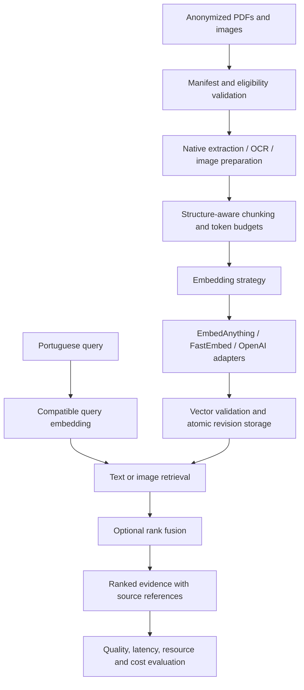

# Embeddings Fundamentals

**Medical Document Embedding Lab · Applied AI engineering in Rust**

A project to investigate how reliably embeddings can retrieve information from Portuguese medical reports, scanned laboratory tables, and images. The pipeline connects document extraction, local and remote embedding models, semantic search, and reproducible evaluation.

I am building this project as part of my portfolio for **AI engineering roles**, with a focus on information retrieval, multimodal systems, and the engineering needed to make model outputs measurable and traceable.

> **Current stage: all four milestones are implemented (Phases 0–4).** The pipeline handles searchable PDFs, scanned PDFs (per-page OCR), and images. It compares three text engine and model configurations (EmbedAnything and FastEmbed; the OpenAI adapter is ready, but its live run awaits a key and permission). Cross-modal image retrieval uses CLIP and multilingual SigLIP. Combined retrieval fuses the text and image rankings with Reciprocal Rank Fusion. All 35 required acceptance scenarios (`@m1`–`@m4`) pass. **Every result comes from a synthetic fixture corpus**, and the anonymized owner corpus is still outstanding. See [the final comparison](reports/phase-4/comparison.md), [acceptance evidence](reports/ACCEPTANCE.md), and [reproduction](reports/README.md).

[Product requirements](spec/PRD.md) · [Implementation plan](spec/PLAN.md) · [Final comparison](reports/phase-4/comparison.md) · [Acceptance evidence](reports/ACCEPTANCE.md) · [Reproduction](reports/README.md)

## The problem I am exploring

Finding a laboratory result requires preserving its meaning through several transformations: PDF extraction or OCR, chunking, tokenization, embedding, and ranking. A useful search result must keep the test name, value, unit, and reference range together—and point back to the original page.

The lab is designed for approximately **10–20 anonymized documents** (still to be supplied; a synthetic fixture corpus stands in) and **10 frozen Portuguese queries** to study questions such as:

- “Onde está o resultado da hemoglobina?”
- “Qual intervalo de referência aparece para a creatinina?”
- “Mostre a radiografia de tórax presente no conjunto de exames.”

The intended output is a ranked set of source passages or image references, with provenance and relevance assessments. The scope is extraction and retrieval; medical diagnosis, model training, and fine-tuning are outside this experiment.

## AI engineering skills reflected in the design

The specifications provide a concrete view of how I approach an AI system: define the evaluation first, isolate model-specific behavior, and make failures observable.

| Area | Design decision | Evidence to explore |
|---|---|---|
| **Semantic search and retrieval foundations for RAG** | Structure-aware chunks, model-specific token budgets, query/document preprocessing, and cosine retrieval | [PRD §6](spec/PRD.md#6-functional-requirements) |
| **Multimodal retrieval** | Separate text and image search paths, compatible text-to-image embeddings, and Reciprocal Rank Fusion (RRF) | [PRD §6.6](spec/PRD.md#66-retrieval-modes) |
| **Model integration and architecture** | A Rust strategy trait separates engines, models, capabilities, and preprocessing from orchestration | [PLAN §2](spec/PLAN.md#2-core-contracts) |
| **Experimental evaluation** | Frozen relevance labels, Precision@3, Hit@3, nDCG@3, and explicit controls for comparison | [PRD §9–10](spec/PRD.md#9-evaluation-plan) |
| **Reliable AI pipelines** | Idempotent ingestion, atomic revision publication, bounded retries, and vector validation | [PLAN §4](spec/PLAN.md#4-reliability--data-handling-design) |
| **Reproducibility and testing** | Configuration fingerprints, retained source revisions, deterministic BDD, and separate real-provider integration evidence | [PLAN §5](spec/PLAN.md#5-testing-layers) |
| **Data handling** | Anonymization eligibility checks, metadata removal, and explicit permission before remote processing | [PRD §11](spec/PRD.md#11-data-handling-requirements) |

## Architecture



**Rust 2024** is the implementation language. Traits isolate extraction, OCR, chunking, embedding, storage, and measurement. The adapters are:
- EmbedAnything (candle) for text models and for the cross-modal CLIP and SigLIP models;
- FastEmbed (ONNX Runtime);
- OpenAI, a remote adapter that runs only with explicit corpus permission.

For the small corpus, the storage design uses revisioned JSONL files and exact cosine search. This keeps rankings inspectable and provides a baseline before introducing approximate search or a dedicated vector database.

### Decisions that matter for model quality

- **Engine and model are separate variables.** The text comparison runs multilingual MiniLM on both EmbedAnything and FastEmbed, which gives identical rankings, and multilingual E5-base on FastEmbed. OpenAI is the remote comparison. Different runtimes and weight formats are recorded; observed differences are reported as configuration comparisons, without attributing them solely to the engine.
- **Matching dimensions do not make embeddings compatible.** Each space has an identity derived from its model, engine, preprocessing, and related configuration. Search must reject incompatible query vectors.
- **Document structure survives chunking.** Laboratory rows stay attached to their headers and units. Token budgets account for model prefixes and special tokens; truncation must be explicit.
- **Image search needs cross-modal alignment.** CLIP ViT-B/32 is the baseline. Multilingual SigLIP passed an integration spike and is evaluated beside it on Portuguese queries.
- **Fusion operates on ranks.** RRF combines text and image rankings without assuming their raw similarity scores are comparable.

## How the system is evaluated

Each configuration is evaluated against the same frozen corpus, queries, and relevance labels. Reports include the top three results per query, source references, scores, and notes explaining successes and failures.

| Question | Evidence |
|---|---|
| Does search retrieve relevant information? | Precision@3, Hit@3, nDCG@3, and per-query error analysis |
| Was the source information preserved? | Field-level extraction accuracy for test names, values, units, and reference ranges |
| What does retrieval cost? | Ingestion throughput, median/p95 query latency, peak local RAM, index size, and estimated provider cost |
| Can a result be reproduced? | Corpus and configuration fingerprints, model provenance, saved revision snapshots, and separate cold/warm measurements |
| Does the pipeline fail safely? | Failure-injection evidence for retries, interrupted updates, invalid vectors, and incomplete runs |

Unknown provider costs and unobservable remote memory are reported as unavailable. Low relevance is a valid experimental finding; the goal is to publish reproducible evidence and explain the limitations.

### Results on the synthetic fixture corpus

These numbers come from 3 synthetic PDFs (28 text chunks), 3 synthetic images, and 10 Portuguese queries with synthetic labels. They show that the pipeline measures what it claims to. They are not evidence of medical retrieval quality.

| Configuration | Mode | Precision@3 | Hit@3 | nDCG@3 | Warm median |
|---|---|---:|---:|---:|---:|
| MiniLM · EmbedAnything | text-only | 0.333 | 0.500 | 0.409 | 16 ms |
| MiniLM · FastEmbed | text-only | 0.333 | 0.500 | 0.409 | 31 ms |
| E5-base · FastEmbed | text-only | **0.433** | 0.700 | 0.540 | 57 ms |
| CLIP ViT-B/32 | image-only | 0.167 | 0.300 | 0.241 | 34 ms |
| SigLIP multilingual | image-only | 0.167 | 0.300 | 0.270 | 59 ms |
| E5-base + SigLIP (RRF) | combined | 0.400 | **0.800** | **0.545** | 88 ms |
| MiniLM + CLIP (RRF) | combined | 0.267 | 0.600 | 0.340 | 40 ms |

Fusion finds a relevant item for more queries: Hit@3 rises above every single leg (0.70 → 0.80 and 0.50 → 0.60), because relevant images reach the top 3 for image queries.

**Its Precision@3 and nDCG@3 are not robust on this corpus.**
- The text and image lists share no item, so each fused tie (two items at 1/61 or at 1/62) is decided by the `record_id` tie-break that the PRD fixes.
- A `record_id` hashes the revision, the chunk, and the space.
- A chunking-rules revision changed every text revision ID without changing any chunk. That alone moved E5-base + SigLIP from 0.367 / 0.508 to 0.400 / 0.545 (P@3 / nDCG@3).

So the gap between combined and text-only quality here is within tie-break noise. The report records this as a finding and does not hide it.

Latencies come from a shared laptop (Apple M3, CPU inference, moderate load) and are indicative only. The full report, with cold start, memory, index size, cost, fidelity, and the top 3 per query, is in [`reports/phase-4/comparison.md`](reports/phase-4/comparison.md).

## Reliability is part of the experiment

A comparison is only useful if its inputs and index state can be trusted. The acceptance contract therefore requires unchanged inputs to produce no duplicate active records, and failed updates to leave the previously committed revision searchable.

The **Cucumber for Rust** suite maps the PRD's Gherkin scenarios to `#[given]`, `#[when]`, and `#[then]` steps: 38 scenarios, covering all 35 required ones. Deterministic fixtures exercise orchestration and failure recovery. Separate integration runs test the real extraction tools and embedding models (17 tests). Passing simulated provider responses does not count as evidence of real model quality or of a working provider integration. That is why the live OpenAI run is listed as outstanding.

Phases 0–3 each passed an independent adversarial review loop by Grok and Codex. Phase 4 adds Antigravity as a third reviewer, and its review loop is **still in progress**: see `reports/reviews/phase-4/FINDINGS.md` and `reports/progress/PROGRESS.md`. Every finding so far was either fixed with a regression test or refuted with evidence. The raw reports and the tracked findings are in `reports/reviews/`.

## Roadmap and current evidence

| Stage | Deliverable | Status |
|---|---|---|
| Specification | Requirements, architecture, acceptance scenarios, and implementation plan | Documented in `spec/` |
| Phase 0 | Library/CLI structure, deterministic adapter, BDD harness, and CI | Implemented (see `reports/progress/PROGRESS.md`) |
| Milestone 1 | PDF extraction, OCR, text embeddings, and traceable search | Implemented (synthetic corpus) |
| Milestone 2 | Provider comparisons, retrieval metrics, and resource/cost reports | Implemented (synthetic corpus; OpenAI live run outstanding) |
| Milestone 3 | Text-to-image retrieval and Portuguese query evaluation | Implemented (CLIP, SigLIP; synthetic corpus) |
| Milestone 4 | Rank fusion and publication of reproducible comparisons | Implemented (RRF; [final report](reports/phase-4/comparison.md)) |
| Owner corpus | Anonymized documents, frozen labels, fidelity sample | **Outstanding** (guide and tools: [`TESTS.md`](TESTS.md)) |

The current repository contains:

```text
embeddings-fundamentals/
├── src/
│   ├── ids.rs, domain.rs   # Canonical-JSON hashing, validated IDs, shared enums
│   ├── corpus.rs           # Manifest, checksums, anonymization gate
│   ├── extraction/         # pdftotext / per-page OCR (pdftoppm + tesseract TSV), fixture replay
│   ├── chunking.rs         # structure-aware-v1: sections, lab rows with headers, token budgets
│   ├── embedding/          # Strategy trait, validation; deterministic, EmbedAnything (text, CLIP/SigLIP), FastEmbed, OpenAI
│   ├── assets.rs           # Image preparation: masks, orientation, metadata-free PNG
│   ├── storage.rs          # Revisioned filesystem store, atomic pointer publish, snapshots, assets
│   ├── pipeline.rs         # Validation, per-source state machine, retries, run report
│   ├── retrieval.rs        # Exact cosine search (text, image) with space guard; combined search
│   ├── fusion.rs           # Reciprocal Rank Fusion (k = 60, configurable depth)
│   ├── evaluation.rs       # Frozen queries and labels, Precision@3, Hit@3, nDCG@3 per mode
│   ├── experiment.rs       # Measured runs: single-mode experiments and combined runs
│   ├── measurement.rs, cost.rs, fidelity.rs, report.rs
│   ├── adapters.rs, config.rs, anonymization.rs, cli.rs
│   └── main.rs             # Thin binary: parse, run, map to exit code
├── tests/
│   ├── bdd.rs              # Cucumber suite; inventory derived from spec/PRD.md
│   ├── bdd_selftest.rs     # Proves the runner fails on skipped/ambiguous/missing scenarios
│   ├── integration.rs      # Real tools and engines (RUN_INTEGRATION=1)
│   ├── pipeline.rs         # Pipeline properties (idempotent skip, append-only snapshots)
│   ├── experiment.rs, combined.rs   # Measured experiments, combined runs, three-mode report
│   └── fixtures/           # Synthetic corpus, captured extraction, frozen rankings
├── examples/gen_fixtures.rs
├── config/                 # Acceptance milestone, saved experiment configurations, frozen queries and labels
├── reports/                # Final comparison, acceptance evidence, reproduction, progress, reviews
└── spec/                   # PRD, PLAN, execution prompt
```

```bash
cargo test                 # unit, pipeline, fixtures, BDD, and runner self-tests
cargo run -- doctor        # check poppler and tesseract
cargo run --features engine-embed-anything -- ingest \
  --manifest tests/fixtures/corpus/manifest.toml \
  --config config/experiments/baseline-text-embed-anything.toml --store store --experiment demo-1
cargo run --features engine-embed-anything -- search \
  --config config/experiments/baseline-text-embed-anything.toml --store store \
  --query "Onde está o resultado da hemoglobina?" --limit 3
```

The full sequence lives in [`reports/README.md`](reports/README.md). It runs the measured experiments (`experiment`), the combined runs (`combine`), searches in `text`, `image`, and `combined` mode, and builds the comparison report (`report`).

## Professional focus

I am seeking opportunities in **AI Engineering / Applied AI**, particularly in semantic search, retrieval infrastructure for RAG, document intelligence, and multimodal evaluation. This project is where I am developing and documenting that work, from testable requirements to implementation and measured results.
