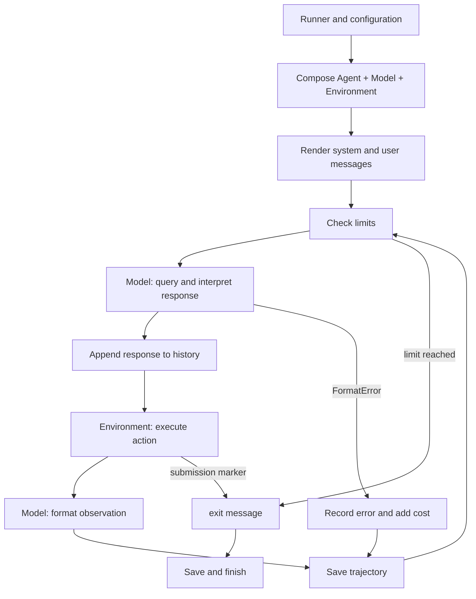

# Mini Rust SWE Agent — a study in agent engineering

This project studies a reimplementation of the **mini-swe-agent harness in Rust**, using the Python implementation as an executable reference. The focus is on AI systems engineering: understand an agent's loop, define contracts, control execution side effects, measure behavior, and justify decisions with reproducible tests.

**Status on 2026-10-28:** the reference analysis and the migration plan are documented. The Rust package has not been created in this delivery. Parity, provider integration, and performance gains are not proven. The working roadmap is in [spec/PLAN.md](spec/PLAN.md).

This study contributes the analysis, the migration design and, in later stages, the Rust implementation and its validation. The original harness, its prompts, and its tests belong to the [mini-swe-agent](mini-swe-agent/README.md) project, by Kilian Lieret, Carlos E. Jimenez, and contributors. Keep the [original license](mini-swe-agent/LICENSE.md) in any adaptation where it applies.

## What is being built

A harness is the software that connects the model to the world: it builds the context, queries the LLM, interprets its action, executes the action, returns the observation, and decides when to stop. The model proposes commands; the harness decides how those commands are interpreted, executed, and recorded.

The initial scope of this project keeps a linear history and textual shell actions, with no native tool-calling and no persistent shell session, as set by [the local task statement](spec/prompt/migrate.md). The current Python reference declares **version 2.4.6** and has more capabilities. They are listed below to show the full system, but they are not automatically deliverables of the first milestone.

The migration will follow this order: contracts and a reproducible reference → traits → local environment → loop → deterministic model → trajectory → CLI → real provider → Docker and expansions. Simulated dependencies let us verify the core before wiring up the shell and the network. The plan includes BDD with Cucumber and differential Python/Rust tests.

## How the harness works



The diagram shows the main path. The code also distinguishes unexpected failures, repeated format errors, and interactive interruptions. An unexpected error during a step records a diagnostic, saves, and is propagated.

Three interfaces in [minisweagent/__init__.py](mini-swe-agent/src/minisweagent/__init__.py) organize the system:

| Interface | Responsibility | Why it matters |
|---|---|---|
| `Agent` | Run the task and save state | Separates control policy from transport and execution |
| `Model` | Query, format messages/observations, expose configuration and variables | Adapting it includes the interaction protocol, not just HTTP |
| `Environment` | Execute an action and expose context/serialization | Lets you swap the local machine for a container or a remote backend |

On the textual path, a response contains exactly one `mswea_bash_command` block. The adapter extracts the command, the environment executes it, and the model formats the result as a new `user` message. The agent accumulates the history and sends it with the next query. Reproducing this design needs no vector memory and no extra planner.

## Catalog of the Python modules

Paths in the tables are relative to [`mini-swe-agent/src/minisweagent/`](mini-swe-agent/src/minisweagent/). The catalog covers the `.py` modules found in the local copy, including utilities, runners, and initializers; configuration files and tests are described afterwards.

### Package, control, and interaction

| Module | Role in the harness | Implication for the port |
|---|---|---|
| [`__init__.py`](mini-swe-agent/src/minisweagent/__init__.py) | Defines the version, global directories, and protocols; creates a directory, shows the startup message, and loads `.env` | Separate the interfaces from the initialization side effects; isolate configuration during tests |
| [`__main__.py`](mini-swe-agent/src/minisweagent/__main__.py) | Entry point for `python -m minisweagent` | Conceptual equivalent of the Rust binary |
| [`exceptions.py`](mini-swe-agent/src/minisweagent/exceptions.py) | `InterruptAgentFlow` carries messages; subclasses include Submitted, LimitsExceeded, TimeExceeded, UserInterruption, and FormatError | Control results/enums keep the messages without panicking |
| [`agents/__init__.py`](mini-swe-agent/src/minisweagent/agents/__init__.py) | Agent class and instance factories | An explicit registry of Rust implementations replaces dynamic imports |
| [`agents/default.py`](mini-swe-agent/src/minisweagent/agents/default.py) | `AgentConfig` and `DefaultAgent`: templates, loop, limits, costs, execution, serialization, and save | Center of state parity and of the order of side effects |
| [`agents/interactive.py`](mini-swe-agent/src/minisweagent/agents/interactive.py) | Extends the agent with human, confirm, and yolo modes; user participation | Deferred; do not confuse its defaults with the minimal non-interactive CLI |
| [`agents/utils/prompt_user.py`](mini-swe-agent/src/minisweagent/agents/utils/prompt_user.py) | Multi-line user input | Terminal adapter, separate from the core |

### Models and routing

| Module | Role in the harness | Implication for the port |
|---|---|---|
| [`models/__init__.py`](mini-swe-agent/src/minisweagent/models/__init__.py) | Picks name/class/model and keeps `GlobalModelStats` with optional limits | Separate per-run cost from global statistics; avoid global state in tests |
| [`models/litellm_model.py`](mini-swe-agent/src/minisweagent/models/litellm_model.py) | LiteLLM adapter with tool-calling, message preparation, retries, cost, and observations | LiteLLM is a broad compatibility layer; a Rust client does not replace it automatically |
| [`models/litellm_textbased_model.py`](mini-swe-agent/src/minisweagent/models/litellm_textbased_model.py) | Specializes LiteLLM for actions extracted from text by regex | Main reference for the selected textual path |
| [`models/litellm_response_model.py`](mini-swe-agent/src/minisweagent/models/litellm_response_model.py) | Variant using the Responses API format | Different contract; outside the initial scope |
| [`models/openrouter_model.py`](mini-swe-agent/src/minisweagent/models/openrouter_model.py) | Integrates OpenRouter, with its own errors and tool call format | Validate payload, authentication, costs, and errors per provider |
| [`models/openrouter_textbased_model.py`](mini-swe-agent/src/minisweagent/models/openrouter_textbased_model.py) | OpenRouter variant with textual parsing | Candidate for a later textual integration |
| [`models/openrouter_response_model.py`](mini-swe-agent/src/minisweagent/models/openrouter_response_model.py) | OpenRouter Responses API, sending the full history in each request | Do not assume remote state or equivalence with chat completions |
| [`models/portkey_model.py`](mini-swe-agent/src/minisweagent/models/portkey_model.py) | Integrates Portkey, virtual key/provider, tool calls, costs, and message preparation | Needs its own gateway contract |
| [`models/portkey_response_model.py`](mini-swe-agent/src/minisweagent/models/portkey_response_model.py) | Portkey Responses API variant, also with the full history | Coverage separate from the chat variant |
| [`models/requesty_model.py`](mini-swe-agent/src/minisweagent/models/requesty_model.py) | Integrates Requesty, with its own handling of authentication and rate limits | Format compatibility does not guarantee operational compatibility |
| [`models/test_models.py`](mini-swe-agent/src/minisweagent/models/test_models.py) | Deterministic models for text, tool calls, and Responses; helpers for test messages and events | Offline oracle; responses that are already structured do not exercise the textual parser on their own |
| [`models/extra/roulette.py`](mini-swe-agent/src/minisweagent/models/extra/roulette.py) | `RouletteModel` picks at random; `InterleavingModel` alternates models in sequence | Experimental routing; require contract tests before migrating |

### Model utilities

| Module | Behavior |
|---|---|
| [`models/utils/actions_text.py`](mini-swe-agent/src/minisweagent/models/utils/actions_text.py) | Extracts exactly one action by regex; errors include the count and the response; renders observations with raw_output, return code, timestamp, and extras |
| [`models/utils/actions_toolcall.py`](mini-swe-agent/src/minisweagent/models/utils/actions_toolcall.py) | Validates tool names/arguments and links observations to call IDs |
| [`models/utils/actions_toolcall_response.py`](mini-swe-agent/src/minisweagent/models/utils/actions_toolcall_response.py) | Parses function calls and function_call_output; translates Responses API stop conditions |
| [`models/utils/anthropic_utils.py`](mini-swe-agent/src/minisweagent/models/utils/anthropic_utils.py) | Reorders thinking blocks for compatibility with the Anthropic protocol |
| [`models/utils/cache_control.py`](mini-swe-agent/src/minisweagent/models/utils/cache_control.py) | Sets explicit cache markers on messages, mainly for Anthropic |
| [`models/utils/content_string.py`](mini-swe-agent/src/minisweagent/models/utils/content_string.py) | Extracts a text representation of messages for display, across different formats |
| [`models/utils/openai_multimodal.py`](mini-swe-agent/src/minisweagent/models/utils/openai_multimodal.py) | Expands multimodal markup into structured content without changing the original |
| [`models/utils/retry.py`](mini-swe-agent/src/minisweagent/models/utils/retry.py) | Centralizes retry through Tenacity, its configuration, and the exceptions that abort retries |

These modules show why "compatible API" is a hypothesis to test. Cache, thinking, null content, call IDs, observation format, and cost can differ even when the endpoint looks similar.

### Execution environments

| Module | Responsibility | Validation needed |
|---|---|---|
| [`environments/__init__.py`](mini-swe-agent/src/minisweagent/environments/__init__.py) | Resolves the class and creates the environment | Configuration and backend selection |
| [`environments/local.py`](mini-swe-agent/src/minisweagent/environments/local.py) | Independent local subprocess, cwd/env, merged output, timeout with a process group, and submission | Actual shell, return code from a signal, UTF-8, children, and partial output |
| [`environments/docker.py`](mini-swe-agent/src/minisweagent/environments/docker.py) | Creates a container, runs through the Docker CLI, forwards env, detects submission, and cleans up resources | Lifecycle, mounts, network, real timeout inside the container, and cleanup |
| [`environments/singularity.py`](mini-swe-agent/src/minisweagent/environments/singularity.py) | Singularity execution backend | Tests on the matching runtime; do not infer from Docker |
| [`environments/extra/bubblewrap.py`](mini-swe-agent/src/minisweagent/environments/extra/bubblewrap.py) | Runs with Bubblewrap and its own temporary directory | Linux features, binds, and directory removal |
| [`environments/extra/contree.py`](mini-swe-agent/src/minisweagent/environments/extra/contree.py) | Runs through the Contree SDK, with its own result/configuration | Optional dependency and external contract |
| [`environments/extra/swerex_docker.py`](mini-swe-agent/src/minisweagent/environments/extra/swerex_docker.py) | Uses the SWE-ReX Docker deployment | Do not confuse with plain Docker; service lifecycle |
| [`environments/extra/swerex_modal.py`](mini-swe-agent/src/minisweagent/environments/extra/swerex_modal.py) | Uses the SWE-ReX Modal deployment | Remote provisioning, credentials, and costs |

The local environment is not a sandbox. Every test that runs commands must use a disposable workspace. Docker also needs its configuration and isolation verified; using a container alone does not prove the host is protected.

### Configuration, serialization, and logs

| Module/resource | Responsibility |
|---|---|
| [`config/__init__.py`](mini-swe-agent/src/minisweagent/config/__init__.py) | Resolves the YAML path and `key.subkey=value` specs; tries to parse the value as JSON and falls back to a string |
| [`config/default.yaml`](mini-swe-agent/src/minisweagent/config/default.yaml) | Textual prompts, environment, and observation/error templates, including truncation |
| [`config/mini_textbased.yaml`](mini-swe-agent/src/minisweagent/config/mini_textbased.yaml) | Configuration for textual runs through the mini runner |
| [`config/mini.yaml`](mini-swe-agent/src/minisweagent/config/mini.yaml) | Default mini configuration, on the tool-calling path |
| [`config/benchmarks/`](mini-swe-agent/src/minisweagent/config/benchmarks/) | Presets `swebench.yaml`, `swebench_backticks.yaml`, `swebench_xml.yaml`, `swebench_modal.yaml`, and `programbench.yaml` |
| [`config/inspector.tcss`](mini-swe-agent/src/minisweagent/config/inspector.tcss) | Style for the inspector's Textual UI |
| [`utils/serialize.py`](mini-swe-agent/src/minisweagent/utils/serialize.py) | `recursive_merge`: merges objects, the right side wins, the UNSET sentinel is ignored |
| [`utils/log.py`](mini-swe-agent/src/minisweagent/utils/log.py) | Configures logging and a file handler |

Configuration is part of the behavior. Swapping the template engine can change whitespace, filters, slices, and missing variables; that changes the prompts sent to the LLM. The port must compare the rendered prompts exactly, not just check that the YAML was loaded.

### Runners, benchmarks, and inspection tools

| Module | Responsibility |
|---|---|
| [`run/hello_world.py`](mini-swe-agent/src/minisweagent/run/hello_world.py) | Minimal example of composition in Python |
| [`run/mini.py`](mini-swe-agent/src/minisweagent/run/mini.py) | Typer CLI: sets up input, merges specs/flags, creates components, and runs the task; uses the interactive agent by default |
| [`run/utilities/mini_extra.py`](mini-swe-agent/src/minisweagent/run/utilities/mini_extra.py) | Dispatches configuration, inspection, and benchmark subcommands |
| [`run/utilities/config.py`](mini-swe-agent/src/minisweagent/run/utilities/config.py) | Setup, set, unset, and editing of the global `.env`; first-run configuration |
| [`run/utilities/inspector.py`](mini-swe-agent/src/minisweagent/run/utilities/inspector.py) | Textual UI that groups messages into steps, browses trajectories, and shows content/reasoning |
| [`run/benchmarks/swebench.py`](mini-swe-agent/src/minisweagent/run/benchmarks/swebench.py) | SWE-bench batch runs: images/environments, instance selection, processing, and the predictions file |
| [`run/benchmarks/swebench_single.py`](mini-swe-agent/src/minisweagent/run/benchmarks/swebench_single.py) | Runs a single SWE-bench instance |
| [`run/benchmarks/programbench.py`](mini-swe-agent/src/minisweagent/run/benchmarks/programbench.py) | ProgramBench batch; a specialized agent trims raw_output and exports the workspace as the submission |
| [`run/benchmarks/utils/common.py`](mini-swe-agent/src/minisweagent/run/benchmarks/utils/common.py) | `ProgressTrackingAgent` reports progress per step |
| [`run/benchmarks/utils/batch_progress.py`](mini-swe-agent/src/minisweagent/run/benchmarks/utils/batch_progress.py) | Manages the progress display for multiple instances |

The other `__init__.py` files are package markers/documentation, with no additional loop: `agents/utils`, `config/benchmarks`, `environments/extra`, `models/extra`, `models/utils`, `run`, `run/benchmarks`, `run/benchmarks/utils`, `run/extra`, `run/utilities`, and `utils`. The `py.typed` file signals that the package ships type information; the internal READMEs explain their areas.

### Existing tests as an executable specification

The suite in [`mini-swe-agent/tests/`](mini-swe-agent/tests/) covers agents, models, environments, configuration, and serialization. Starting points:

- `agents/test_default.py`: loop, limits, and termination; `test_interactive.py` and `test_multimodal.py` cover extensions.
- `environments/test_local.py` and `test_docker.py`: execution and backend contracts; `extra/` covers additional integrations.
- `models/test_actions_text.py`, the toolcall/Responses tests, and `test_format_error_response_persistence.py`: parsing and preservation of invalid responses.
- `config/test_init.py`, `test_swebench_template.py`, and `utils/test_serialize.py`: configuration, templates, and merge.
- `conftest.py`: isolation of global statistics, Docker/Podman selection, and comparison helpers; `test_fire.py` makes real opt-in calls.
- `test_data/`: data and update scripts. Some helpers expect trajectories as lists of messages; check that the files are available and do not assume they use the same schema as the current envelope.

Inherited tests guide the port, but their normalizations must not be copied without review. Stripping whitespace or output lines can hide relevant differences. The parity suite will have its own strict policy, documented in the plan.

## The engineering decisions this study exercises

**Observable equivalence.** The reference must stay executable. Comparing only the final answer would hide different commands, wrong billing, extra calls, or altered observations. Validation must cover the history, the requests to the model, the actions, the intermediate states, and the files produced.

**Separating determinism from AI evaluation.** With a scripted model and environment, we can require structural equivalence. With a real LLM, two calls can diverge: measure success rate, cost, and latency on fixed tasks, and do not treat different text as a bug by default.

**Idiomatic modeling in Rust.** Traits bound the model/environment/agent; enums express termination and control errors; Result preserves failures; ownership avoids copying the whole history. Keep the core simple and synchronous at first, with a testable library and a thin binary. The `rust-skills` skill guided the [plan](spec/PLAN.md#5-applying-rust-skills).

**Compatibility without hiding problems.** The code calls the environment bash, but uses `/bin/sh` by default on POSIX; switching to bash explicitly needs a recorded decision. Python saves in the finally block of each step, charges for invalid responses, and checks limits before the next query. These details are part of the contract.

**Operation and diagnostics.** A trajectory must allow the run to be reconstructed; structured logs must show stage, duration, and cost without leaking credentials. Cleanup of processes and containers must be tested under failures and interruptions.

## How to start the implementation

Read [the detailed plan](spec/PLAN.md) first. It covers setting up the Python environment, freezing the reference, contracts, the implementation order, and the planned comparison commands. The [code study](spec/STUDY.md) details the loop, the textual parser, shell state, the submission protocol, templates, global statistics, and the list of gates P01–P18 that parity must meet; it also records that the textual YAMLs do not select the textual model on their own.

From `mini-rust-swe-agent/`, when code work starts:

```bash
cargo new --bin --edition 2024 --vcs none --name mini-swe rust-mini-swe-agent
cd rust-mini-swe-agent
cargo build
cargo test
```

These commands create the skeleton; they do not implement the harness. Add `src/lib.rs`, pin the toolchain and dependencies, and follow the plan's gates. `cargo new` creates a new folder; if the folder already exists, inspect it before choosing `cargo init`, as described in the [Cargo documentation](https://doc.rust-lang.org/cargo/commands/cargo-init.html).

The Python copy lives inside the `CognitionLab` Git repository, with no Git checkout of its own detected. Before claiming that a SHA freezes the upstream, verify the origin. The provisional content-hash identification and the pinning procedure are in the plan.

## How to present the results in the portfolio

| Evidence to produce | Skill demonstrated | Current state |
|---|---|---|
| Module and flow inventory | Reading agent architecture | Documented in this README |
| Plan, scope, and proposed contracts | Decomposition and compatibility analysis | Documented; executable contracts pending |
| Fixtures and differential report | Testing systems with probabilistic behavior at the edges | Planned |
| Cucumber scenarios | Behavioral requirements tied to the implementation | Planned |
| ADRs on shell, errors, schemas, and templates | Justified technical decisions | Planned |
| Subprocess/container tests | Control of side effects and operational reliability | Planned |
| Provider integration and task evaluation | Integration engineering and LLM evaluation | Planned |
| Reproducible benchmarks | Evidence-based performance analysis | Planned |

Update this table as each milestone is verified. For each result, publish the command run, versions, environment, number of cases, failures/skips, and limitations. No success rate or performance improvement is claimed at this stage.
