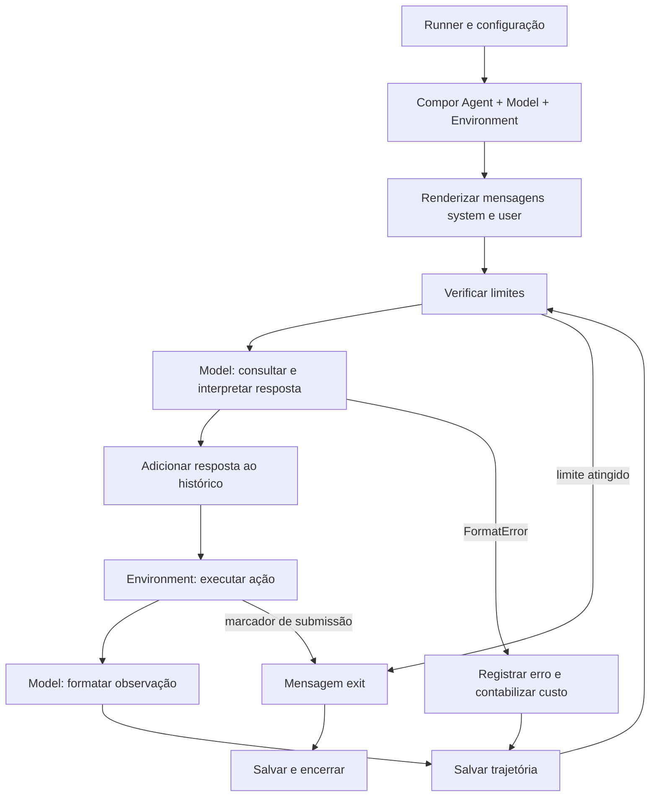

# Mini Rust SWE Agent — estudo de engenharia de agentes

Este projeto estuda a reimplementação do harness do **mini-swe-agent em Rust**, usando a implementação Python como referência executável. O foco é demonstrar engenharia de sistemas de IA: compreender o ciclo de um agente, definir contratos, controlar efeitos de execução, medir comportamento e justificar decisões com testes reproduzíveis.

**Status em 28/10/2026:** análise da referência e plano de migração documentados. O pacote Rust ainda não foi criado nesta entrega; não há paridade, integração com provedor ou ganho de desempenho comprovados. O roteiro executável de trabalho está em [spec/PLAN.md](spec/PLAN.md).

A contribuição deste estudo é a análise, o desenho da migração e, nas próximas etapas, a implementação e validação em Rust. O harness original, seus prompts e testes pertencem ao projeto [mini-swe-agent](mini-swe-agent/README.md), de Kilian Lieret, Carlos E. Jimenez e contribuidores. Preservar a [licença original](mini-swe-agent/LICENSE.md) nas adaptações pertinentes.

## O que está sendo construído

Um harness é o software que conecta o modelo ao mundo: monta o contexto, consulta o LLM, interpreta sua ação, executa a ação, devolve a observação e decide quando parar. O modelo propõe comandos; o harness determina como esses comandos são interpretados, executados e registrados.

O recorte inicial deste projeto mantém histórico linear e ações textuais de shell, sem tool-calling nativo ou sessão de shell persistente, conforme [o enunciado local](spec/prompt/migrate.md). A referência Python atual declara **versão 2.4.6** e contém capacidades adicionais. Elas estão catalogadas abaixo para mostrar o sistema completo, mas não são automaticamente entregáveis do primeiro marco.

A migração seguirá: contratos e referência reproduzível → traits → ambiente local → loop → modelo determinístico → trajetória → CLI → provedor real → Docker e expansões. Dependências simuladas permitem verificar o núcleo antes de ligar shell e rede. O plano inclui BDD com Cucumber e testes diferenciais Python/Rust.

## Como o harness funciona



O diagrama resume o caminho principal. O código também distingue falhas inesperadas, erros de formato repetidos e interrupções interativas. Um erro inesperado durante o passo registra diagnóstico, salva e é propagado.

Três interfaces em [minisweagent/__init__.py](mini-swe-agent/src/minisweagent/__init__.py) organizam o sistema:

| Interface | Responsabilidade | Por que importa |
|---|---|---|
| `Agent` | Executar tarefa e salvar estado | Separa política de controle de transporte e execução |
| `Model` | Consultar, formatar mensagens/observações, expor configuração e variáveis | A adaptação inclui o protocolo de interação, não apenas HTTP |
| `Environment` | Executar ação e expor contexto/serialização | Permite trocar máquina local por container ou backend remoto |

No caminho textual, uma resposta contém exatamente um bloco `mswea_bash_command`. O adaptador extrai o comando, o ambiente executa e o modelo formata o resultado como uma nova mensagem `user`. O agente acumula o histórico e o envia na consulta seguinte. Não há necessidade de memória vetorial ou planejador adicional para reproduzir esse desenho.

## Catálogo dos módulos Python

Os caminhos das tabelas são relativos a [`mini-swe-agent/src/minisweagent/`](mini-swe-agent/src/minisweagent/). O catálogo cobre os módulos `.py` encontrados na cópia local, incluindo utilitários, runners e inicializadores; arquivos de configuração e testes estão descritos depois.

### Pacote, controle e interação

| Módulo | Papel no harness | Implicação para o port |
|---|---|---|
| [`__init__.py`](mini-swe-agent/src/minisweagent/__init__.py) | Define versão, diretórios globais, protocols; cria diretório, mostra startup e carrega `.env` | Separar interfaces dos efeitos de inicialização; isolar configuração durante testes |
| [`__main__.py`](mini-swe-agent/src/minisweagent/__main__.py) | Entrada de `python -m minisweagent` | Equivalente conceitual ao binário Rust |
| [`exceptions.py`](mini-swe-agent/src/minisweagent/exceptions.py) | `InterruptAgentFlow` carrega mensagens; subclasses incluem Submitted, LimitsExceeded, TimeExceeded, UserInterruption e FormatError | Resultados/enums de controle preservam mensagens sem panic |
| [`agents/__init__.py`](mini-swe-agent/src/minisweagent/agents/__init__.py) | Factories de classe e instância de agente | Registro explícito de implementações Rust substitui imports dinâmicos |
| [`agents/default.py`](mini-swe-agent/src/minisweagent/agents/default.py) | `AgentConfig` e `DefaultAgent`: templates, loop, limites, custos, execução, serialização e save | Centro da paridade de estado e sequência de efeitos |
| [`agents/interactive.py`](mini-swe-agent/src/minisweagent/agents/interactive.py) | Estende o agente com modos human, confirm e yolo; participação do usuário | Adiado; não confundir seus defaults com a CLI mínima não interativa |
| [`agents/utils/prompt_user.py`](mini-swe-agent/src/minisweagent/agents/utils/prompt_user.py) | Entrada multilinha do usuário | Adaptador de terminal, separado do núcleo |

### Modelos e roteamento

| Módulo | Papel no harness | Implicação para o port |
|---|---|---|
| [`models/__init__.py`](mini-swe-agent/src/minisweagent/models/__init__.py) | Escolhe nome/classe/modelo e mantém `GlobalModelStats` com limites opcionais | Separar custo por execução e estatísticas globais; evitar estado global nos testes |
| [`models/litellm_model.py`](mini-swe-agent/src/minisweagent/models/litellm_model.py) | Adaptador LiteLLM com tool-calling, preparação de mensagens, retries, custo e observações | LiteLLM é uma camada de compatibilidade ampla; não há substituição automática por um cliente Rust |
| [`models/litellm_textbased_model.py`](mini-swe-agent/src/minisweagent/models/litellm_textbased_model.py) | Especializa LiteLLM para ações extraídas de texto por regex | Principal referência do caminho textual selecionado |
| [`models/litellm_response_model.py`](mini-swe-agent/src/minisweagent/models/litellm_response_model.py) | Variante com formato Responses API | Contrato distinto; fora do recorte inicial |
| [`models/openrouter_model.py`](mini-swe-agent/src/minisweagent/models/openrouter_model.py) | Integra OpenRouter, com erros próprios e formato de tool calls | Validar payload, autenticação, custos e erros por provedor |
| [`models/openrouter_textbased_model.py`](mini-swe-agent/src/minisweagent/models/openrouter_textbased_model.py) | Variante OpenRouter com parsing textual | Candidata a integração textual posterior |
| [`models/openrouter_response_model.py`](mini-swe-agent/src/minisweagent/models/openrouter_response_model.py) | Responses API do OpenRouter com histórico completo em cada requisição | Não assumir estado remoto ou equivalência com chat completions |
| [`models/portkey_model.py`](mini-swe-agent/src/minisweagent/models/portkey_model.py) | Integra Portkey, virtual key/provedor, tool calls, custos e preparação de mensagens | Exige contrato próprio do gateway |
| [`models/portkey_response_model.py`](mini-swe-agent/src/minisweagent/models/portkey_response_model.py) | Variante Portkey Responses API, também com histórico completo | Cobertura separada da variante de chat |
| [`models/requesty_model.py`](mini-swe-agent/src/minisweagent/models/requesty_model.py) | Integra Requesty, com tratamento próprio de autenticação e rate limit | Compatibilidade de formato não garante compatibilidade operacional |
| [`models/test_models.py`](mini-swe-agent/src/minisweagent/models/test_models.py) | Modelos determinísticos para texto, tool calls e Responses; helpers de mensagens e eventos de teste | Oráculo offline; respostas já estruturadas não exercitam sozinhas o parser textual |
| [`models/extra/roulette.py`](mini-swe-agent/src/minisweagent/models/extra/roulette.py) | `RouletteModel` escolhe aleatoriamente; `InterleavingModel` alterna modelos por sequência | Roteamento experimental; exigir testes de contrato antes de migrar |

### Utilitários dos modelos

| Módulo | Comportamento |
|---|---|
| [`models/utils/actions_text.py`](mini-swe-agent/src/minisweagent/models/utils/actions_text.py) | Extrai exatamente uma ação por regex; erros incluem contagem e resposta; renderiza observações com raw_output, retorno, timestamp e extras |
| [`models/utils/actions_toolcall.py`](mini-swe-agent/src/minisweagent/models/utils/actions_toolcall.py) | Valida nomes/argumentos de tools e associa observações aos IDs de chamadas |
| [`models/utils/actions_toolcall_response.py`](mini-swe-agent/src/minisweagent/models/utils/actions_toolcall_response.py) | Parsing de function calls e function_call_output; traduz condições de término da Responses API |
| [`models/utils/anthropic_utils.py`](mini-swe-agent/src/minisweagent/models/utils/anthropic_utils.py) | Reordena blocos de thinking para compatibilidade com o protocolo Anthropic |
| [`models/utils/cache_control.py`](mini-swe-agent/src/minisweagent/models/utils/cache_control.py) | Ajusta marcadores explícitos de cache nas mensagens, principalmente para Anthropic |
| [`models/utils/content_string.py`](mini-swe-agent/src/minisweagent/models/utils/content_string.py) | Extrai representação textual de mensagens para exibição, incluindo diferentes formatos |
| [`models/utils/openai_multimodal.py`](mini-swe-agent/src/minisweagent/models/utils/openai_multimodal.py) | Expande marcações multimodais para conteúdo estruturado sem modificar o original |
| [`models/utils/retry.py`](mini-swe-agent/src/minisweagent/models/utils/retry.py) | Centraliza retry via Tenacity, configuração e exceções que abortam tentativas |

Esses módulos mostram por que “API compatível” é uma hipótese a testar. Cache, thinking, conteúdo nulo, IDs de chamadas, formato de observação e custo podem variar mesmo quando o endpoint parece semelhante.

### Ambientes de execução

| Módulo | Responsabilidade | Validação necessária |
|---|---|---|
| [`environments/__init__.py`](mini-swe-agent/src/minisweagent/environments/__init__.py) | Resolve classe e cria ambiente | Configuração e seleção do backend |
| [`environments/local.py`](mini-swe-agent/src/minisweagent/environments/local.py) | Subprocess local independente, cwd/env, saída mesclada, timeout com grupo de processos e submissão | Shell efetivo, retorno por sinal, UTF-8, filhos e saída parcial |
| [`environments/docker.py`](mini-swe-agent/src/minisweagent/environments/docker.py) | Cria container, executa via CLI Docker, encaminha env, reconhece submissão e limpa recursos | Ciclo de vida, mounts, rede, timeout real no container e cleanup |
| [`environments/singularity.py`](mini-swe-agent/src/minisweagent/environments/singularity.py) | Backend de execução Singularity | Testes no runtime correspondente; não inferir a partir de Docker |
| [`environments/extra/bubblewrap.py`](mini-swe-agent/src/minisweagent/environments/extra/bubblewrap.py) | Execução com Bubblewrap e diretório temporário próprio | Recursos Linux, binds e remoção do diretório |
| [`environments/extra/contree.py`](mini-swe-agent/src/minisweagent/environments/extra/contree.py) | Integra execução pelo SDK Contree, com resultado/configuração próprios | Dependência opcional e contrato externo |
| [`environments/extra/swerex_docker.py`](mini-swe-agent/src/minisweagent/environments/extra/swerex_docker.py) | Usa deployment Docker do SWE-ReX | Não confundir com o Docker direto; ciclo de vida do serviço |
| [`environments/extra/swerex_modal.py`](mini-swe-agent/src/minisweagent/environments/extra/swerex_modal.py) | Usa deployment Modal do SWE-ReX | Provisionamento remoto, credenciais e custos |

O ambiente local não é sandbox. Cada teste que executa comandos deve usar workspace descartável. Docker também exige verificação de configuração e isolamento; apenas usar um container não prova que o host está protegido.

### Configuração, serialização e logs

| Módulo/recurso | Responsabilidade |
|---|---|
| [`config/__init__.py`](mini-swe-agent/src/minisweagent/config/__init__.py) | Resolve caminho de YAML e specs `chave.subchave=valor`; tenta JSON para o valor e usa string se não for JSON |
| [`config/default.yaml`](mini-swe-agent/src/minisweagent/config/default.yaml) | Prompts textuais, ambiente e templates de observação/erro, incluindo truncamento |
| [`config/mini_textbased.yaml`](mini-swe-agent/src/minisweagent/config/mini_textbased.yaml) | Configuração para execução textual pelo runner mini |
| [`config/mini.yaml`](mini-swe-agent/src/minisweagent/config/mini.yaml) | Configuração padrão do mini, com caminho de tool-calling |
| [`config/benchmarks/`](mini-swe-agent/src/minisweagent/config/benchmarks/) | Presets `swebench.yaml`, `swebench_backticks.yaml`, `swebench_xml.yaml`, `swebench_modal.yaml` e `programbench.yaml` |
| [`config/inspector.tcss`](mini-swe-agent/src/minisweagent/config/inspector.tcss) | Estilo da interface Textual do inspetor |
| [`utils/serialize.py`](mini-swe-agent/src/minisweagent/utils/serialize.py) | `recursive_merge`: merge de objetos, precedência à direita, sentinela UNSET ignorada |
| [`utils/log.py`](mini-swe-agent/src/minisweagent/utils/log.py) | Configura logging e handler para arquivo |

A configuração é parte do comportamento. Trocar um motor de templates pode mudar espaços, filtros, slices e variáveis ausentes; isso altera os prompts enviados ao LLM. O port deve comparar os prompts renderizados exatamente, não apenas conferir se o YAML foi carregado.

### Runners, benchmarks e ferramentas de inspeção

| Módulo | Responsabilidade |
|---|---|
| [`run/hello_world.py`](mini-swe-agent/src/minisweagent/run/hello_world.py) | Exemplo mínimo de composição via Python |
| [`run/mini.py`](mini-swe-agent/src/minisweagent/run/mini.py) | CLI Typer: configura entrada, mescla specs/flags, cria componentes e executa tarefa; usa agente interativo por padrão |
| [`run/utilities/mini_extra.py`](mini-swe-agent/src/minisweagent/run/utilities/mini_extra.py) | Despacha subcomandos de configuração, inspeção e benchmarks |
| [`run/utilities/config.py`](mini-swe-agent/src/minisweagent/run/utilities/config.py) | Setup, set, unset e edição do `.env` global; configuração de primeiro uso |
| [`run/utilities/inspector.py`](mini-swe-agent/src/minisweagent/run/utilities/inspector.py) | UI Textual que agrupa mensagens em passos, navega trajetórias e exibe conteúdo/reasoning |
| [`run/benchmarks/swebench.py`](mini-swe-agent/src/minisweagent/run/benchmarks/swebench.py) | Execução em lote SWE-bench: imagens/ambientes, seleção de instâncias, processamento e arquivo de predições |
| [`run/benchmarks/swebench_single.py`](mini-swe-agent/src/minisweagent/run/benchmarks/swebench_single.py) | Execução de uma instância SWE-bench |
| [`run/benchmarks/programbench.py`](mini-swe-agent/src/minisweagent/run/benchmarks/programbench.py) | Lote ProgramBench; agente especializado reduz raw_output e exporta workspace como submissão |
| [`run/benchmarks/utils/common.py`](mini-swe-agent/src/minisweagent/run/benchmarks/utils/common.py) | `ProgressTrackingAgent` reporta progresso por passo |
| [`run/benchmarks/utils/batch_progress.py`](mini-swe-agent/src/minisweagent/run/benchmarks/utils/batch_progress.py) | Gerencia exibição do progresso de múltiplas instâncias |

Os demais `__init__.py` são marcadores/documentação de pacotes, sem loop adicional: `agents/utils`, `config/benchmarks`, `environments/extra`, `models/extra`, `models/utils`, `run`, `run/benchmarks`, `run/benchmarks/utils`, `run/extra`, `run/utilities` e `utils`. O arquivo `py.typed` sinaliza disponibilidade de tipagem do pacote; os READMEs internos explicam suas áreas.

### Testes existentes como especificação executável

A suíte em [`mini-swe-agent/tests/`](mini-swe-agent/tests/) cobre agentes, modelos, ambientes, configuração e serialização. Pontos de partida:

- `agents/test_default.py`: loop, limites e término; `test_interactive.py` e `test_multimodal.py` cobrem extensões.
- `environments/test_local.py` e `test_docker.py`: execução e contratos dos backends; `extra/` cobre integrações adicionais.
- `models/test_actions_text.py`, testes de toolcall/Responses e `test_format_error_response_persistence.py`: parsing e preservação de respostas inválidas.
- `config/test_init.py`, `test_swebench_template.py` e `utils/test_serialize.py`: configuração, templates e merge.
- `conftest.py`: isolamento de estatísticas globais, seleção de Docker/Podman e helpers de comparação; `test_fire.py` envolve chamadas reais opt-in.
- `test_data/`: dados e scripts de atualização. Alguns helpers esperam trajetórias como listas de mensagens; validar a disponibilidade dos arquivos e não assumir que são o mesmo schema do envelope atual.

Testes herdados orientam o port, mas suas normalizações não devem ser copiadas sem revisão. Remover whitespace ou linhas de output pode esconder diferenças relevantes. A suíte de paridade terá sua própria política restrita, documentada no plano.

## As decisões de engenharia que este estudo exercita

**Equivalência observável.** A referência precisa continuar executável. Comparar apenas a resposta final esconderia comandos diferentes, cobrança incorreta, chamadas adicionais ou observações alteradas. A validação deve incluir o histórico, os pedidos ao modelo, as ações, os estados intermediários e os arquivos produzidos.

**Separação entre determinismo e avaliação de IA.** Com modelo e ambiente roteirizados, é possível exigir equivalência estrutural. Com LLM real, duas chamadas podem divergir: medir taxa de sucesso, custo e latência em tarefas fixas, sem tratar texto diferente como bug automaticamente.

**Modelagem idiomática em Rust.** Traits delimitam modelo/ambiente/agente; enums expressam término e erros de controle; Result preserva falhas; ownership evita copiar todo o histórico. Manter o núcleo simples, síncrono inicialmente, com biblioteca testável e binário fino. A skill `rust-skills` orientou o [plano](spec/PLAN.md#5-aplicação-de-rust-skills).

**Compatibilidade sem esconder problemas.** O código chama o ambiente de bash, mas usa `/bin/sh` por padrão em POSIX; mudar para bash explicitamente requer decisão registrada. O Python salva no finally de cada passo, cobra respostas inválidas e verifica limites antes da próxima consulta. Esses detalhes são parte do contrato.

**Operação e diagnóstico.** Uma trajetória deve permitir reconstruir a execução; logs estruturados devem apontar etapa, duração e custo sem divulgar credenciais. Limpeza de processos e containers deve ser testada em falhas e interrupções.

## Como iniciar a implementação

Ler primeiro [o plano detalhado](spec/PLAN.md). Ele contém preparação do ambiente Python, congelamento da referência, contratos, sequência de implementação e comandos planejados de comparação. O [estudo do código](spec/STUDY.md) detalha o loop, o parser textual, o estado do shell, o protocolo de submissão, os templates, as estatísticas globais e a lista de gates P01–P18 que a paridade precisa cumprir; ele também registra que os YAMLs textuais não selecionam o modelo textual por si sós.

A partir de `mini-rust-swe-agent/`, quando iniciar o trabalho de código:

```bash
cargo new --bin --edition 2024 --vcs none --name mini-swe rust-mini-swe-agent
cd rust-mini-swe-agent
cargo build
cargo test
```

Esses comandos criam o esqueleto; não implementam o harness. Adicionar `src/lib.rs`, fixar toolchain e dependências e seguir os gates do plano. `cargo new` cria uma pasta nova; se ela já existir, inspecionar antes de escolher `cargo init`, conforme a [documentação do Cargo](https://doc.rust-lang.org/cargo/commands/cargo-init.html).

A cópia Python está dentro do Git de `CognitionLab`, sem checkout Git próprio detectado. Antes de afirmar que um SHA congela o upstream, verificar a origem. A identificação provisória por hash de conteúdo e o procedimento de fixação estão no plano.

## Como apresentar os resultados no portfólio

| Evidência a produzir | Competência demonstrada | Situação atual |
|---|---|---|
| Inventário de módulos e fluxo | Leitura de arquitetura de agentes | Documentado neste README |
| Plano, recorte e contratos propostos | Decomposição e análise de compatibilidade | Documentado; contratos executáveis pendentes |
| Fixtures e relatório diferencial | Testes de sistemas com comportamento probabilístico nas bordas | Planejado |
| Cenários Cucumber | Requisitos comportamentais ligados à implementação | Planejado |
| ADRs sobre shell, erros, schemas e templates | Decisões técnicas justificadas | Planejado |
| Testes de subprocess/container | Controle de efeitos e confiabilidade operacional | Planejado |
| Integração de provedor e avaliação de tarefas | Engenharia de integração e avaliação de LLMs | Planejado |
| Benchmarks reproduzíveis | Análise de desempenho baseada em evidência | Planejado |

Atualizar esta tabela conforme cada marco for verificado. Para cada resultado, publicar comando executado, versões, ambiente, quantidade de casos, falhas/skips e limitações. Nenhuma taxa de sucesso ou melhoria de performance está sendo afirmada nesta etapa.
