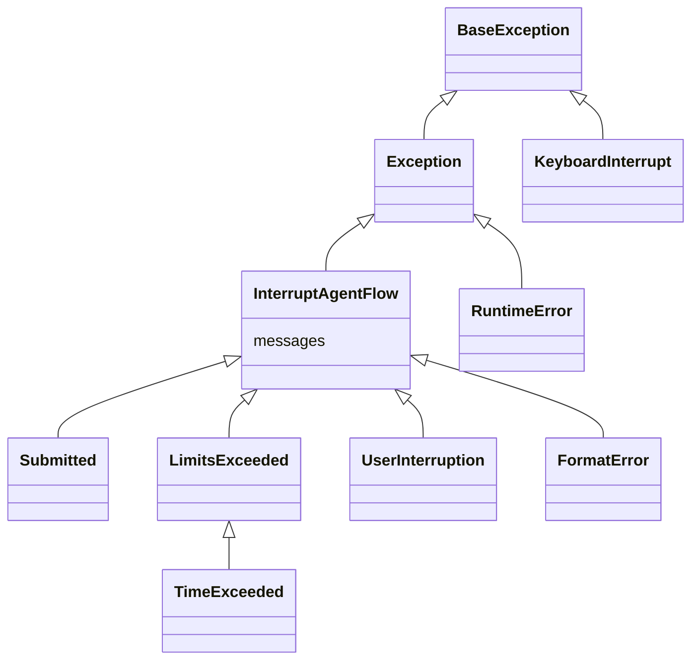
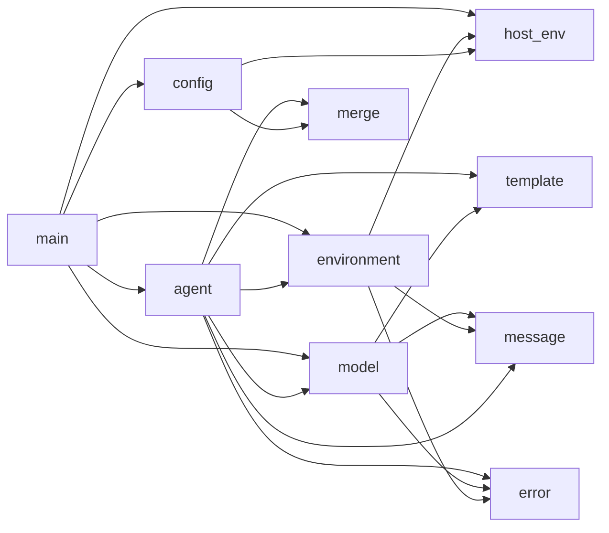
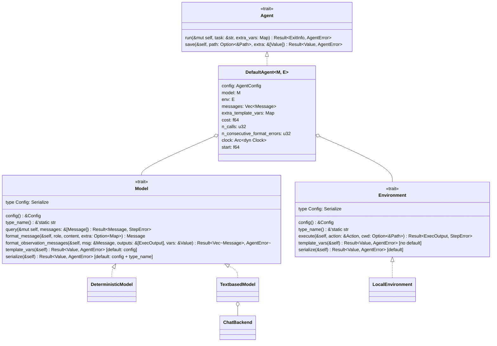
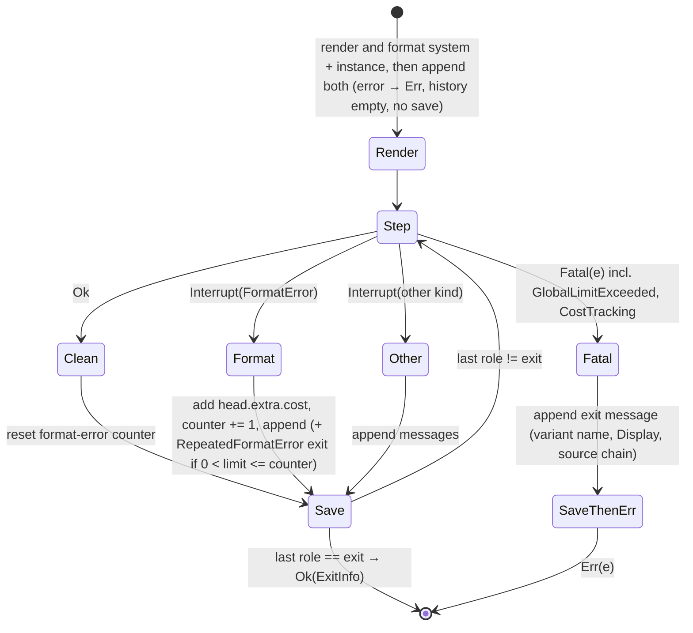
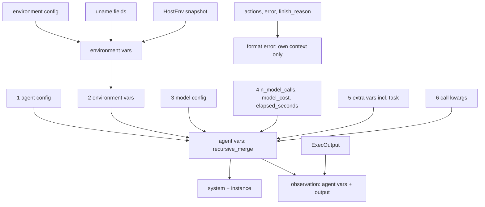
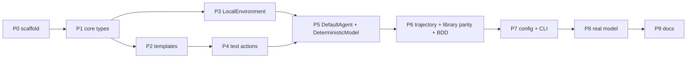

# Migration plan: mini-swe-agent (Python) → mini-swe-agent-rs (Rust)

- **Date:** 2026-11-23 (revision 5: revision 4, which merged the earlier `spec/PLAN.md` and `spec/STUDY.md` into the single plan, after adversarial review round 2)
- **Reference:** `mini-rust-swe-agent/mini-swe-agent/`, package `minisweagent` version **2.4.6** (`src/minisweagent/__init__.py:11`)
- **Target:** `mini-rust-swe-agent/mini-swe-agent-rs/` (this directory)
- **Status:** plan and architecture study only. No Rust code exists yet, and no parity has been proven.

Paths of the form `default.py:96-124` are relative to `mini-swe-agent/src/minisweagent/`. Test paths (`tests/...`) are relative to `mini-swe-agent/`. When this document disagrees with the Python code, the code wins and this document must be corrected.

**This is the only migration plan.** The earlier roadmap (`spec/PLAN.md`) and study (`spec/STUDY.md`) were merged into it and removed (section 6). Their unique content is now in sections 1.0, 1.6, 1.7 (traps 23-31), 2.2 (clock), 2.5, 3.7, 3.9, 3.10, 3.15 (items 1, 4, 5 and 7), 3.16, 4.1 and 5 (R12, D12). Repository paths such as `../CLAUDE.md` are relative to the crate directory `mini-swe-agent-rs/`. The task statement is `../spec/prompt/migrate.md`; the crate's `README.md` will record status. Section 6 summarizes the adversarial reviews (Codex, Grok, Antigravity), and `reviews/round-*/FINDINGS.md` records every finding and its disposition.

---

## 1. Analysis of the Python project

### 1.0 Reference and provenance

- The copy in `mini-swe-agent/` declares version 2.4.6. Its Git root is the parent repository `CognitionLab/`, so a local SHA does not identify the upstream commit.
- **Verified on 2026-11-23** against a shallow clone of upstream tag `v2.4.6` (commit `a83fcae82d2a08f0ee0c688f9d137b3566c097f8`), excluding `.git`, `.venv`, `__pycache__`, `.pytest_cache` and `.env`. Every file on the text path is identical. The differences are:
  - `.pre-commit-config.yaml`: a newer `ruff` revision.
  - `config/benchmarks/programbench.yaml`: reworded benchmark prompt.
  - Missing locally: `.github/` and `tests/test_data/github_issue.traj.json`, both dropped by `.gitignore` when the copy was imported.
  - Extra locally: `uv.lock` and `src/mini_swe_agent.egg-info/`.

  Both files that differ are outside the v1 scope. The parity target is therefore tag `v2.4.6`; R8 tracks drift.
- **Python oracle environment.** Run `uv run --frozen` inside `mini-swe-agent/` (the copy has a `uv.lock`) with `MSWEA_SILENT_STARTUP=1` and `MSWEA_GLOBAL_CONFIG_DIR` set to a temporary directory. Import-time code creates that directory and loads its `.env` (trap 21), so no real credentials enter the run.
  - Network, container and `--run-fire` tests stay out of the offline baseline; they can cost money.
  - P0 records the baseline: `uv` version, OS, the commands and their results.
- The Python source is never edited to make Rust pass. Restoring the upstream fixture (trap 23) is the only change to the copy.

### 1.1 Key files

The package has about 5,350 lines of Python across 60 files, but the agent itself is small. `DefaultAgent` is 190 lines including its config class and docstrings, and the loop proper (`run`, `step`, `query`, `execute_actions`) is about 70 lines.

| File | Lines | Role | In Rust v1? |
|---|---:|---|---|
| `__init__.py` | 92 | Version, global config dir, `.env` loading, startup banner (import-time side effects, lines 26-36); the `Model`, `Environment`, `Agent` protocols (lines 43-80) | Protocols: yes. Side effects: moved to `main` |
| `exceptions.py` | 26 | `InterruptAgentFlow(*messages)` and subclasses `Submitted`, `LimitsExceeded`, `TimeExceeded(LimitsExceeded)`, `UserInterruption`, `FormatError` | Yes, as an enum |
| `agents/default.py` | 190 | `AgentConfig` (19-35) and `DefaultAgent`: template vars, loop, limits, cost, serialization, save | Yes, the center of the port |
| `agents/interactive.py` | 209 | `InteractiveAgent(DefaultAgent)`: human/confirm/yolo modes; overrides `add_messages`, `query`, `step`, `execute_actions` | No (v2) |
| `environments/local.py` | 92 | `LocalEnvironmentConfig` (13-16), `execute` (24-43), `_check_finished` (45-56), `get_template_vars` (58-59), `_run` with process-group kill (72-92) | Yes |
| `environments/docker.py`, `singularity.py`, `extra/*` | 80-161 each | Container and sandbox backends; each has its own `_check_finished` (e.g. `docker.py:140`) | No |
| `agents/__init__.py`, `environments/__init__.py`, `models/__init__.py` | 28-113 | Name → dotted-path registries with `importlib` (`_MODEL_CLASS_MAPPING`, `models/__init__.py:78-89`); `get_model`, `get_model_name` (45-75); `GlobalModelStats` (13-42) | Registry: a `match`. Global stats: yes, injected |
| `models/litellm_model.py` | 164 | `LitellmModel`: tool-calling (`tools=[BASH_TOOL]`), retry, cost, message preparation (cache control, Anthropic thinking blocks) | Only the shared parts (retry, cost, query shape) |
| `models/litellm_textbased_model.py` | 48 | Text-based variant: no tools, regex parsing (`action_regex`, line 8) | Yes, the model path for v1 |
| `models/utils/actions_text.py` | 70 | `parse_regex_actions` (15-40) and `format_observation_messages` (43-70) | Yes |
| `models/utils/retry.py` | 25 | tenacity: 10 attempts (`MSWEA_MODEL_RETRY_STOP_AFTER_ATTEMPT`), exponential wait 4-60 s, abort list | Yes, hand-written |
| `models/test_models.py` | 269 | `DeterministicModel` (104-) returns canned outputs; `_process_test_actions` (75-87) handles `raise`, `/sleep`, `/warning` | Yes, as the parity oracle |
| `models/utils/{cache_control,anthropic_utils,openai_multimodal,content_string,actions_toolcall*}.py` | 28-141 | Provider quirks, multimodal, tool-call parsing | No |
| `models/{openrouter,portkey,requesty}_*.py`, `extra/roulette.py` | 64-213 | Other providers and routing models | No |
| `utils/serialize.py` | 29 | `recursive_merge` (skips `None` inputs and `UNSET` values) and the `UNSET` sentinel | Yes |
| `config/__init__.py` | 64 | Config lookup (12-28), `key.path=value` specs (31-53), YAML loading (56-61) | Yes |
| `config/default.yaml`, `mini_textbased.yaml` | ~170 | Text-based prompts: `system_template`, `instance_template`, `observation_template`, `format_error_template`, `model_kwargs` | Yes, embedded |
| `config/mini.yaml`, `config/benchmarks/*.yaml` | ~170 each | Tool-calling and benchmark configs | No |
| `run/mini.py` | 109 | The `mini` CLI (typer): config merge, model/env/agent factories, `agent.run` | Yes, reduced |
| `run/hello_world.py` | 42 | Smallest composition: `DefaultAgent(LitellmModel, LocalEnvironment, **default.yaml["agent"])` | Yes, as an example |
| `run/benchmarks/*`, `run/utilities/*` | 17-316 | SWE-bench, ProgramBench, batch progress, inspector TUI, `mini-extra config` | No |
| `utils/log.py` | 36 | Rich logging handler | Replaced by `log` |

### 1.2 The three protocols (`__init__.py:43-80`)

- **`Model`**: `query(messages) -> dict`, `format_message(**kwargs) -> dict`, `format_observation_messages(message, outputs, template_vars) -> list[dict]`, `get_template_vars() -> dict`, `serialize() -> dict`, and a `config` attribute.
- **`Environment`**: `execute(action, cwd="") -> dict`, `get_template_vars() -> dict`, `serialize() -> dict`, `config`.
- **`Agent`**: `run(task, **kwargs) -> dict`, `save(path, *extra_dicts) -> dict`, `config`.

The model owns more than transport: it parses actions (or raises `FormatError`) and formats observations. So the action protocol (text blocks vs tool calls) lives in the model, not in the agent. The environment owns the termination signal (`Submitted`).

### 1.3 Main flow

```mermaid
sequenceDiagram
    participant R as run()
    participant Q as query()
    participant M as Model
    participant X as execute_actions()
    participant E as Environment
    R->>R: messages = [system, user] (rendered templates, before the loop)
    loop until last message has role "exit"
        R->>Q: step() = execute_actions(query())
        Q->>Q: check step/cost limit, then wall time
        Q->>M: model.query(messages)
        M-->>Q: assistant message (extra.actions, cost, timestamp) or FormatError
        Q->>Q: n_calls += 1 (before the call), cost += extra.cost, append
        Q->>X: message
        X->>E: env.execute(action) for each action
        E-->>X: {output, returncode, exception_info} or Submitted
        X->>M: format_observation_messages(message, outputs, vars)
        M-->>X: user observation messages (appended)
        R->>R: on interrupt: append its messages; finally: save()
    end
    R-->>R: return messages[-1].extra (exit_status, submission)
```

Step by step, with references:

1. **Initialization** (`default.py:39-50`). The agent receives an already built model and environment, validates its config with pydantic, and sets `messages = []`, `cost = 0.0`, `n_calls = 0`, `n_consecutive_format_errors = 0`, `_start_time = time.time()`. The CLI builds the parts first (`run/mini.py:72-101`): it merges config specs, then calls `get_model` (which resolves the model *name* before the class, `models/__init__.py:47`, and fails if no name is found), `get_environment(default_type="local")`, `get_agent(default_type="interactive")`.
2. **Start of `run`** (`default.py:88-95`). `task` and `**kwargs` are merged into `extra_template_vars` with `|=` (never cleared, so a second `run` keeps stale kwargs). The history is reset, and the system and instance templates are rendered and appended through `model.format_message(role=..., content=...)`. These messages have **no `extra` key**: `format_message` returns its kwargs unchanged when `multimodal_regex` is empty (`openai_multimodal.py:38-39`). This rendering happens **before** the `try/finally`, so a render error here is never saved.
3. **Loop** (`default.py:96-124`). Each iteration calls `step()` inside `try/except/finally`. A step that returns normally resets the format-error counter. The loop exits when the last message has `role == "exit"`, and `run` returns that message's `extra`.
4. **`query`** (`default.py:130-152`). Limits are checked *before* the call: `0 < step_limit <= n_calls` or `0 < cost_limit <= cost` raises `LimitsExceeded`; `0 < wall_time_limit_seconds <= int(elapsed)` raises `TimeExceeded`. Then `n_calls += 1`, `model.query(self.messages)`, `cost += extra.get("cost", 0.0)`, append.
5. **Model query, text-based path** (`litellm_model.py:81-106` with the overrides in `litellm_textbased_model.py:20-37`). Messages are prepared by dropping only the `extra` key, every other key is forwarded (`litellm_model.py:76-79`). Retry around the HTTP call; compute cost (raise `RuntimeError` if the cost is unknown or ≤ 0, unless `cost_tracking: ignore_errors`, in which case the cost is `0.0`, lines 108-126); `GLOBAL_MODEL_STATS.add(cost)` (also with `0.0`); parse actions from `content or ""`. On `FormatError`, the cost and the raw response are written into the error message's `extra` before re-raising (lines 90-98). On success, the message is `response.choices[0].message.model_dump()` (role, content and provider fields such as `tool_calls: null`) plus `extra = {actions, response, cost, timestamp}`.
6. **Action parsing** (`actions_text.py:15-40`). `re.findall(action_regex, content, re.DOTALL)`: with the shipped pattern (one capture group) this returns **the group**, i.e. the command inside the fence, not the full match. Each item is `str.strip()`ped. Exactly one action is required; otherwise a `FormatError` carries one `user` message rendered from `format_error_template` (vars: `actions`, `error`, `finish_reason`), with `extra = {interrupt_type: "FormatError", n_actions, model_response}`.
7. **`execute_actions`** (`default.py:154-157`). Runs `env.execute` for each item of `extra.get("actions", [])` (missing actions mean zero commands; the list comprehension means the first exception aborts the rest), then appends `model.format_observation_messages(message, outputs, self.get_template_vars())`.
8. **Local execution** (`local.py:24-43`, `72-92`). `command = action.get("command", "")`. `Popen(command, shell=True, text=True, encoding="utf-8", errors="replace", stderr=STDOUT, start_new_session=True)` with stdin inherited, `cwd = arg or config.cwd or os.getcwd()`, `env = os.environ | config.env`. `communicate(timeout)` waits for **both** EOF on the pipe and process exit. On timeout: `killpg(SIGKILL)`, drain the partial output, raise `TimeoutExpired`. Any exception becomes `{output: partial, returncode: -1, exception_info: "An error occurred while executing the command: " + str(e), extra: {exception_type: type(e).__name__, exception: str(e)}}`. A command killed by a signal returns `returncode = -signal` (no exception).
9. **Submission** (`local.py:45-56`). If `output.lstrip().splitlines(keepends=True)[0].strip() == "COMPLETE_TASK_AND_SUBMIT_FINAL_OUTPUT"` and `returncode == 0`, raise `Submitted` with an `exit` message whose content and `extra.submission` are the remaining lines joined.
10. **Observation** (`actions_text.py:43-70`). For each output, a `user` message rendered from `observation_template` (with `output` and all template vars in scope), and `extra = {raw_output, returncode, timestamp, exception_info, **output.extra}`.
11. **Termination and save** (`default.py:120-124`, `182-190`). `save()` runs in `finally` after *every* step, including failing ones, and even without a path (it still builds the serialized dict). It writes `json.dumps(data, indent=2)` after creating parent directories. `save(path, *extra_dicts)` merges the extra dicts last, so they can override `exit_status` and `submission` (`tests/run/test_save.py:28`).

### 1.4 Message and trajectory schema

A message is a dict with `role`, `content` and optional `extra`. Roles used on the text path: `system`, `user`, `assistant`, `exit`. Whether `extra` is present matters: system and initial user messages, and `LocalEnvironment` outputs without errors (`local.py:30`), have no `extra` key.

Trajectory (`default.py:159-180`), merged with `recursive_merge(agent_data, model.serialize(), env.serialize(), *extra_dicts)`:

```text
{
  "info": {
    "model_stats": {"instance_cost": float, "api_calls": int},
    "config": {"agent": {...}, "agent_type": "minisweagent.agents.default.DefaultAgent",
               "model": {...}, "model_type": "...", "environment": {...}, "environment_type": "..."},
    "mini_version": "2.4.6",
    "exit_status": str, "submission": str
  },
  "messages": [...],
  "trajectory_format": "mini-swe-agent-1.1"
}
```

### 1.5 Limits

| Limit | Where | Semantics | Default |
|---|---|---|---|
| `step_limit` | `default.py:132` | Before each query: `0 < limit <= n_calls`; 0 disables | 0 |
| `cost_limit` | `default.py:132` | Before each query: `0 < limit <= cost`; the call that crosses the limit still completes; 0 disables | 3.0 in `AgentConfig`; 0 in `default.yaml`; 3.0 in `mini_textbased.yaml` |
| `wall_time_limit_seconds` | `default.py:140` | Before each query, on `int(elapsed)`; 0 disables | 0 |
| `max_consecutive_format_errors` | `default.py:104` | Exit when `0 < limit <= counter`; **0 disables** this exit; the counter is reset only by a step that returns normally | 3 |
| Command `timeout` | `local.py:16`, `86-91` | Per command, covers pipe drain and exit, kills the whole process group | 30 s |
| Global cost and call limit | `models/__init__.py:20-31` | `MSWEA_GLOBAL_COST_LIMIT`, `MSWEA_GLOBAL_CALL_LIMIT`; checked *after* counting with strict `<`: `0 < cost_limit < cost or 0 < call_limit < n_calls + 1`; raises `RuntimeError` (a fatal error, not `LimitsExceeded`) | 0 (off) |
| Retries | `retry.py:19-25` | `stop_after_attempt(10)` = 10 tries; wait `clamp(2^(attempt_number - 1), 4, 60)` s, i.e. 4, 4, 4, 8, 16, 32, 60, 60, 60 (tenacity 9.x `wait_exponential`); no retry on `UnsupportedParamsError`, `NotFoundError`, `PermissionDeniedError`, `ContextWindowExceededError`, `AuthenticationError`, `KeyboardInterrupt` (`litellm_model.py:50-57`) | 10 |

### 1.6 Error handling

| Exception | Raised in | Handled in `run` | Messages appended |
|---|---|---|---|
| `Submitted` | `env.execute` (`local.py:50`) | `except InterruptAgentFlow` | One `exit` message (`exit_status: "Submitted"`) |
| `LimitsExceeded`, `TimeExceeded` | `query` (`default.py:133`, `141`) | `except InterruptAgentFlow` | One `exit` message |
| `FormatError` | `model.query` (parser) | Own branch (`default.py:100-114`): add `e.messages[0].extra.cost`, increment the counter | The `user` error message; plus an `exit` message `RepeatedFormatError` when the counter reaches the limit |
| `FormatError()` with no messages | Only in tests (`test_test_models.py:104-108`) | `e.messages[0]` raises `IndexError` inside the handler; it propagates without an exit message (`finally` still saves) | None |
| `UserInterruption` | Only `InteractiveAgent` | `except InterruptAgentFlow` | Its messages |
| `RuntimeError` from global stats or cost tracking | `model.query` | Generic arm (`default.py:117-119`), after global stats already counted the call; no assistant message, no agent cost added | One `exit` message, `exit_status: "RuntimeError"`, then re-raise |
| Any other `Exception` | Anywhere in the step | `handle_uncaught_exception` (`default.py:74-86`), then re-raise | One `exit` message with `exit_status = type(e).__name__`, `content = exception_str = str(e)`, `traceback` |
| `KeyboardInterrupt` | Anywhere | Not caught (`BaseException`), but `finally` still saves; also never retried | None |



`RepeatedFormatError` is an `exit_status` value, not a class. The global-limit `RuntimeError` is not a `LimitsExceeded`. "Return normally with a terminal status" and "save, then propagate an error" are different outcomes, and the difference reaches the CLI exit code (3.12).

### 1.7 Parity traps found in the code

These details are easy to miss and change the trajectory:

1. **On a `FormatError`, the assistant message is never appended.** The raw text survives only in the error message's `extra.model_response` and `extra.response`. `n_calls` was already incremented, and the cost is added later in `run` (`default.py:102`).
2. **`Submitted` aborts the remaining actions, and no observation is appended** for the submitting step.
3. **Timeouts:** the partial output is kept (`local.py:90-91`); `exception_type` is `TimeoutExpired`; the text is `Command '<cmd>' timed out after <n> seconds` with `%s` formatting, not `repr` (verified with CPython's `TimeoutExpired.__str__`).
4. **`text=True` enables universal newlines.** `\r\n` and lone `\r` in command output become `\n`.
5. **`shell=True` runs `/bin/sh -c`, not bash**, despite the "bash" wording in the prompts. On macOS `/bin/sh` is bash in POSIX mode; on Debian/Ubuntu it is `dash`. The Rust port runs `/bin/bash -c` instead (decision D11, divergence in 2.4).
6. **`str.splitlines` splits on more than `\n`** (`\r`, `\r\n`, `\v`, `\f`, `\x1c`-`\x1e`, `\x85`, `
`, `
`). Rust's `str::lines` splits only on `\n`.
7. **Signal exits return `-signal`**, and OS errors stringify as `[Errno 2] No such file or directory: '/x'`.
8. **`start_new_session=True` is `setsid`:** the child has no controlling terminal and inherits stdin.
9. **`mini_textbased.yaml` does not select the text-based model.** No config sets `model_class: litellm_textbased`, so `get_model` falls back to the tool-calling `LitellmModel` (`models/__init__.py:110-113`). The text path is reached only with `--model-class litellm_textbased` or through `DeterministicModel`.
10. **`DeterministicModel` does not parse.** Its outputs are message dicts whose `extra.actions` are already built (`test_models.py:16-28`, `110-116`). Special actions live **inside `extra.actions`**: `{"raise": <exception object>}`, `{"command": "/sleep N"}`, `{"command": "/warning msg"}`. A `raise` happens before `GLOBAL_MODEL_STATS.add`. The agent's cost comes from `extra.cost`; `cost_per_call` only feeds the global stats. Because `serialize()` dumps the config with `model_dump(mode="json")`, a `raise` holding an exception object makes **every save fail** with `PydanticSerializationError` (verified), so Python fixtures with `raise` cannot produce trajectories as they stand.
11. **The format-error tests use tool-call fakes.** `test_repeated_format_errors_terminate_cleanly`, `test_format_error_counter_resets_on_success` and `test_format_errors_count_against_cost_limit` (`tests/agents/test_default.py:463-544`) use hand-written `_FlakyToolcallModel` and `_BilledFormatErrorModel`, not `DeterministicModel`. The billed fake charges global stats and then raises with `extra.cost` set.
12. **`model_kwargs` are LiteLLM client arguments.** The shipped text configs set `model_kwargs.drop_params: true` (`mini_textbased.yaml:143-144`, `default.yaml:142-143`), which LiteLLM consumes locally. Other common keys (`api_base`, `api_key`, `timeout`) are transport settings, not request-body fields.
13. **Pydantic ignores unknown keys** (`agent.mode: confirm` in `mini_textbased.yaml` is dropped) and coerces in lax mode (for example the string `"3"` into an int). `model_dump()` serializes only known fields.
14. **PyYAML is YAML 1.1:** unquoted `yes`, `no`, `on`, `off` are booleans; `3.` and `0.` are floats (`mini_textbased.yaml:105`, `default.yaml:105`); an empty file loads as `None`, which `recursive_merge` skips.
15. **Config lookup** (`config/__init__.py:12-28`) replaces any non-`.yaml` suffix with `.yaml`, then tries five places: the path as given, `$MSWEA_CONFIG_DIR` (default `.`), the built-in dir, `builtin/extra`, `builtin/benchmarks`.
16. **CLI layering** (`run/mini.py:63-104`): an explicit `-c` list *replaces* the default config; `-o` has a default (`<global dir>/last_mini_run.traj.json`) that is always overlaid; the task comes from `-t`, then `run.task` in the merged config, then `_multiline_prompt()` (`mini.py:94-97`: prompt_toolkit multi-line input, submitted with Esc then Enter). Before that, `configure_if_first_time()` (`mini.py:68`, `run/utilities/config.py:62-66`) runs an interactive setup wizard unless `MSWEA_CONFIGURED` is set, so an unattended `mini` run must set it. With no `-c`, the default config is `mini.yaml`, the tool-calling one (`mini.py:22`).
17. **Jinja2 defaults:** `Template(...)` uses `keep_trailing_newline=False` and `StrictUndefined`. Templates use `| length`, `[:5000]`, `[-5000:]`, ``, `is defined`, `in [...]`, ``. Values render with Python formatting (`True`, `None`, `1.0`).
18. **`json.dumps` defaults to `ensure_ascii=True`**, and key order follows insertion order. `json.loads` treats `2 == 2.0` as equal; `serde_json::Value` does not.
19. **`run()` does not reset `n_calls`, `cost`, `n_consecutive_format_errors`, the start time or `extra_template_vars`**, only the history (`default.py:88-91`). A run that ended on `RepeatedFormatError` starts the next `run` with the counter already at the limit, so its first format error exits at once. `run()` renders and formats **both** initial messages before one `add_messages` call (`default.py:91-94`), so an instance-template failure leaves the history empty, not holding the system message.
20. **Template variable precedence** (`default.py:52-64`): agent config < env vars (`env.config`, `platform.uname()` fields, all of `os.environ`, `local.py:58-59`) < model config < `{n_model_calls, model_cost, elapsed_seconds}` < `extra_template_vars` < call kwargs. The instance template needs `system`, `release`, `version`, `machine` from that merge (`mini_textbased.yaml:42-44`).
21. **Import-time side effects** (`__init__.py:26-36`): creating the global config dir (`platformdirs.user_config_dir("mini-swe-agent")`, i.e. `~/Library/Application Support/mini-swe-agent` on macOS and `~/.config/mini-swe-agent` on Linux), printing a banner, loading `.env` without overriding existing variables. Tests set `MSWEA_SILENT_STARTUP`.
22. **The authentication error text** appends a hint about `mini-extra config set KEY VALUE` (`litellm_textbased_model.py:25-27`).
23. **The fixture `tests/test_data/local.traj.json` was missing from this copy** because `mini-swe-agent/.gitignore` ignores `*.traj.json`, so the import into this repository dropped it. It was restored from upstream tag `v2.4.6` (SHA-256 `e75ec9ab2cbb9dc6a2c09b6f2b8d5f0820505d75e0ae9fa3350072a6bbd8844f`), and the two Python tests that read it (`tests/run/test_local.py`, `tests/run/test_run_hello_world.py`) pass. It is an old-style plain message list (6 messages, no `info`), so it seeds model responses and expected observations, not full trajectories.
   - Its system and instance texts come from an older template version, and `tests/run/test_local.py` ignores them. That test compares only the observations, after `normalize_outputs`.
   - `update_outputs_local.py` is stale: it passes strings as `outputs`, but `DeterministicModelConfig.outputs` needs `list[dict]`.
   - Golden trajectories therefore come from the parity runner (3.15), never from this file.
   - Committing it needs `git add -f`.
   - `github_issue.traj.json` is missing for the same reason; it is out of scope (SWE-bench).
24. **Shell state does not persist; the filesystem does** (`local.py:72-92`).
   - `cd` and `export` in one action do not reach the next action; files written in one action stay for the next.
   - Background children: a child that inherits stdout (`echo hi; sleep 30 &`) keeps the pipe open. The command then ends only at the timeout, as `TimeoutExpired` with partial output `hi`, and the whole group is killed.
   - A child with its output redirected (`sleep 30 >/dev/null 2>&1 &`) lets the command return at once, and that child **survives** with no cleanup.
   - A persistent shell, or restoring files after each step, would "improve" results and break parity.
25. **Three template contexts, not one** (`default.py:52-67`, `actions_text.py:15-70`).
   - System and instance templates get the full agent merge (trap 20).
   - The observation template gets `output=output` **plus** the agent vars as keyword arguments. If the vars already hold an `output` key, Python raises `TypeError` (duplicate keyword argument); there is no silent precedence.
   - The format-error template gets only `actions`, `error` and `finish_reason`. It sees no agent vars.
   - Inside the merge, an environment variable named `system` overrides the `uname` value of the same name.
   - `get_template_vars` uses `model_dump()` without `mode="json"`, so `output_path` reaches templates as a `Path` (renders as the path) or `None` (renders as `None`).
26. **A failure while rendering `format_error_template` happens before any `FormatError` exists.** The call was billed and the global stats already counted it, but the cost and raw-response enrichment (`litellm_model.py:90-98`) never runs. The step then takes the generic fatal path. "Every invalid response keeps its cost" is true only when the error message renders.
27. **Wall-clock time with truncation.** `elapsed_seconds = int(time.time() - start)` (`default.py:60`, `140`). The limit is an integer, so `limit <= int(elapsed)` is the same as `limit <= elapsed`: a `wall_time_limit_seconds: 1` allows a query at 0.999 s and blocks it from 1.000 s on. The truncation is visible only in the `elapsed_seconds` template variable (1.999 s renders as `1`). `time.time()` is not monotonic; a backward clock jump delays the limit, a forward jump fires it early. (Revision 4 wrongly said 1.999 s was still allowed; three reviewers caught it in round 2.)
28. **`GlobalModelStats` details** (`models/__init__.py:13-42`).
   - The limits are read from the environment once, when the module is imported; later changes are ignored.
   - The lock covers the increments but not the check, so under threads the call that gets the `RuntimeError` is not deterministic.
   - It is per process, not a budget across workers.
   - With `MSWEA_GLOBAL_CALL_LIMIT=1`, the **first** response already fails (`1 < 1 + 1`).
29. **The parser does not validate the command.**
   - An empty block is one valid action (an empty command).
   - A multi-line block, or commands chained with `&&`, count as one action.
   - A plain `` ```bash `` fence does not count.
   - A closing fence inside a heredoc ends the match early.
30. **The submission marker is fragile in both directions.**
   - These do not submit: a log line before the marker, a different case, extra text on the marker line, a non-zero return code, the marker only in the model's text.
   - Printing a file that starts with the marker submits by accident.
   - Leading blank lines and spaces around the marker are accepted.
   - CRLF: `_check_finished` on its own keeps `\r\n` in the submission (`splitlines(keepends=True)`). In `LocalEnvironment`, universal newlines (trap 4) have already turned it into `\n`, so the end-to-end submission has `\n`. Test both the helper and the environment.
   - A marker with no trailing newline gives an empty submission.
   - The test matrix in 3.15 has these 10 cases.
31. **The oracle must compose the classes explicitly.** `mini` defaults to `InteractiveAgent`, and without `model_class` it picks the tool-calling `LitellmModel` (trap 9). The parity runner therefore builds `DefaultAgent` with `DeterministicModel` (or `LitellmTextbasedModel`) and `LocalEnvironment` directly, never through `mini` with a plain YAML.

### 1.8 Extension points

- **Protocols** (duck typing): any object with the right methods is a model, an environment, or an agent.
- **Registries with dynamic import** (`agents/__init__.py:8-28`, `environments/__init__.py:8-33`, `models/__init__.py:78-113`): a short name or any dotted path loads a class at run time.
- **`config_class=`** keyword: subclasses swap the pydantic config (`InteractiveAgent`, `LitellmTextbasedModel`).
- **Subclassing hooks:** `query`, `step`, `execute_actions`, `add_messages` are documented override points ("Override to add hooks", `default.py:131`). `InteractiveAgent` uses all of them.
- **Templates in YAML:** prompts, observation and error formatting are data, not code.
- **`save(path, *extra_dicts)`** and **`run(task, **kwargs)`**: callers inject extra trajectory data and template vars.

### 1.9 External dependencies and their Rust needs

From `pyproject.toml:33-48`:

| Python | Used for | Rust need | v1 |
|---|---|---|---|
| `jinja2` | All templates, `StrictUndefined` | `minijinja` (same author as Jinja2) | Yes |
| `pydantic` | Config validation and defaults, `model_dump` | `serde` derive with `#[serde(default)]` | Yes |
| `pyyaml` | Config files | `serde-saphyr` (D5) | Yes |
| `litellm` | Multi-provider client, cost registry, error taxonomy | Own text-based adapter for one wire protocol, over a sync HTTP client | One protocol |
| `requests`, `openai` | HTTP for some providers | Same HTTP client | Shared |
| `tenacity` | Retry | A 20-line loop | Yes |
| `typer` | CLI | `clap` (derive) | Yes |
| `python-dotenv`, `platformdirs` | `.env` and global config dir | `dotenvy` (parse only), `dirs` | Yes |
| `rich` | Console output, logging | `log` + `env_logger`; plain `eprintln!` | Yes |
| stdlib `subprocess`, `os`, `signal`, `platform` | Processes, process groups, `uname` | `std::process`, `std::io::pipe`, `nix` (`killpg`, `poll`, `uname`) | Yes |
| stdlib `re`, `json`, `time` | Parsing, trajectory, timestamps | `regex`, `serde_json`, `std::time` | Yes |
| `textual`, `prompt_toolkit` | Inspector TUI, interactive input | `ratatui`, `reedline` | No |
| `datasets`, `swe-rex`, `modal` | Benchmarks and remote sandboxes | — | No |

---

## 2. Goals and scope of the Rust project

### 2.1 Must be identical

These are the parity contract. A deterministic run must produce a trajectory that is structurally equal to Python's, after the normalization in section 3.15.

1. **Message schema** (`role`, `content`, `extra`, including whether `extra` is present) and the **append-only history**. The trajectory *is* the history.
2. **Loop semantics:** limits checked before each query, in the same order, with the same "0 disables" rules; `n_calls` increments before the call; cost accumulates from `extra.cost` (missing = 0.0); the format-error counter and its reset rule; the loop ends on an `exit` message; `run` returns the last message's `extra`.
3. **Every interrupt and fatal error appends the same messages** (section 1.6), including the `RepeatedFormatError` exit and the exit message for unexpected errors.
4. **Save after every step of the loop**, including failing steps.
5. **LocalEnvironment:** independent shell process per command, stderr merged into stdout, env overlay, cwd resolution, `-signal` return codes, the timeout that covers drain and exit, kills the process group and keeps partial output, `returncode: -1` with `exception_info`, `extra.exception_type` and `extra.exception` on errors.
6. **Submission protocol:** the marker on the first non-blank line (Python `splitlines` semantics), `returncode == 0`, submission = remaining lines.
7. **Text action protocol:** the default `action_regex`, the `findall` group rule, exactly one action, the `FormatError` message shape.
8. **Template rendering** of the shipped text-based configs, byte for byte, with strict undefined variables and the same variable precedence.
9. **Trajectory format** `mini-swe-agent-1.1`, with the same keys, including `save` extra dicts merged last.
10. **Config semantics:** recursive merge, `key.path=value` specs with JSON value parsing, file lookup order and suffix rule, unknown keys ignored.
11. **CLI flag names** for the subset that is kept (`-m`, `-t`, `-c`, `-o`, `-l`, `--model-class`, `--environment-class`, `--agent-class`) and the task resolution order.

### 2.2 Improvements that do not add complexity

- **No import-time side effects.** The global config dir, `.env` and the banner move into `main`. The library does nothing on load.
- **No hidden global state, no process-environment mutation.** `GlobalModelStats` is created by `main` and shared with the model. The process environment is read **once** in `main` into a `HostEnv` snapshot (`BTreeMap<String, String>`), with the `.env` file parsed into it (keys already set win, as `load_dotenv` does). `HostEnv` is passed to `LocalEnvironment`, config loading, retry and cost settings. Nothing calls `std::env::set_var` (which is `unsafe` in edition 2024), and tests build their own `HostEnv`, so they stay parallel and `unsafe`-free.
- **Fail fast.** Template syntax, the action regex, reserved `model_kwargs` keys and config types are checked when the config is loaded. (Strict undefined variables can still only fail at render time, as in Python.)
- **JSON-only deterministic fixtures.** Rust's `raise` action holds a JSON spec, `{"raise": {"kind": "FormatError", "messages": [...]}}`, inside `extra.actions`. The Python parity runner uses a thin `DeterministicModel` subclass that turns the same spec into the exception at query time, so both configs stay serializable (trap 10).
- **Injected wall clock.** A one-method `Clock` trait (`now(&self) -> f64`, seconds since the epoch) replaces the direct `time.time()` calls. `SystemClock` keeps Python's wall-clock semantics, including the `int()` truncation of trap 27; a monotonic clock would change terminations (D12). Rust tests use a `ManualClock` that the test sets between steps (interior mutability: an `AtomicU64` holding the `f64` bits), so wall-time limits are tested without sleeps and timestamps are exact. `ManualClock` is a small public type, not hidden behind `cfg(test)`, because integration tests in `tests/` compile the library without `cfg(test)`. The differential parity harness uses `SystemClock` on the Rust side, since Python uses `time.time()`: the wall-time scenario relies on real time (3.15 item 4). Subprocess timeouts use a separate monotonic `Instant` (3.7).
- **Unrepresentable empty interrupts.** An `Interrupt` always holds at least one message, so the `FormatError` handler cannot hit Python's `IndexError` path (section 1.6).
- **Atomic trajectory writes** through a uniquely named temp file in the destination directory, then a rename. Last writer wins.
- **Bounded drain after a kill.** If a grandchild escapes the process group and keeps the pipe open, Python's `communicate()` hangs after the kill; Rust stops waiting after a short grace period and returns the partial output.
- **Text-based model by default** in the Rust CLI, which removes trap 9 for the only path v1 supports (a deliberate divergence, 2.4).
- **A single static binary** with the text-based configs embedded (`include_str!`).

### 2.3 Out of scope for v1

| Excluded | Why | Where it would go |
|---|---|---|
| Native tool-calling, Responses API (`mini.yaml`, `actions_toolcall*.py`, `*_response_model.py`) | The local task asks for the text path only | A second parser behind the same `Model` trait |
| Multimodal content, Anthropic cache control and thinking-block reordering, `set_cache_control` auto-selection for Anthropic-like names (`models/__init__.py:55-60`) | Provider-specific | Inside a provider adapter |
| `InteractiveAgent` (human, confirm, yolo), `prompt_user`, inspector TUI | Terminal UX, not the harness | v2, by composition (3.3) |
| Docker, Singularity, Bubblewrap, SWE-ReX, Modal, Contree | Each backend needs its own contract | New `Environment` impls |
| OpenRouter, Portkey, Requesty adapters; Roulette and Interleaving models | One provider first | New `ChatBackend` impls |
| SWE-bench, ProgramBench, batch runs, and the benchmark configs | Evaluation tooling | A separate binary later |
| `mini-extra config setup` wizard (`run/utilities/config.py:62-`) | Interactive setup | Documented env vars instead |
| A bundled model price table | Prices change; a stale table silently misreports cost | A LiteLLM-format registry file supplied by the user |
| Stateful shell sessions, tools other than the shell | Forbidden by the task | — |
| Windows | `killpg` and process groups are POSIX | `#[cfg(unix)]` only |
| Graceful Ctrl-C | Python saves but adds no exit message | Open decision D8 |

### 2.4 Deliberate divergences

| Field or behavior | Python | Rust | Parity rule |
|---|---|---|---|
| `info.config.*_type` | `minisweagent.agents.default.DefaultAgent` | `type_name()` strings such as `mini_swe_agent_rs::DefaultAgent` | Ignored |
| `info.mini_version` | `2.4.6` | The crate version | Ignored |
| Default model class | Tool-calling `LitellmModel` | Text-based model | Documented |
| Fatal `exit_status`, `content`, `exception_str` | Python class name and `str(e)` (`RuntimeError`, `IndexError`) | A stable name per error variant and its `Display` (D6) | `exit_status` compared through the D6 table; `content`, `exception_str` ignored for fatal exits |
| `extra.traceback` | Python traceback | The error's `source()` chain | Ignored |
| JSON encoding | `ensure_ascii=True` | Raw UTF-8 | Compared after parsing |
| `extra.response` | `litellm` `ModelResponse.model_dump()` | The provider's raw JSON | Ignored for real providers |
| Child process session | `setsid` (no controlling terminal), stdin inherited | New process group (`process_group(0)`), **stdin `/dev/null`** | Documented; a command that reads stdin gets EOF instead of the terminal or `SIGTTIN` |
| Hang after kill when a grandchild escaped the group | `communicate()` blocks | Bounded grace period, then partial output | Documented |
| Cost | `litellm.completion_cost` (tiers, cache tokens, provider cost) | Flat per-token input and output prices from a registry file (3.8) | Same only for flat-priced models; deterministic runs unaffected |
| Authentication error hint | Mentions `mini-extra config set` | Mentions the API-key environment variable | Text not compared |
| YAML 1.1 booleans (`yes`/`no`/`on`/`off` unquoted) and pydantic lax coercion | Booleans; `"3"` → 3 | YAML 1.2 (strings); strict serde types | Shipped configs avoid both; documented |
| Built-in configs | All YAML in `config/`, `extra/`, `benchmarks/` | Only the text-based ones embedded; lookup order unchanged | Documented |
| Shell (D11) | `shell=True`: `/bin/sh -c` (bash in POSIX mode on macOS, `dash` on Debian/Ubuntu) | `/bin/bash -c` on every OS | Parity scenarios use only commands whose output is the same under `sh` and `bash`; a Rust-only test checks that `$BASH_VERSION` is set. A host without `/bin/bash` gets the spawn-error observation (`FileNotFoundError`) |
| Startup file `BASH_ENV` (D11) | Ignored by `/bin/sh`; passed on to children | Inherited `BASH_ENV` removed from the child environment; kept if set in `config.env` | Fixture with a marker file |
| Default config with no `-c` | `mini.yaml` (tool-calling, `run/mini.py:22`) | Embedded `mini_textbased.yaml` | Documented; parity scenarios always pass `-c` |
| Task when neither `-t` nor `run.task` is given | `_multiline_prompt()` (prompt_toolkit), after the setup wizard if `MSWEA_CONFIGURED` is unset | Read stdin to EOF; never a wizard | Not compared (interactive) |
| `examples/hello_world.rs` | `hello_world.py` uses the tool-calling `LitellmModel` | `TextbasedModel` | Documented |
| Literal `model_kwargs.api_key` in the trajectory | Dumped as given | `"<redacted>"` | Parity scenarios never set it |
| Non-UTF-8 environment entries | Decoded with `surrogateescape`, visible to templates | Passed to the child unchanged; left out of template vars | Documented |
| Timeout when the shell left its process group | `communicate()` hangs after `killpg` | `child.kill()` after `killpg` | Documented |

### 2.5 Essential versus accidental

"Accidental" means the implementation can change. It does not mean an observable output may change without being recorded in 2.4.

| Aspect | Essential (the contract) | Accidental (replaceable) |
|---|---|---|
| Loop | Order of events, history, termination conditions | Python classes and inheritance |
| Action | Which texts are accepted or rejected, and the command that runs | Parser spread over three files |
| Shell | One process per action, merged output, cwd/env rules, timeout | `subprocess` vs `Command` |
| Submission | Marker, position, return code, remaining text | An exception as the transport |
| Templates | Contexts, precedence, rendered bytes | Jinja2 itself, if minijinja proves equal (3.9) |
| Statistics | Scope, counting, thresholds, when the failure happens | Module singleton, `threading.Lock` |
| Trajectory | Schema, values, message order, save points | `json.dumps(indent=2)`, `ensure_ascii` |
| Metadata | Presence and meaning | Real timestamps, temp paths, class names (mapped, 3.15) |
| UI | Not part of M1 | Typer, Rich, Textual, the banner |

The magic marker is accidental to the idea of an agent, but essential to compatibility with this version.

### 2.6 Simplicity budget

The spirit of the original is "about 100 lines of agent". The Rust budget, excluding tests and doc comments: `agent.rs` ≤ 250 lines, `environment/local.rs` ≤ 250, the whole library ≤ 1,800. If a module goes over budget, the cause must be written down in the README (for example, process-group and pipe handling that Python gets from `subprocess`).

---

## 3. Architecture

### 3.1 Crate and module layout

**Decision: one Cargo package with a library and a binary, not a workspace.** The parts are small and change together. A workspace adds manifests, version coordination and slower navigation, and it pays off only when crates have separate consumers or release cycles. Split later if a second binary (for example a benchmark runner) needs the library without the CLI dependencies.

```text
mini-swe-agent-rs/
├── Cargo.toml              # edition 2024, rust-version = "1.99.1", publish = false, [lints] table
├── Cargo.lock              # committed
├── rust-toolchain.toml     # channel "1.99.1", same as ../../embeddings-fundamentals
├── clippy.toml             # allow-unwrap/expect/panic-in-tests = true
├── LICENSE-THIRD-PARTY.md  # attribution for the copied YAML prompts
├── spec/migration-plan.md, spec/reviews/
├── config/                 # copies of default.yaml, mini_textbased.yaml (embedded)
├── src/
│   ├── lib.rs              # re-exports; no side effects
│   ├── main.rs             # CLI: clap, HostEnv, .env, global dir, composition, exit code
│   ├── host_env.rs         # HostEnv snapshot (process env + .env overlay)
│   ├── clock.rs            # Clock trait, SystemClock, ManualClock (public, tiny)
│   ├── message.rs          # Message, Role, Action, ExecOutput, timestamps
│   ├── error.rs            # Interrupt, StepError, AgentError, ModelError (thiserror)
│   ├── merge.rs            # recursive_merge over serde_json::Value
│   ├── template.rs         # minijinja wrapper: strict env, compiled templates
│   ├── config.rs           # spec loading, key=value specs, typed sections
│   ├── agent.rs            # Agent trait, AgentConfig, DefaultAgent
│   ├── environment/
│   │   ├── mod.rs          # Environment trait
│   │   └── local.rs        # LocalEnvironment, run_command, check_finished, splitlines
│   └── model/
│       ├── mod.rs          # Model trait, registry, GlobalModelStats
│       ├── actions_text.rs # parse_regex_actions, format_observation_messages
│       ├── deterministic.rs
│       ├── textbased.rs    # TextbasedModel<B: ChatBackend>
│       ├── openai_compat.rs# ChatBackend over HTTP (ureq)
│       ├── cost.rs         # registry lookup, cost_tracking
│       └── retry.rs
├── examples/hello_world.rs # mirrors run/hello_world.py
├── parity/
│   ├── run_python.py       # oracle runner: imports ../mini-swe-agent, never edits it
│   ├── goldens.py          # renders the template goldens of 3.9
│   └── scenarios/*.json    # shared scenarios (Python runner, Rust tests, BDD)
└── tests/
    ├── local_env.rs        # ported test_local.py + new process tests
    ├── agent.rs            # ported test_default.py cases
    ├── parity.rs           # differential scenarios, comparator self-tests
    ├── support/mod.rs      # shared by parity.rs and bdd.rs: runners, recorders, comparator
    ├── fake_http.rs        # wire-level request test (3.15 item 2, P8)
    ├── bdd.rs              # Cucumber runner (harness = false)
    └── features/*.feature  # Gherkin specs over parity/scenarios
```

Reports from parity runs go to `target/parity/` (ignored by Git), never into the source tree, and never with secrets.



The module names follow the Python ones (`agents/default.py` → `agent.rs`, `models/utils/actions_text.py` → `model/actions_text.rs`), so a reader of the original can find each part.

### 3.2 Core data types

| Python | Rust type | Design |
|---|---|---|
| message `dict` | `Message { role: Role, content: String, extra: Option<Map<String, Value>>, rest: Map<String, Value> }` | `Role` is an enum (`System`, `User`, `Assistant`, `Exit`) serialized in lowercase. `extra` uses `skip_serializing_if = "Option::is_none"`, so a missing key stays missing and an explicit `{}` stays explicit. `rest` (`#[serde(flatten)]`) keeps provider fields such as `tool_calls: null`. Serde's flatten only puts *unknown* keys into `rest` on deserialization; `rest` is private and its setter rejects `role`, `content`, `extra`, so duplicate keys cannot be serialized |
| provider response message | `WireMessage { role: String, content: Option<String>, #[serde(flatten)] rest }` | `content: null` is valid on the wire; the parser uses `content.unwrap_or_default()` (an `Option` method, not a panic), as Python's `content or ""` |
| action dict | `Action` enum: `Command { command: String }` or `Raise(RaiseSpec)`, decoded **by key presence**, not with `#[serde(untagged)]` | Python checks `"raise" in action` first (`test_models.py:78`). A custom `Deserialize` (or `TryFrom<Map>`) yields `Raise` whenever a `raise` key exists, and a malformed `raise` payload is an error, never an empty command. Otherwise `Command`, with a missing `command` = `""` (`local.py:26`). An untagged enum with a defaulted `command` would match `{"raise": …}` as an empty command (round 2). The original JSON object is kept for config dumps. `Raise` is accepted only by `DeterministicModel`. Tests: raise only, raise plus command, malformed raise, `{}` |
| env output `dict` | `ExecOutput { output: String, returncode: i32, exception_info: String, extra: Option<Map> }` | Same keys as Python; `extra` absent on success |
| `run()` return value | `ExitInfo { exit_status: String, submission: String }` | Read from the last message's `extra` |
| template vars `dict` | `serde_json::Value` (object) | Built by `recursive_merge`, passed to minijinja with `Value::from_serialize` |

**Why `extra` stays an open map instead of a typed enum per message kind:** the keys differ by message kind (actions and cost; raw_output and returncode; interrupt_type and n_actions; exit_status and submission), Python merges arbitrary `output.extra` keys into observations (`actions_text.py:64`), and the trajectory must keep key presence exactly. A typed enum would need a variant per producer plus a catch-all, and serializing it identically is harder than keeping a map. The agent reads only four keys. Typed accessors on `Message` (`cost() -> f64` with 0.0 when missing, `actions() -> Result<Vec<Action>, _>` with an empty list when missing) and typed constructors (`Message::exit(...)`, `Message::observation(...)`) give compile-time help where it matters.

### 3.3 Traits



**Associated `Config` type, fallible defaults.** `Model` provides default `template_vars()` and `serialize()` from `self.config()` and `self.type_name()`, mirroring the identical `model_dump()` bodies in every Python model. Both return `Result`, because `serde_json::to_value` is fallible (for example a map with non-string keys; non-finite floats do **not** fail, they become `null`, so cost and price values are validated as finite where they are produced); no default method may panic. `Environment` provides only `serialize()` by default: `LocalEnvironment::template_vars` merges its config, the `uname` fields and the `HostEnv` snapshot (`local.py:58-59`), so a config-only default would leave `system`/`release`/`machine` undefined and fail strict rendering.

**Static dispatch: `DefaultAgent<M: Model, E: Environment>`.** The agent owns its parts as generic fields. Tests keep concrete types and can inspect the model after a run. The CLI picks the model at run time with a `match` on the model class name, and each arm calls one generic `run_agent(model, env, config)` function. With two model types and one environment this produces two copies of a small function, with no `Box<dyn>` forwarding impls. Associated types and `type_name()` are fine under static dispatch; if the number of combinations grows (D10), switch to `Box<dyn Model>` and move `Config` behind a method that returns `Value`.

**`query` takes `&mut self`** because `DeterministicModel` advances an index. **`execute` takes `&self`**: `LocalEnvironment` is stateless, and a stateful backend would use interior mutability for its own handles.

**`Agent` trait.** It mirrors the Python protocol, including `run(task, **kwargs)` (`extra_vars`, merged into `extra_template_vars` and never cleared, as `|=` does) and `save(path, *extra_dicts)` (`extra`, merged last). It has one implementation in v1 and costs a few lines; it gives `main`, the examples and the parity harness one surface. Python's other extension mechanism is subclassing (`InteractiveAgent` overrides four methods). Rust would use composition in v2: a `Hooks` trait with no-op default methods (`on_message`, `before_execute -> Result<(), Interrupt>`) passed to `DefaultAgent` as a third generic parameter defaulting to `NoHooks`. It is not built in v1.

**`ChatBackend` trait** (one method: `complete(&self, request: &ChatRequest) -> Result<ChatResponse, BackendError>`). It separates the HTTP transport from the text-based model logic (retry, cost, parsing, message building). Unit tests inject a canned backend; a separate fake HTTP server test (3.15) checks the real wire JSON.

### 3.4 Ownership and borrowing

| Data | Owner | How it is passed | Reason |
|---|---|---|---|
| Model, environment | `DefaultAgent` (moved in at construction) | Field access `self.model`, `self.env` | Mirrors Python composition; `into_parts()` gives them back to tests |
| History `Vec<Message>` | `DefaultAgent` | `&[Message]` to `Model::query` | Python passes the list by reference; no clone of the history per call |
| API request messages | Built per call inside the model | `ApiMessage<'a>(&'a Message)` with a custom `Serialize` that writes every key except `extra` | The one place where a lifetime is natural: the request lives only for the HTTP call, and it forwards provider fields exactly as `litellm_model.py:76-79` does, without copying messages |
| Messages carried by an interrupt | `Interrupt { kind, head: Message, tail: Vec<Message> }` | Moved into the history | At least one message by construction; consumed when handled |
| Assistant message from `query` | Returned by value, pushed into the history | See the step sequence below | Avoids overlapping borrows |
| Config sections | Owned by each component | `&AgentConfig` | Read-only after construction |
| Compiled templates | A `minijinja::Environment<'static>` owned by the component that renders them (agent: system/instance; model: observation/format error), templates added with `add_template_owned` | `&self` | Compiled once at construction, rendered per step |
| `HostEnv` | `main`, then `Arc<HostEnv>` | Cloned `Arc` into the environment, config and model | Read-only snapshot; no locks |
| Command output | Owned by the command runner, filled by its `poll` loop | Moved into `ExecOutput` | No shared buffers, no locks |
| `Clock` | `Arc<dyn Clock>` created in `main` (`SystemClock`) or a test (`ManualClock`) | Cloned `Arc` into the agent, the model (assistant timestamps) and the observation formatter | One dynamic call per read; a generic parameter would add a type parameter to every component for no gain |
| `GlobalModelStats` | `Arc<GlobalModelStats>` created in `main` | Cloned `Arc` into the model | The only shared mutable state: `Mutex<(f64, u64)>`; poisoning is recovered with `PoisonError::into_inner` |

**Step sequence that satisfies the borrow checker, in Python's order.** As in `default.py:130-152`, `query(&mut self) -> Result<(), StepError>` checks the limits, increments `n_calls`, calls the model, adds the cost and **pushes** the assistant message; tests can call it on its own, as `test_default.py:301-307` does. `execute_actions` does not take a `&Message` parameter (that would borrow `self.messages` while `&mut self` is held, `E0502`). Instead, `step(&mut self)` does: (1) `self.query()?;`, (2) `let actions = self.messages.last().map(Message::actions).transpose()?.unwrap_or_default();` (a short borrow that ends with the owned `Vec<Action>`; decoding happens **after** the assistant was appended and charged, so a malformed action list fails with the same saved history as Python), (3) no push here, (4) `let outputs = actions.iter().map(|a| self.env.execute(a, None)).collect::<Result<Vec<_>, _>>()?;` (borrows only `self.env`; short-circuits on `Submitted` like the Python list comprehension), (5) `let vars = self.template_vars()?;`, (6) `let obs = self.model.format_observation_messages(last, &outputs, &vars)?;` where `last` comes from `self.messages.last()` (an empty history here is an internal `AgentError`, never an `unwrap`); this borrows `self.model` and `self.messages` immutably as disjoint fields in the same expression scope, (7) `self.messages.extend(obs);` after those borrows end.

Rules for the implementation: take `&str` and `&Path` in parameters, return owned `String` only where the result outlives the input; no `clone()` of the history or of large `Value` trees in the loop; no byte-index slicing of `&str` (char-safe operations only); integer conversions with `try_from` (for example `child.id()` to a `nix::unistd::Pid`).

### 3.5 Control flow and error handling

Python uses exceptions for two different things: **normal control flow that carries messages** (`InterruptAgentFlow`) and **real failures**. Rust keeps them apart in the types:

| Type | Variants | Role |
|---|---|---|
| `InterruptKind` | `Submitted`, `LimitsExceeded`, `TimeExceeded`, `UserInterruption`, `FormatError` | Mirrors `exceptions.py`; `is_limit()` covers the `TimeExceeded(LimitsExceeded)` relation |
| `Interrupt` | `{ kind, head: Message, tail: Vec<Message> }` with constructors per kind | Carries the messages, like `InterruptAgentFlow(*messages)`; never empty |
| `StepError` | `Interrupt(Interrupt)`, `Fatal(AgentError)` | Return type of `step`, `query`, `Model::query`, `Environment::execute` |
| `AgentError` (`thiserror`) | `Model(ModelError)`, `Template(TemplateError)`, `Config(ConfigError)`, `Io { path: PathBuf, source: io::Error }`, `Json(serde_json::Error)` | Real failures |
| `ModelError` (`thiserror`) | `Http { status, body }`, `Transport`, `Authentication`, `NotFound`, `PermissionDenied`, `ContextWindowExceeded`, `UnsupportedParams`, `CostTracking { model, reason }`, `GlobalLimitExceeded { cost, calls }`, `OutputsExhausted`, `InvalidResponse` | Also drives the retry abort list |

Conversions: `From<Interrupt>`, `From<AgentError>` **and `From<ModelError>`, `From<TemplateError>`** for `StepError`, because `?` performs only one `From` hop. `Io` errors carry their path, so they are built at the failure site with `map_err`, not through `#[from]`. Python's `RuntimeError` paths (global limit, cost tracking) are `ModelError` variants: fatal, with the exit message, then `Err` (section 1.6). `ModelError::CostTracking`'s `Display` keeps Python's key phrases (`Cost must be > 0.0, got {cost}`, `cost_tracking: 'ignore_errors'`, `MSWEA_COST_TRACKING='ignore_errors'`) so the ported tests can match them.

The `run` loop is a `match` that maps one-to-one onto `default.py:97-121`:



Python's `finally` becomes "every arm falls through to `self.save()`" inside the loop. Saving is skipped when `output_path` is `None` (Python builds the dict and throws it away; nothing observable changes). If `save` itself fails, that error is returned (Python behaves the same: an exception in `finally` replaces the original).

Rules: no `unwrap`/`expect`/`panic!`/`unsafe` outside tests. They are enforced by a `[lints]` table in `Cargo.toml`, which applies to every target (library, binary, examples, integration tests): `unsafe_code = "forbid"`, `clippy::unwrap_used`, `expect_used`, `panic`, `indexing_slicing` = `"deny"`. `clippy.toml` sets `allow-unwrap-in-tests`, `allow-expect-in-tests`, `allow-panic-in-tests` (the sibling crate's convention) and `allow-indexing-slicing-in-tests`, so `#[test]` functions may use them. These settings apply only where `cfg(test)` is set. `tests/bdd.rs` has `harness = false`, so `cfg(test)` is not set there: its step functions return `Result` and use no `unwrap`, `expect` or indexing, and shared helpers in `tests/support/` follow the same rule. `anyhow` only in `main.rs`, for the top-level report and the exit code.

### 3.6 Sync or async

**Decision: synchronous, no `tokio`.** The loop is strictly sequential: one model call, then one command, then the next model call. Python is synchronous too. `async` would add a runtime, colored functions through every trait, and harder process-group handling (`tokio::process` kills only the direct child; the group kill would still need `nix`). v1 has no concurrency at all: reading a child's pipe while waiting for it is a `poll` loop in the calling thread (3.7).

| Need | Sync answer |
|---|---|
| HTTP with timeout | `ureq` 3.x (blocking, rustls), configured with `http_status_as_error(false)` so 4xx/5xx bodies stay readable |
| Command timeout | A single-thread `poll` loop on the pipe against one monotonic deadline (3.7) |
| Retry backoff | `std::thread::sleep` |
| Future batch runs (SWE-bench) | One agent per OS thread (`std::thread::scope`), as Python's `ThreadPoolExecutor` does |

Revisit only if one process must drive hundreds of agents at once. `reqwest::blocking` was rejected because it starts a tokio runtime internally.

### 3.7 LocalEnvironment

Port of `local.py:24-92`, with `std::process::Command`:

1. `Command::new("/bin/bash").arg("-c").arg(command)` (D11: bash, not Python's `/bin/sh`; non-interactive, no `--posix`), `current_dir(cwd or config.cwd or std::env::current_dir())`, `env_clear()` then the `HostEnv` child environment overlaid with `config.env`, `stdin(Stdio::null())` (2.4).
   - **Startup files:** non-interactive bash reads no rc files but **does** source `$BASH_ENV`. An inherited `BASH_ENV` is removed from the child environment, and one set explicitly in `config.env` is kept. Recorded in 2.4, with a fixture that sets `BASH_ENV` to a file that prints a marker.
2. **Merged stderr:** `std::io::pipe()` (stable since Rust 1.87) gives one `(reader, writer)`; the writer is cloned for `stdout` and `stderr`. The parent must drop its copies of the writer (drop the `Command`) right after `spawn`, or EOF never arrives.
3. **New process group:** `CommandExt::process_group(0)` (stable, no `unsafe`). `setsid` would need `pre_exec`, which is `unsafe`; together with stdin `/dev/null`, a process group gives what matters (group kill, no terminal reads). Recorded in 2.4.
4. **One deadline over drain and exit, in one thread** (what `communicate(timeout)` does). The deadline is `Instant::now() + timeout` taken at spawn: monotonic, and **absolute**, never an idle timer between bytes (a command that prints without pause for 60 s under a 30 s timeout stops at 30 s). The clock of 2.2 is not used here. Round 2 replaced the earlier reader thread and `mpsc` channel with `poll`: no thread to leak or panic, no unbounded channel, and the pipe can be closed when we stop.
   - The reader is set non-blocking (`nix::fcntl`, safe API). Loop: compute `remaining = deadline.saturating_duration_since(now)`; stop if it is zero; `nix::poll::poll` on the reader's `BorrowedFd` with `remaining` (converted with a checked, clamped `PollTimeout`); read what is available into the buffer, treating `WouldBlock` and `Interrupted` as "poll again". The deadline is checked on **every** iteration, so a continuously readable pipe cannot extend it.
   - Read `Ok(0)` is EOF. Any other read or poll error is a runner error (item 7), distinct from EOF. The child is **not** reaped during this phase, so its pid and process group stay valid for `killpg`.
   - After EOF, poll `try_wait` with short sleeps until the same deadline (covers a child that closes stdout and keeps running).
   - On deadline: `killpg(pgid, SIGKILL)` (treat `ESRCH` as success; any other error is logged), then `child.kill()` (covers a shell that left its group; Python would hang here), then `wait()` to reap. Then drain what is already readable for a short grace period (for example 1 s, same poll loop) and **drop the reader**, which closes our end even if an escaped grandchild still holds the write end (2.2).
   - Build the timeout output: partial text, `returncode: -1`, `exception_info: "An error occurred while executing the command: Command '<cmd>' timed out after <n> seconds"`, `extra: {exception_type: "TimeoutExpired", exception: "Command '<cmd>' timed out after <n> seconds"}`.
   - The buffer is unbounded, as in Python. A command that floods output under a long timeout uses memory like `communicate()` does.
5. **Return code:** `status.code()`, else `-status.signal()` (`ExitStatusExt`), else `-1`; no `unwrap`.
6. **Decoding:** `String::from_utf8_lossy`, then universal-newline translation (`\r\n` → `\n`, lone `\r` → `\n`) to match `text=True`.
7. **Errors** (spawn failure, missing cwd, a read or poll error): the `returncode: -1` output with Python's spelling, returned at once after killing the group. `exception_type` comes from a small mapping (`ENOENT` → `FileNotFoundError`, `EACCES` → `PermissionError`, `ENOTDIR` → `NotADirectoryError`, else `OSError`) and the message from a helper that formats `[Errno <n>] <strerror>: '<path>'` like CPython, so missing-cwd observations match.
8. **Submission check** after building the output, with a `splitlines(keepends)` helper that follows Python's separator set. `execute` returns `Err(StepError::Interrupt(Submitted))`.
9. **`template_vars`**: config + `uname` fields (`system`, `node`, `release`, `version`, `machine`; via `nix::sys::utsname`, no `unsafe`) + the `HostEnv` template view, later wins. Python's `processor` field is included too. The `uname` map, including `processor` (from `uname -p`, with `unknown` mapped to `""` as CPython's `platform` does), is computed **once** at construction, because Python caches `platform.uname()`; a step never spawns `uname`.

### 3.8 Model layer

**`DeterministicModel`** (port of `test_models.py:75-130`). Config: `outputs: Vec<Message>` (message-shaped, like Python), `model_name = "deterministic"`, `cost_per_call = 1.0`, `observation_template`, `multimodal_regex` (kept as an ignored field for config parity). On each query it advances the index and inspects `extra.actions` like `_process_test_actions`: `Action::Raise(spec)` returns the matching interrupt (or a fatal error) **before** global stats are charged; `/sleep N` sleeps and `/warning msg` logs, then the next output is used (as a loop, not recursion). `N` is parsed as a float and converted with `Duration::try_from_secs_f64`; a negative, non-finite or unparsable value is a model error, not a panic. Otherwise it calls `global_stats.add(cost_per_call)?` and returns the output. Running past the end returns `ModelError::OutputsExhausted` (Python raises `IndexError`, mapped by D6).

**Ports of the Python format-error fakes.** `_FlakyToolcallModel` and `_BilledFormatErrorModel` (`tests/agents/test_default.py:463-544`) become small `Model` impls in the Rust test suite, adapted to the text path (they emit text-path `FormatError` messages). The billed one charges global stats and then returns `FormatError` with `extra.cost`, so the "format errors count against the cost limit" behavior is tested with `max_consecutive_format_errors: 0`.

**`TextbasedModel<B: ChatBackend>`** (port of `litellm_model.py:81-106` with `litellm_textbased_model.py`):

0. **Config fields.** `TextbasedModelConfig` has every field of Python's `LitellmTextbasedModelConfig` (`litellm_model.py:25-46`, `litellm_textbased_model.py:7-14`): `model_name`, `model_kwargs`, `litellm_model_registry`, `set_cache_control` (kept, ignored in v1), `cost_tracking`, `format_error_template`, `observation_template`, `multimodal_regex` (kept, ignored), `action_regex`. Two defaults come from the environment in Python, read once at import time: `litellm_model_registry` from `LITELLM_MODEL_REGISTRY_PATH` and `cost_tracking` from `MSWEA_COST_TRACKING`. Rust fills them from `HostEnv` after deserialization, when the key is absent.
1. **Settings split.** `model_kwargs` stays unchanged in `TextbasedModelConfig` (so `serialize()` keeps config parity) and is split when the model is built:
   - transport settings: `api_base` (or `base_url`; default `https://api.openai.com/v1`), `api_key` (else the variable named by `api_key_env`, default `OPENAI_API_KEY`, read from `HostEnv`), `timeout`. The key lives only in transport state. Python dumps a literal `model_kwargs.api_key` into the trajectory (`litellm_model.py:156-160`); Rust writes `"<redacted>"` in its place (2.4), and the docs recommend `api_key_env`;
   - LiteLLM-only keys, stripped: `drop_params` (and other documented LiteLLM client options as they are found);
   - reserved request keys, rejected at config load with a clear error: `model`, `messages`, `tools`, `tool_choice`, `stream`, `n`;
   - everything else goes into the request body (`temperature`, `max_tokens`, …).
2. **Request:** `{"model": model_name, "messages": [ApiMessage...], ...body}`. Every message key except `extra` is forwarded.
3. **Retry** (`retry.rs`): up to `MSWEA_MODEL_RETRY_STOP_AFTER_ATTEMPT` tries (default 10, read from `HostEnv`). Before try `n + 1`, wait `clamp(2^(n - 1), 4, 60)` seconds, computed with `1u64.checked_shl(n - 1).unwrap_or(u64::MAX)` (no overflow for large settings). No retry on `Authentication`, `NotFound`, `PermissionDenied`, `ContextWindowExceeded`, `UnsupportedParams`, mapped from HTTP 401, 404, 403, and 400 bodies (readable because of `http_status_as_error(false)`). Each retry logs at `warn`. Ctrl-C ends the process (D8), which matches "never retried".
4. **Cost** (`cost.rs`). Supported subset, stated as a divergence: `prompt_tokens × input_cost_per_token + completion_tokens × output_cost_per_token` from a **LiteLLM-format registry JSON** (`litellm_model_registry` or `LITELLM_MODEL_REGISTRY_PATH`). Lookup: the exact `model_name`, then the name without its `provider/` prefix. No bundled prices (2.3). Missing usage, a missing price or a cost ≤ 0 is `ModelError::CostTracking` unless `cost_tracking: ignore_errors` (`MSWEA_COST_TRACKING`); with `ignore_errors` the cost is `0.0` and the call **still** goes through `global_stats.add(0.0)`, as in Python. Consequence for P8: a real run needs either a registry file or `ignore_errors`; the README and the error message say so.
5. `global_stats.add(cost)?` (strict `<` condition after counting, section 1.5).
6. Parse `content.unwrap_or_default()` with `parse_regex_actions`. On `FormatError`, insert `cost` and the raw response JSON into the head message's `extra` before returning the interrupt (`litellm_model.py:90-98`).
7. On success: an assistant message with role, content and the provider's other message fields in `rest`, and `extra = {actions, response, cost, timestamp}`.

**Wire protocol for v1: OpenAI-compatible Chat Completions** (`POST {base_url}/chat/completions`). One adapter covers OpenAI, OpenRouter, a LiteLLM proxy, vLLM and Ollama, and Anthropic offers an OpenAI-compatible endpoint. A native Anthropic Messages adapter is a later `ChatBackend`, needed only for features such as explicit cache control.

**Action parsing** (`actions_text.rs`). The pattern is compiled with `(?s)` prepended (Python's `re.DOTALL`). `findall` rule: if the pattern has exactly one capture group, each item is that group; with no group, the whole match; with more than one group, the config is rejected at load (Python would return tuples, which then fail as commands). Each item is trimmed with Python `str.strip` semantics.

**Model name resolution** keeps `get_model_name` (`models/__init__.py:65-75`): CLI flag, then `model.model_name` in config, then `MSWEA_MODEL_NAME`, else a config error. It runs before the class is chosen, as in Python. The class registry is a `match` on `"deterministic"` and `"textbased"` (aliases `"litellm_textbased"`, `"openai_textbased"`), with an error listing the accepted names. Python's dotted-path import is not emulated.

**`GlobalModelStats`**: `Mutex<(f64, u64)>` plus limits read from `HostEnv` (`MSWEA_GLOBAL_COST_LIMIT`, `MSWEA_GLOBAL_CALL_LIMIT`) at construction. `add` counts, then checks Python's exact condition and returns `ModelError::GlobalLimitExceeded`.

### 3.9 Templates

**`minijinja`**, with `UndefinedBehavior::Strict` and `keep_trailing_newline(false)` (Jinja2's defaults). It supports every construct the shipped configs use: `| length`, string slicing with negative bounds, ``, `is defined`, `in [...]`, ``. Rejected alternatives: `tera` (different filters and whitespace rules, so the YAML prompts would need edits) and `askama` (templates compiled into the binary, so prompts could no longer live in YAML).

`template.rs` wraps one `minijinja::Environment<'static>` per owner (3.4). Templates from config are added once at construction (syntax errors fail at start) and rendered per step with a `serde_json::Value` context, returning `Result<String, TemplateError>`.

The three rendering contexts (trap 25), with increasing precedence inside each merge:



Rust mirrors the `output` collision where Python hits it: inside the per-output loop, when an observation is rendered. If the agent vars contain an `output` key, rendering that observation returns `TemplateError::DuplicateKey("output")` (Python raises `TypeError`). With zero outputs nothing is rendered, so the step succeeds, as in Python; an eager check would make it fatal. `None` values render as `None` and `Path` values as their text, through the custom formatter below.

Value formatting and string semantics may differ between Jinja2 and minijinja (`True`/`true`, `None`/`none`, float formatting, `length` counting code points). **Golden tests** settle this before any agent code: a Python script renders each shipped template with fixed inputs (short output, output over 10,000 chars, non-ASCII output, `exception_info` set, `finish_reason = "length"`, `model_cost = 1.0`, `n_model_calls = 2`, Darwin and Linux `system` values) and the Rust test must produce the same bytes. Any mismatch is fixed with a custom formatter in `template.rs`, not by editing the prompts.

### 3.10 Configuration

Layering is the same as `run/mini.py:72-92`:

1. Each `-c` spec becomes a `serde_json::Value`: `key.path=value` (value parsed as JSON, else kept as a string; empty key segments are an error, `config/__init__.py:31-53`), or a YAML file. File lookup follows `config/__init__.py:12-28`: replace a non-`.yaml` suffix with `.yaml`, then try the path as given, `$MSWEA_CONFIG_DIR` (default `.`), then the embedded built-ins (the `extra/` and `benchmarks/` candidates are kept in the order but have no embedded content in v1). An empty document is skipped, like `None` in `recursive_merge`. An explicit `-c` list replaces the default config.
2. CLI flags become one more layer, always added last, including the `-o` default. Python's `UNSET` sentinel becomes `Option`: a flag that was not given is not inserted.
3. `recursive_merge` (port of `utils/serialize.py:6-29`; later wins, nested objects merge, `null` layers skipped).
4. Each section is deserialized into a typed struct: `AgentConfig`, `LocalEnvironmentConfig`, `TextbasedModelConfig` or `DeterministicModelConfig`. Defaults use `#[serde(default)]` with the Python defaults. Unknown keys are ignored (serde's default, as pydantic). `agent_class`, `model_class` and `environment_class` are read first and removed, as the Python factories `pop` them.
5. **Supported YAML subset**, tested in P0 when D5 is chosen, by parsing into `serde_json::Value` (the merge input): `3.` and `0.` are floats; quoted `'off'` stays a string; unquoted YAML 1.1 booleans are strings (2.4); block scalars (`|`, `|-`) keep their text exactly; an empty or comment-only file is `null` (skipped by the merge); duplicate keys keep the **last** value (PyYAML `safe_load` does); aliases and merge keys resolve; a non-string key is an error. With `serde-saphyr`, load through `from_str_with_options` with `strict_booleans: true` and `duplicate_keys` set to last-wins (its defaults infer YAML 1.1 booleans and reject duplicates) and keep the default resource budget. In the typed dumps, `system_template` and `instance_template` stay required fields, and `model_name` is resolved before deserialization (3.8). A test dumps the typed config of each shipped YAML and compares it with Python's `model_dump(mode="json")`.

The Rust struct defaults are the **pydantic** defaults, not the YAML values. The YAML values arrive as a layer. No struct uses `deny_unknown_fields`.

| Field | Pydantic default | `default.yaml` | `mini_textbased.yaml` |
|---|---|---|---|
| `agent.step_limit` | 0 | 0 | 0 |
| `agent.cost_limit` | 3.0 | 0.0 (off) | 3.0 |
| `agent.wall_time_limit_seconds` | 0 | absent | absent |
| `agent.max_consecutive_format_errors` | 3 | absent | absent |
| `agent.output_path` | `None` | absent | absent |
| `agent.mode` | not a field of `AgentConfig` | absent | `confirm` (ignored) |
| `environment.{cwd, env, timeout}` | `""`, `{}`, 30 | only `env` | only `env` |
| `model.action_regex` / `format_error_template` | default regex / short template | absent / long template | absent / long template |
| `model.cost_per_call` (deterministic) | 1.0 | — | — |

Merge tests cover `false`, `0` and `null` values, a replaced list, merged objects, an empty key segment and unknown fields. An absent key, `null`, `""` and `0` stay distinct.

Default config when no `-c` is given: the embedded `mini_textbased.yaml`. Python's default is `mini.yaml`, the tool-calling config (`run/mini.py:22`), so this is a divergence (2.4). `MSWEA_MINI_CONFIG_PATH` overrides the default in both.

### 3.11 Trajectory serialization

- `serde_json` with the `preserve_order` feature, so keys keep insertion order and diffs against Python output are readable.
- `DefaultAgent::serialize(extra)` builds the agent part as a `Value`, then `recursive_merge(agent_data, model.serialize()?, env.serialize()?, extra...)`.
- `save(path, extra)`: `create_dir_all(parent)` (an empty parent is treated as success by std), write pretty JSON (2-space indent, like `indent=2`) to a `tempfile::NamedTempFile::new_in(parent)`, `persist(path)`. Last writer wins when two runs share a path. Called after every loop step when a path is set (3.5).
- Timestamps: `Clock::now()` (2.2); `SystemClock` returns `SystemTime::now()` as `f64` seconds since the epoch, like `time.time()`.
- Config dumps: `AgentConfig.output_path` serializes as a string or `null`, as `model_dump(mode="json")` does.

### 3.12 CLI and entry points

Binary name `mini-swe-agent-rs`. `clap` derive.

| Python (`run/mini.py:56-65`) | Rust v1 | Notes |
|---|---|---|
| `-m/--model` | Same | Name resolution of 3.8 |
| `--model-class` | Same | Registry of 3.8; default `textbased` |
| `--environment-class` | Same, accepts only `local` | |
| `--agent-class` | Same, accepts only `default` | Python's default is `interactive` |
| `-t/--task` | Same | Task order: `-t`, then `run.task` in the merged config, then stdin |
| `-l/--cost-limit` | Same | |
| `-c/--config` (repeatable) | Same | Default: embedded `mini_textbased.yaml` |
| `-o/--output` | Same, default always overlaid | Default: `<global config dir>/last_mini_run.traj.json` |
| `-y/--yolo`, `--exit-immediately` | Rejected with a clear message (D7) | Interactive only |

`main.rs` does what Python does at import time, explicitly and in this order: build `HostEnv` from `std::env::vars_os()` (`vars()` panics on non-Unicode entries). The child environment keeps every entry as `OsString`; the template and config view holds only the UTF-8 entries, and a skipped entry is logged at `debug` (Python decodes such entries with `surrogateescape`; recorded in 2.4); resolve the global config dir (`MSWEA_GLOBAL_CONFIG_DIR`, else `dirs::config_dir().join("mini-swe-agent")`, the same path as `platformdirs`); create it; parse its `.env` with `dotenvy::from_path_iter` into `HostEnv` without overriding existing keys (a missing file is an empty overlay, as with `load_dotenv`; a test starts from an empty config dir); print the banner to stderr unless `MSWEA_SILENT_STARTUP` is set. Exit codes: 0 when the run ends with any exit message (including `LimitsExceeded`, as Python returns normally), 1 for a fatal error (after the trajectory was saved), 2 for usage errors (clap's default).

`examples/hello_world.rs` mirrors `run/hello_world.py:32-37`, which builds `DefaultAgent` from the tool-calling `LitellmModel`, `LocalEnvironment` and the `agent` section of `default.yaml`. The Rust example uses `TextbasedModel` (2.4), so it lands in **P8**, with the model.

The task's third source is stdin: when neither `-t` nor `run.task` gives a task, the CLI reads stdin to EOF (2.4). The setup wizard is never run.

### 3.13 Logging

`log` with `env_logger` (level from `RUST_LOG`). The agent logs each appended message at `debug`, as `default.py:70` does, but only its metadata (role, content length, `extra` keys): raw provider responses and shell output can carry secrets. A test puts a sentinel API key in `HostEnv` and checks that it appears in no log line, trajectory or parity report. Retries log at `warn`. Logs go to stderr so stdout stays free. `tracing` is not needed: there are no async tasks or spans to correlate.

### 3.14 Recommended dependencies

Pin exact versions in P0, commit `Cargo.lock`, and align with `../../embeddings-fundamentals/Cargo.toml` where it already uses a crate (`clap` 4.6.x, `dotenvy` 0.15.x, `regex` 1.13.x, `nix` 0.31.x). Run `cargo audit` (or `cargo deny check advisories`) at P0 and before each milestone, and record the result in the README.

| Crate | Purpose | Alternatives rejected |
|---|---|---|
| `serde`, `serde_json` (`preserve_order`) | Messages, configs, trajectory | — |
| `serde-saphyr` 2.2.x (D5, decided) | Config files | `serde_yaml` (deprecated, archived), `serde_yml` (RUSTSEC-2025-0068, unsound), `yaml-rust` (unmaintained, RUSTSEC-2024-0320); see D5 |
| `minijinja` | Templates | `tera`, `askama` (3.9) |
| `regex` | Action parsing | `fancy-regex`, only if user regexes need lookaround (R6) |
| `thiserror` | Library errors | Hand-written `Display` impls |
| `anyhow` | `main.rs` only | — |
| `clap` (derive) | CLI | `argh`: smaller, but the sibling crate already uses clap and its repeatable options with defaults fit `-c` |
| `ureq` 3.x (rustls) | HTTP for the model | `reqwest::blocking` (starts tokio internally) |
| `nix` (`signal`, `feature`, `process`, `poll`, `fs`) | `killpg`, `uname`, `Pid`, `poll`, non-blocking pipe (`fcntl`) | `libc` (needs `unsafe`), `rustix` (fine, but the sibling uses `nix`) |
| `dotenvy` | Parse `.env` (`from_path_iter`, no `set_var`) | — |
| `dirs` | Global config dir with the `platformdirs` layout | `directories::ProjectDirs` (adds qualifier and organization to the macOS path) |
| `tempfile` | Atomic save | — |
| `log`, `env_logger` | Logging | `tracing` (3.13) |
| Dev: `assert_cmd`, `pretty_assertions` | Tests | — |
| Dev: `cucumber` (D9), plus `futures` for `executor::block_on` in that test target only | BDD scenarios | `tokio` as the executor (heavier; cucumber needs only some executor) |

No `tokio` in the library or binary, no `async-trait`, no `unsafe`.

### 3.15 Testing and parity strategy

1. **Unit tests ported from Python**, one Rust test per Python test where the behavior is in scope:
   - `tests/utils/test_serialize.py` → `merge.rs`
   - `tests/environments/test_local.py`: 18 test functions (20 collected cases with the `return_codes` parameters), including the process-group kill → `tests/local_env.rs`, with env-variable tests rewritten to inject `HostEnv` instead of patching `os.environ`
   - **New LocalEnvironment tests** with no Python counterpart in that file: CRLF and lone `\r` translation; `splitlines` separators (`\v`, `\f`, `\x1c`, `\x85`, `
`) and the submission marker; signal exit (`kill -9 $$` → `-9`); missing cwd (`FileNotFoundError` text); stdin at EOF; a background grandchild holding the pipe (`sleep 100 &`) is killed at the deadline; a child that closes stdout and keeps running is killed at the deadline; a quoted, multi-line command in the timeout message; a command that prints without pause is stopped at the absolute deadline; a background child with redirected output survives the command (trap 24); the bash check of 2.4
   - **Shell-state scenarios** (trap 24), each in a fresh temporary workspace: `cd` in one action, then `pwd`; `export` in one action, then a read; `cd` and a read in the same action; a file written, then read; cwd precedence (argument, `config.cwd`, process cwd); two runs on independent copies of the same workspace. One combined case: `cd sub; export X=abc; printf x > f`, followed by `pwd; printf '%s' "${X-unset}"; cat sub/f`
   - **Submission matrix** (trap 30), 10 cases, for `check_finished` and through `LocalEnvironment`
   - **Parser cases** (trap 29): zero, one and two blocks; adjacent fences; an empty block; a multi-line block; a closing fence inside a heredoc; a plain `bash` fence; `content: null`; CRLF inside the block; a truncated reply with `finish_reason = "length"`; a user regex with an optional group that does not match (Python's `findall` gives `""`)
   - **Template edge cases** (trap 25): an `output` key in the agent vars; an environment variable named `system`; a failing `format_error_template` (trap 26: fatal path, no cost enrichment); a render failure before the loop (no save)
   - **Reuse** (trap 19): a second `run` on the same agent keeps `n_calls`, cost, start time, old `extra_template_vars` and `n_consecutive_format_errors`. The first run ends on `RepeatedFormatError`; the second run's first format error exits at once; a clean first step clears the counter
   - **Wall-time boundaries** with `ManualClock`, limit 1: elapsed `0.999` allows the query, `1.000` blocks it, `1.999` blocks it and renders `elapsed_seconds` as `1`; a backward jump. The port of `test_wall_time_limit_enforcement` (`test_default.py:410-426`) advances the clock inside `execute`, so the second query is blocked with `n_calls == 1`
   - **Shell-sensitive Python tests:** `test_local_environment_multiline_output` (`test_local.py:219-228`) uses `echo -e`. It is ported as a Rust-only bash test and kept out of `parity/scenarios` (R11)
   - `tests/agents/test_default.py`, text-model cases (completion, step, cost and wall-time limits, timeouts with partial output, multiple steps, template stats, timestamps, history, empty actions) plus the three format-error tests through the ported fakes (3.8), including an error → success → error sequence under a limit of 2
   - `tests/models/test_litellm_textbased_model.py`, `test_truncation_finish_reason.py`, `test_format_error_response_persistence.py` → `model/textbased.rs` with a canned `ChatBackend`; the auth-hint assertion is replaced (2.4)
   - Global stats boundary tests: cost equal to the limit does not trip, one cent over does; the rejected call has no assistant message and no agent cost; `/sleep` and injected raises are not charged
   - Retry tests: the first four delays are 4, 4, 4, 8 s (with an injected sleeper); 401 aborts at once
   - `tests/config/test_init.py` → `config.rs`, adapted to the embedded set (2.4)
2. **Fake HTTP server test (P8).** A `std::net::TcpListener` in the test captures the request built from the shipped `mini_textbased.yaml`: no `drop_params`, provider fields from the previous assistant message echoed, `model` and `messages` present, auth header set. It also returns a 400 context-window body to check error mapping.
3. **Template goldens** (3.9).
4. **Differential parity (library level, P6).** Shared JSON scenario files hold canned model outputs (with JSON `raise` specs), a task, config overrides and a temporary working directory. A Python runner (`parity/run_python.py`, run with `uv run --frozen` in `mini-swe-agent/`, never modifying it) builds `DeterministicModel` through the thin subclass of 2.2 and calls `agent.run` and `save`. A Rust integration test builds the same agent through the library. The CLI repeats one scenario in P7. Harness rules:
   - **One explicit environment for both sides.** Both runs get the same small, credential-free environment, not the developer's: `PATH`, `HOME` (a temp dir), `LANG=C.UTF-8`, `TMPDIR`, `MSWEA_SILENT_STARTUP=1`, `MSWEA_CONFIGURED=true`, `MSWEA_GLOBAL_CONFIG_DIR` (a temp dir) and the scenario's own variables. No API key variables. Rust builds its `HostEnv` from that same map.
   - **Same absolute paths, fresh copies.** For each scenario, the harness copies the pristine initial workspace to a fixed per-scenario path, runs Python, moves the results out, recreates the workspace from the pristine copy at the **same** path, then runs Rust. `pwd` output, `info.config.environment.cwd` and `info.config.agent.output_path` are therefore equal without path rewriting. Trajectories and reports are written outside the compared workspace. If an OS forces different paths (for example `/private` symlinks on macOS), the harness canonicalizes the path first.
   - **Recording wrappers.** Both runners wrap the model and the environment in thin test-only recorders: a deep copy of the history passed to each `query`, and each action passed to `execute`. Production types stay clean. This query history is not the provider payload; the payload is checked in P8 (item 2).
   - **Wall time on real clocks.** The wall-time scenario uses `SystemClock` and Python's `time.time()`: limit 1 s, a first command `sleep 2`, then a reply that must never be consumed. Both sides must stop with `TimeExceeded`, 1 model query and 1 unconsumed reply.
   A comparator normalizes both and requires equality:
   - selectors are exact JSON paths per record type, not field names matched anywhere: `messages[*].extra.timestamp` (value replaced, key presence kept), `info.config.{agent,model,environment}_type`, `info.mini_version`, `messages[*].extra.traceback` of the exit message. A `timestamp` key anywhere else, for example inside provider or fixture data, is compared;
   - fatal exits: map both the exit message's `extra.exit_status` and `info.exit_status` through D6; drop the exit message's `content` and `extra.exception_str`;
   - numbers: an integer and a float with the same value are equal (`2 == 2.0`, as `json.loads` compares); integers above 2^53 are compared as integers, never through `f64`;
   - key order ignored; JSON parsed on both sides (so `ensure_ascii` does not matter);
   - `info.config.model.outputs` compared as JSON (both sides hold the same JSON specs).
   - **Nothing else is normalized.** Normalization is a list of named JSON paths. Prompt, command, output and submission strings are compared exactly (no strip, no line removal). Array order is kept. An absent key, `null`, `""` and `0` are different. Costs are compared exactly, since fixture costs are exact decimal inputs.
   The comparison has three layers, reported separately:
   - **Protocol:** the messages each side passed to every model query (both runners record them), the actions passed to the environment, the prompts, and the observations.
   - **State:** the trajectory, cost, call count, exit status, submission and the global stats after the run.
   - **Artifacts:** a file diff of the working directory after the run. Each side starts from its own fresh copy of the pristine directory (same path, one after the other); the two runs never see each other's changes.
   A scenario fails if scripted outputs are left over or run out unexpectedly, so a test cannot pass without running the whole script.
   The comparator has its own mutation tests. Changing a command, a message, a cost or the order, or removing a field, must fail. Changing only an authorized path (a message timestamp) must pass, and so must a `2` vs `2.0` difference. Changing a `timestamp` key nested in provider data must fail.
   Minimum scenarios: submit on step 1; submit after N steps; step limit; cost limit; wall-time limit; command timeout with partial output; a failing command; a signal exit; two format errors then recovery; repeated format errors; `max_consecutive_format_errors: 0` with a cost limit; model outputs exhausted (fatal path); global call limit; non-ASCII and `\r\n` output; output over 10,000 chars; `save` with extra dicts.
   **Raw-response differential (P8).** The deterministic model ships ready actions, so it cannot prove the text path: billing, then parsing, then `FormatError` enrichment, then agent accounting. A second differential set runs Python's real `LitellmTextbasedModel` with `litellm.completion` patched to return canned provider responses (with usage), against Rust's `TextbasedModel` with a canned `ChatBackend`. Cases: a valid reply, zero and two blocks, `content: null`, `finish_reason = "length"`, and `ignore_errors` with a missing price.
5. **BDD with Cucumber** (D9, in scope). A dedicated test target `tests/bdd.rs` (`harness = false` in `Cargo.toml`) runs Gherkin features from `tests/features/`. Steps are thin: they load the same JSON scenario files as item 4, call the same library harness and comparator, and assert on the result, so BDD adds readable specs, not a second oracle. The async runtime stays in this test target: the library and binary remain synchronous (3.6). Features, by phase:
   - `agent_loop.feature` (P6): submit, the limit checked before the next query, cost exactly at the threshold, wall-time limit, consecutive format errors and recovery, an invalid template, saving on failure, fatal exits; one Gherkin scenario per parity scenario of item 4;
   - `local_environment.feature` (P6): timeout with a background child and partial output, the stateless shell, signal exit, missing cwd, Unicode output, the submission marker;
   - `cli.feature` (P7): the P7 gate command, task resolution order, config lookup.
   No scenario may be skipped silently: the runner uses `World::cucumber().fail_on_skipped()` and exits non-zero on any failure, and after the run it checks that the executed scenario IDs equal the manifest of `parity/scenarios/` (a missing or unmatched scenario fails). The `cucumber` runner needs an async `main`; it is driven with `futures::executor::block_on`, only in this target. `cargo test --test bdd` is part of the quality gates from P6 on. Example:

   ```gherkin
   Feature: Completion and limits of the text-based agent
     Scenario: The step limit is checked before the next query
       Given the scenario "step_limit_1"
       When I run it in the Python and Rust harnesses
       Then each harness made exactly 1 model query
       And both end with exit status "LimitsExceeded"
       And the normalized trajectories are equal
   ```
6. **Quality gates** on every phase: `cargo fmt --check`, `cargo clippy --all-targets --locked -- -D warnings`, `cargo test --locked`, `cargo test --doc`. The host is macOS. Two Linux gates, because the parity and BDD targets need the Python oracle:
   - **Rust-only** (from P0): `docker run --rm -v "$PWD":/src -w /src rust:1.99.1 cargo test --locked --lib --test local_env --test agent` (plus `--test fake_http` from P8).
   - **Full suite** (from P6): a small test image (`parity/Dockerfile`: `rust:1.99.1` plus `uv` and the pinned Python) that mounts the parent `mini-rust-swe-agent/` and runs `cargo test --locked`, or the same job in CI.
   Each phase names which gate it needs. A phase that names Linux in its "done" criteria is not done until that run is green. A suite skipped for lack of credentials or a daemon is reported as **unverified**, not passed.
7. **Parity checklist.** M1 is reached only when every gate below points to a passing test or scenario. Each gate maps a requirement to a Python symbol, a scenario, both runs and the diff.

| Gate | What must match | Covered by |
|---|---|---|
| P01 Reference | Same Python files (1.0), configs, OS/shell, initial workspace | P0 baseline record; R8 |
| P02 Composition | `DefaultAgent` + text or deterministic model + `LocalEnvironment`, built explicitly (trap 31) | `parity/run_python.py` |
| P03 Templates | Contexts, precedence, rendered bytes, failure phase | 3.9 goldens; item 1 template edge cases |
| P04 Payload | M1: the history passed to each model query (protocol layer). M2: messages sent to the provider (all keys but `extra`) | M1: recording wrappers; M2 (P8): item 2 fake HTTP server and the raw-response differential of item 4 |
| P05 Parser | Raw-text cases of trap 29 | Item 1 parser cases |
| P06 Format error | Cost and response kept, counter increment and reset, `RepeatedFormatError` | Ported format-error tests; scenarios |
| P07 Local limits | Below, equal, above, zero; increment before query; time check before the call | `ManualClock` boundary tests; the real-time wall-time scenario |
| P08 Global limits | Strict `<`, read once, scope, stats after the failure | Global stats boundary tests |
| P09 Environment | cwd/env, one process per action, persistent files, return codes, merged stream, UTF-8, timeout with descendants | `tests/local_env.rs` |
| P10 Termination | The 10-case submission matrix; no query after submitting | Item 1; scenarios |
| P11 Observation | Text and `extra` keys (`raw_output`, `returncode`, `timestamp`, `exception_info`, output extras) | P4 tests; scenarios |
| P12 Order | Assistant before execution; no observation after `Submitted`; no action after an interrupt | Scenarios (protocol layer) |
| P13 Persistence | Same save points; pre-loop render failure not saved; a failing `save` replaces the error | `tests/agent.rs` |
| P14 Result | Terminal return vs propagated error; CLI exit codes (3.12) | `cli.feature` |
| P15 Normalization | Only the named paths of item 4 | Comparator tests |
| P16 Comparator | The mutations of item 4 fail | Comparator tests |
| P17 Isolation | Fresh workspace copies at the same path, one explicit environment, `ManualClock` in Rust unit tests, a new `GlobalModelStats` per scenario, no network | Harness design |
| P18 Reuse | A second `run` on the same agent | Item 1 reuse test |

### 3.16 Rust guidelines applied

The task asks for the `/rust-skills` rules. They were applied together with the rust-engineer guidance, as needed, not as a checklist of every optimization. The skill is installed only in `../../embeddings-fundamentals/`.

| Rules | Where they show in this plan |
|---|---|
| `own-borrow-over-clone`, `own-slice-over-vec` | `&[Message]` into `query`, moved messages, no history clones (3.4) |
| `err-result-over-panic`, `err-thiserror-lib`, `err-context-chain` | `StepError`/`AgentError`/`ModelError`, `Io` with its path, `anyhow` only in `main` (3.5) |
| `type-no-stringly`, `pat-exhaustive-enum` | `Role`, `Action`, `InterruptKind`; explicit conversion to the compatibility JSON |
| `serde-default-compat`, `serde-flatten` | Pydantic defaults, `Option` for `extra`, `rest` for provider fields (3.2, 3.10) |
| `proj-lib-main-split`, `proj-flat-small`, `proj-msrv-declare` | One package, thin `main.rs`, pinned toolchain and `rust-version` (3.1) |
| `test-mock-traits`, `test-integration-dir` | `ChatBackend`, deterministic model, `ManualClock`, `tests/` (3.15) |
| `obs-no-sensitive-data` | No API keys or raw request bodies in logs or parity reports (3.13) |
| `perf-profile-first`, `anti-premature-optimize` | No `Arc`, pools or caches beyond the shared stats, clock and `HostEnv` |

Performance is measured only if it matters: startup, memory and loop throughput with the deterministic model in release mode, and end-to-end latency separately with a real API. A run is dominated by model time, so no speed-up is promised.

---

## 4. Phased implementation plan



Milestone **M1, offline parity** = P0 to P7. Milestone **M2, usable agent** = P8 and P9. Each phase ends with the quality gates of 3.15 green and the README status updated.

| Phase | Deliverable | Python reference | Done when |
|---|---|---|---|
| **P0 Scaffold** | The directory already holds `spec/`, so `cargo new` would refuse it. The task's `cargo new --bin` becomes `cargo init --bin --vcs none --edition 2024 --name mini-swe-agent-rs` run inside it (no nested repository; inspect the directory first), plus `src/lib.rs`. Also: `rust-toolchain.toml` (1.99.1, with `rustfmt` and `clippy`), `rust-version = "1.99.1"`, `publish = false`, `[lints]` table, `clippy.toml`; configs copied with attribution; `serde-saphyr` loaded with the options of 3.10 (D5); dependencies pinned, `Cargo.lock` committed, advisory check run; `.gitignore` for `target/`; the **Python baseline** of 1.0 | `pyproject.toml`, `config/*.yaml`, `uv.lock` | `cargo build`, `fmt --check`, `clippy --all-targets -D warnings`, `test --locked` pass on macOS and in the Linux container; the YAML subset tests of 3.10 pass with `serde-saphyr` (if one fails, switch to the `yaml-rust2` fallback and record it); license attribution present; the Python baseline (`uv run --frozen pytest tests/agents/test_default.py tests/environments/test_local.py tests/config/test_init.py tests/utils/test_serialize.py tests/run/test_local.py`) is recorded in the README with its result |
| **P1 Core types** | `host_env.rs`, `clock.rs`, `message.rs`, `error.rs`, `merge.rs`; the `Model`, `Environment`, `Agent` traits with no implementations | `__init__.py:43-80`, `exceptions.py`, `utils/serialize.py` | Port of `test_serialize.py` passes; a `Message` without `extra` round-trips without gaining one; provider fields kept; `Interrupt` cannot be built empty; no `unwrap` outside tests |
| **P2 Templates** | `template.rs` with strict minijinja; golden script and fixtures | `actions_text.py:30`, `default.py:66-67`, the YAML templates | Every shipped text-based template matches the Python goldens byte for byte; an undefined variable is a `TemplateError` |
| **P3 LocalEnvironment** | `environment/local.rs` | `local.py` | The 18 ported `test_local.py` functions (20 cases) and the new tests of 3.15 pass on macOS and in the Linux container |
| **P4 Text actions** | `model/actions_text.rs`: `parse_regex_actions`, `format_observation_messages` | `actions_text.py` | Zero, one and two blocks; the asserted command text is the inside of the fence; `finish_reason = "length"` message; observation `extra` keys identical to Python's |
| **P5 Agent loop** | `agent.rs` (`AgentConfig`, `DefaultAgent`, including `serialize` and the atomic `save` of 3.11, because the loop saves after every step), `model/deterministic.rs`, `GlobalModelStats` (the deterministic model already charges it), the two ported format-error fakes | `default.py`, `test_models.py`, `test_default.py`, `tests/run/test_save.py` | The test-default cases of 3.15 and the `test_save.py` port pass, with no stub left in `impl Agent`; the loop body reads side by side with `default.py:96-124`; `agent.rs` within budget |
| **P6 Parity and BDD** | `parity/` runner, recording wrappers, `parity/Dockerfile`, `tests/support/` harness and comparator; scenario files (seeded from `tests/test_data/local.traj.json`, trap 23); Cucumber target `tests/bdd.rs` with `agent_loop.feature` and `local_environment.feature` | `default.py:159-190`, `tests/run/test_local.py` | All scenarios of 3.15 produce equal normalized trajectories through the library, on macOS and in the full-suite Linux gate; comparator self-tests pass; `cargo test --test bdd` passes with one Gherkin scenario per parity scenario and the manifest check |
| **P7 Config and CLI** | `config.rs` (including the `TextbasedModelConfig` struct, so the typed dumps can be tested before the model exists), `main.rs`. `--model-class textbased` returns a clear "available from P8" config error until P8 | `config/__init__.py`, `run/mini.py` | The two CLIs, run with the explicit environment of 3.15 item 4, write equal trajectories. Python: `MSWEA_CONFIGURED=true uv run --frozen mini --agent-class default --model-class deterministic -m deterministic -c mini_textbased -c model.outputs=<json> -t <task> -o <path>`. Rust: `mini-swe-agent-rs --model-class deterministic -m deterministic -c mini_textbased -c model.outputs=<json> -t <task> -o <path>`. The outputs hold no `raise` specs (stock Python parses them as plain dicts); both exit codes are asserted; task order (`-t`, `run.task`, stdin), lookup order, suffix rule and key=value specs tested; typed config dumps match Python's for both shipped YAML files; `cli.feature` passes. **M1 reached** |
| **P8 Real model** | `model/textbased.rs`, `openai_compat.rs`, `retry.rs`, `cost.rs`, `examples/hello_world.rs` (3.12); provider, model and wire format recorded in the README (D4); no API key or request body in logs | `litellm_model.py`, `litellm_textbased_model.py`, `retry.py`, `models/__init__.py` | Canned-backend tests (success, format error with cost and response persisted, retry then success, abort on 401, cost tracking error and `ignore_errors` with `add(0.0)`, global limits) and the fake HTTP server test and the raw-response differential (3.15 item 4) pass; `tests/fake_http.rs` joins the Rust-only Linux gate; one manual run against a real endpoint, with a registry file, solves a toy task (an `#[ignore]` test, opt-in with an API key) |
| **P9 Docs** | README (status, design decisions, divergences, how to run the BDD features) | — | README lists every divergence of 2.4 and every decision's outcome, the commands that were run and their results, and links to the parity evidence; the paths in `../CLAUDE.md`, `../README.md` and `../spec/prompt/migrate.md` still match the crate. **M2 reached** |

Each phase can be one small pull request whose description names the behavior, the Python reference and the validation.

### 4.1 Later milestones (outside this plan's scope)

- **M3, Docker.** It needs its own contract before any code:
  - the image by digest, creation, cwd, `env` vs `forward_env`, the interpreter (`bash -lc` in the reference), pull and exec timeouts, cleanup;
  - tests for an unavailable daemon, partial startup, a command with a child, timeout, interruption and container removal. A `docker exec` client timeout does not prove that the process inside the container ended;
  - explicit cleanup as the main path, with `Drop` only as a fallback that cannot panic;
  - broad mounts are not isolation; stricter profiles are security decisions, not parity.
- **M4, controlled expansion.** More providers, environments, the interactive agent and benchmarks follow the same chain for each item: contract → Python fixture → Rust port → differential tests → integration test → report.
  - Batch runs need concurrency limits, per-task isolation, coordinated result writing and resumption.
  - Tool-calling and multimodal stay excluded until the scope changes (2.3).

---

## 5. Risks and open decisions

### 5.1 Risks

| # | Risk | Impact | Mitigation |
|---|---|---|---|
| R1 | minijinja and Jinja2 differ in value formatting, `length` on strings, or whitespace control | Prompts and observations differ silently | Golden tests in P2 before any agent code; custom formatter if needed |
| R2 | Universal newlines and `splitlines` semantics | Observations and submissions differ for output with `\r` or rare separators | Dedicated tests (3.15) |
| R3 | Process handling races: the child exits before `killpg`, pid reuse, a grandchild holding the pipe, a child that closes stdout early | Hung run or a signal to the wrong group | One deadline over drain and exit; no reaping before the kill decision; `ESRCH` treated as success; bounded drain; tests for each case (3.15) |
| R4 | LiteLLM is much more than an HTTP client (provider quirks, `model_kwargs` options, cost tables, error taxonomy) | "Works with any provider" cannot be promised | v1 promises one wire protocol; `model_kwargs` split (3.8); error mapping by HTTP status, tested with a fake server and per provider before claiming support |
| R5 | No cost for real runs without a registry file | `CostTracking` error on the first call (same as Python for unregistered models) | Clear error naming the registry file and `ignore_errors`; documented in README and P8 |
| R6 | User-supplied `action_regex` uses Python-only syntax (lookaround, backreferences) or several groups | Config load error | Error names the problem; switch to `fancy-regex` only if a real config needs it |
| R7 | Parity fixtures depend on the machine (uname, env vars in rendered prompts, paths) | Flaky differential tests | Run both sides on the same machine in the same test; fixed `cwd` in a temp dir; explicit normalization list (3.15) |
| R8 | The local copy drifts from upstream tag `v2.4.6` (1.0: today two out-of-scope files differ) | Parity target moves silently | Re-run the 1.0 comparison before P6 and before each milestone; record the tag, the commit and the list of differing files in the README |
| R12 | Bugs in the parity harness (a comparator that normalizes too much, a runner that skips steps) | Parity is claimed without being proven | Comparator mutation tests, the "left-over outputs fail" rule, protocol and artifact layers (3.15 item 4) |
| R9 | The prompts are copied from the upstream project | License obligations | Keep the upstream license notice with the copied YAML files (P0) |
| R10 | Scope creep toward tool-calling or interactive mode | Breaks the simplicity budget | Section 2.3 is the gate; changes need an explicit decision |
| R11 | Rust runs `/bin/bash` (which also sources `BASH_ENV`), Python runs `/bin/sh` (bash in POSIX mode on macOS, `dash` on Debian). macOS ships bash 3.2; minimal images (Alpine, distroless) may have no `/bin/bash` | A command whose output differs between `sh` and `bash` (for example `echo -e`, `$'…'`, arrays) breaks parity; no bash means every command fails | Parity scenarios avoid such commands; shell-sensitive Python tests (for example `test_local.py:219-228`, `echo -e`) are Rust-only tests, never parity evidence; a Rust-only test pins the bash behavior; the spawn error names `/bin/bash`; README states the requirement |

### 5.2 Open decisions

"**Decided**" marks a decision the owner took on 2026-11-23; the others are still recommendations.

| # | Decision | Options | Recommendation or outcome |
|---|---|---|---|
| D1 | Crate directory name | `mini-swe-agent-rs/` (this request) or `rust-mini-swe-agent/` (old name in `../CLAUDE.md`, `../README.md`, `../spec/prompt/migrate.md` and the old plan) | **Decided: `mini-swe-agent-rs/`.** The documents were updated, so only one name exists |
| D2 | Which plan is authoritative | This file, or the old `spec/PLAN.md` + `spec/STUDY.md` | **Decided: one plan.** The old documents were merged here and removed (revision 4); `../spec/prompt/migrate.md` item 5 points to this file |
| D3 | Text-based only, or also tool-calling with a single `bash` tool | Text only; both | Text only in v1 (task constraint). The `Model` trait already isolates the protocol, so tool-calling is an additive `Model` later |
| D4 | First real provider | OpenAI-compatible; native Anthropic Messages | OpenAI-compatible (widest reach with one adapter); native Anthropic later if cache control matters |
| D5 | YAML crate (survey of crates.io and RustSec, 2026-11-23) | **`serde-saphyr` 2.2.0** (pure Rust, no `unsafe-libyaml`, serde deserializer, released 2026-11-18, MSRV 1.89, no advisories); **`yaml-rust2` 0.13.2** or **`saphyr` 0.4.0** (pure-Rust parsers, active, no serde: manual mapping to `serde_json::Value`); **`serde_yaml_ng` 0.10.0** and **`serde_norway` 0.9.42** (forks of `serde_yaml` over `unsafe-libyaml`, last released 2024-05 and 2024-12). Excluded: `serde_yaml` (deprecated and archived, 2024-03), `serde_yml` (RUSTSEC-2025-0068, unsound and archived), `yaml-rust` (RUSTSEC-2024-0320, unmaintained) | `serde-saphyr` 2.2.x (pin the exact patch, below the 3.0 release candidate), deserialization only, loaded with `strict_booleans: true` and last-wins duplicate keys (3.10 item 5); audit the resolved `Cargo.lock` (its parser dependency included). Fallback: `yaml-rust2` plus a ~40-line `Yaml` → `serde_json::Value` converter, if any subset test fails or needs a workaround. All three round-2 reviewers agreed with this order. **Decided (owner, 2026-11-23): `serde-saphyr`** |
| D6 | Fatal `exit_status` names | Python names; Rust variant names | Rust variant names (`OutputsExhausted`, `GlobalLimitExceeded`, `CostTracking`, …) plus a mapping table (`IndexError`, `RuntimeError`, …) used only by the comparator |
| D7 | CLI compatibility for interactive flags (`-y`, `--exit-immediately`) and an alias `mini` | Accept and ignore; reject | Reject with a clear message in v1 (silent no-ops hide behavior); no `mini` alias |
| D8 | Ctrl-C handling | Default (the process dies; the last saved step stays on disk); handle `SIGINT` to append an exit message and save | Default in v1: the trajectory is saved after every step, so at most the current step is lost. Python's `finally` also saves that partial step; a Rust handler that saves would match it, but it must work while the loop is blocked in an HTTP call or a child wait, which adds a flag-checking path everywhere. Children in their own process group keep running, as in Python; document it. Revisit with the interactive agent |
| D9 | BDD with Cucumber (required by `../spec/prompt/migrate.md`) | `cucumber` driving the parity scenarios; plain Rust tests only | **Decided: in scope.** Cucumber is a regular dev-dependency in the `tests/bdd.rs` target from P6 on, over the same JSON scenarios (3.15 item 5); the library stays sync |
| D10 | Generic vs `dyn` composition | Generics (3.3); `Box<dyn Model>` | Generics while combinations stay few; the switch is local to `main.rs` and the traits |
| D11 | Shell binary | `/bin/sh` (Python parity); `/bin/bash` | **Decided: `/bin/bash`**, matching the "bash only" wording of the task and the prompts. Recorded as a divergence (2.4) with risk R11 |
| D12 | Clock for limits and timestamps | Wall clock (`time.time()` semantics); monotonic `Instant` | Wall clock behind the injected `Clock` (2.2), for parity with trap 27. A monotonic clock is a later product change, recorded as a divergence when made |

---

## 6. Adversarial review history

After round 2 the owner decided D5: `serde-saphyr`.

Round 2 (2026-11-23) sent revision 4, the merged plan, to the same three reviewers in parallel. Each run was managed by its own subagent: read-only, no permission bypass, no retry. Each prompt (`reviews/round-2/review-prompt.md`) asked the reviewer to apply Rust best practices. Raw outputs are in `reviews/round-2/{codex,grok,agy}.md`; the dispositions are in `reviews/round-2/FINDINGS.md`.

| Reviewer | Findings | Accepted | Partly accepted | Refuted |
|---|---:|---:|---:|---:|
| Codex | 14 (5 high) | 14 | 0 | 0 |
| Antigravity | 12 (5 high) | 8 | 4 | 0 |
| Grok | 11 (6 high) | 8 | 3 | 0 |

The findings that more than one reviewer raised independently:
- the untagged `Action` that swallowed `raise` (all three);
- the phase dependencies P5 → P6 and P7 → P8 (all three);
- the `serde-saphyr` loader options (all three);
- the subprocess runner's deadline and cleanup (all three);
- trap 27's wrong wall-time example, merged from the old plan unchecked;
- the `query` push order;
- the comparator's path rules;
- the Cucumber skip rules.

The biggest design change is in §3.7: the reader thread and channel gave way to a single-thread `poll` loop. "Partly accepted" means the problem was real but a different fix was chosen, for example:
- the same absolute path for both runs instead of placeholder rewriting;
- a public `ManualClock` instead of a `test-support` feature.

Revision 4 (2026-11-23) merges the old `spec/PLAN.md` (roadmap, 2026-10-28) and `spec/STUDY.md` (study of the Python harness) into this file, then removes them with the empty `spec/PRD.md` and the study prompt `spec/prompt/study.md`. Where the documents disagreed, this is what was kept:
- **Shell:** the old plan's "`/bin/sh` by default, bash optional" gave way to the owner's D11.
- **Package name:** the old `mini-swe` gave way to `mini-swe-agent-rs`.
- **Comparator:** the old Python `compare.py` gave way to one comparator in the Rust tests, extended with the old plan's three layers and mutation tests.
- **Clock:** the old plan's injected wall clock was adopted (D12) in place of `Instant`.
- **Ctrl-C:** the old plan's SIGINT handler that saves was not adopted (D8 explains why).
- **Provenance:** the old aggregate-hash approach was replaced by a direct comparison with the upstream tag (1.0).
- **Fixture:** the old note that `update_outputs_local.py` is stale was kept (trap 23).

Revision 3 (2026-11-23) adds no review round. It records the owner's decisions: D1 (`mini-swe-agent-rs/`, with the old name replaced in four documents), D9 (Cucumber in scope from P6) and D11 (`/bin/bash`). It also records the crate survey for D5, still open, and the restored `local.traj.json` fixture (trap 23).

Round 1 (2026-11-23) sent revision 1 of this plan to three independent reviewers with the same prompt (`reviews/review-prompt.md`), each told to verify claims against the Python code and to judge the design by Rust best practices. Antigravity was also told to use its `rust-dev` plugin. All three ran read-only. Their raw outputs are in `reviews/round-1/{codex,grok,agy}.md`, and every finding with its disposition is in `reviews/round-1/FINDINGS.md`.

| Reviewer | Findings | Accepted | Partly accepted | Refuted |
|---|---:|---:|---:|---:|
| Codex (`codex exec -s read-only`) | 11 | 9 | 2 | 0 |
| Grok (`grok --permission-mode plan -p`) | 18 | 15 | 3 | 0 |
| Antigravity (`agy --mode plan -p`) | 14 | 13 | 1 | 0 |

"Partly accepted" means the problem was real but the fix differs from the reviewer's, or one sub-claim was refuted with evidence (for example Codex's claim that the timeout text uses `repr`; CPython uses `%s`).

The findings all three reviewers agreed on, now fixed in this revision:
- `model_kwargs.drop_params` would have broken every real request.
- `extra` key presence and nullable provider `content`.
- Signal return codes, and the session vs. process-group difference.
- The `E0502` borrow conflict in the step.
- The `Agent` trait missing `run` kwargs and `save` extra dicts.
- Lint attributes that did not cover the binary.
- The fixed `.tmp` save path.
- Wrong `test_local.py` counts.
- P6 depending on the P7 CLI.

Single-reviewer findings that changed the design:
- The `findall` capture-group rule (Grok).
- One deadline over drain and exit for commands (Codex).
- The `raise` placement inside `extra.actions`, and Python's unserializable `raise` configs (Antigravity, Codex; verified).
- The tenacity wait off-by-one (Grok; verified against tenacity's `wait.py`).
- The global-limit `RuntimeError` path (Grok).
- `HostEnv` injection to avoid `unsafe` `set_var` in edition 2024 (Antigravity, Codex).
- `dirs` instead of `directories` for the `platformdirs` layout (Grok; verified path).
- Number normalization in the comparator (Grok).
