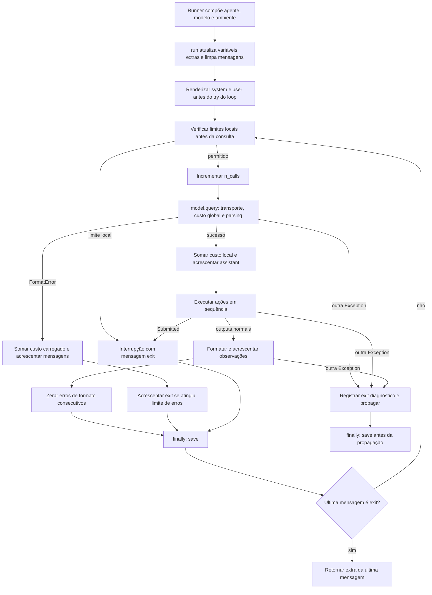
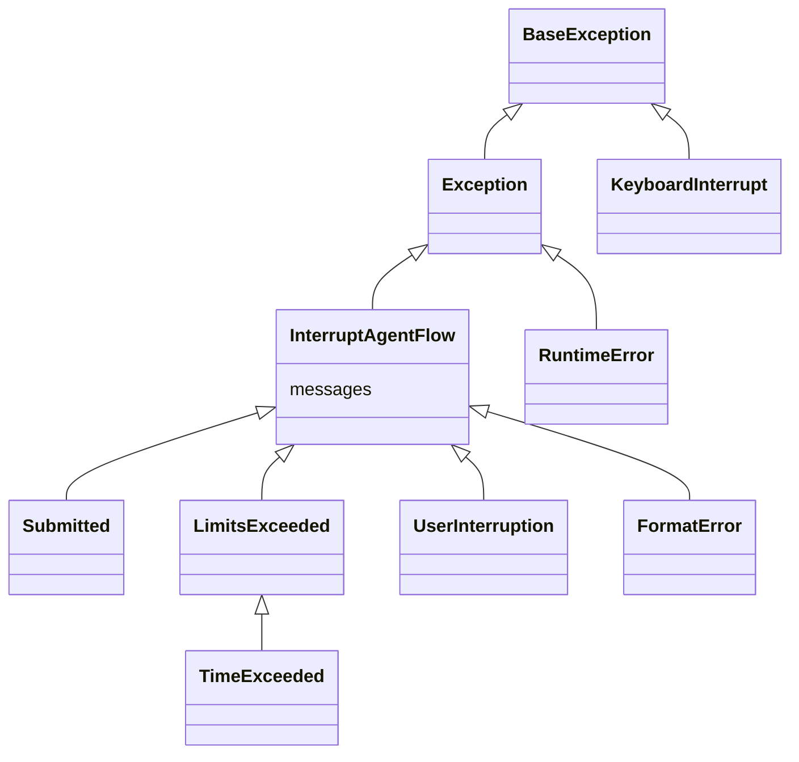
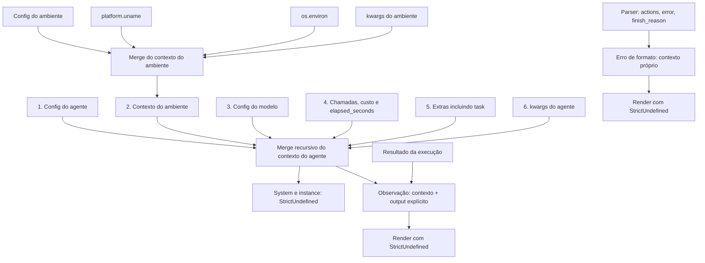

# Estudo do harness Python e suas implicações para Rust

Este documento confronta [PLAN.md](PLAN.md) e [README.md](../README.md) com a implementação local do mini-swe-agent, que declara versão 2.4.6. É um estudo estático do código, não um relatório de testes executados ou uma prova de paridade. O plano continua sendo o roteiro de implementação; este estudo detalha as hipóteses que precisam ser verdadeiras para seus critérios de aceite terem significado.

O escopo inicial é o caminho textual: `DefaultAgent`, modelo textual, `LocalEnvironment`, configuração e trajetória. Tool-calling e Responses API são analisados como contraste, sem ampliar o escopo. A procedência upstream ainda deve ser fixada conforme o passo 0 do plano; um SHA do Git pai não identifica a versão upstream.

## 1. Separação explícita dos módulos

O catálogo arquivo a arquivo está no README. Aqui a divisão é por responsabilidade, estado e fronteira de teste. Caminhos são relativos a `mini-swe-agent/src/minisweagent/`.

| Módulo/fronteira | Responsabilidade própria | Estado e efeitos | Fronteira Rust proposta |
|---|---|---|---|
| `__init__.py` | Protocols Agent, Model e Environment; versão e diretórios | Import cria diretório, mostra startup e carrega dotenv | Interfaces na biblioteca; inicialização explícita no executável |
| `agents/default.py` | Loop, histórico, limites locais, controle de término e save | Mensagens, custo, chamadas, erros consecutivos, instante inicial | `agent`: coordenador com ownership do histórico |
| `exceptions.py` | Interrupções que carregam mensagens | Transporte de controle e mensagens | `error`: resultados de controle separados de falhas fatais |
| `models/litellm_model.py` | Consulta, preparação do payload, custo, parsing e montagem da mensagem | Rede, retries, estatística global e resposta bruta | `model`: adaptador de protocolo, não só transporte HTTP |
| `models/litellm_textbased_model.py` | Especialização textual da consulta, parsing e observação | Herda `query()` da classe base | Parser textual explícito e testável |
| `models/utils/actions_text.py` | Regex de ações e template das observações | Timestamp e mensagens de erro | Funções de parsing/renderização com relógio controlado |
| `models/utils/actions_toolcall*.py` | Parsing de tools e associação de IDs | Formatos de chat e Responses distintos | Fora do M1; contratos separados se incorporados |
| `models/__init__.py` | Factories e GlobalModelStats | Singleton, env vars e lock | Seleção de backend + estatísticas compartilhadas explícitas |
| `models/test_models.py` | Respostas determinísticas já estruturadas; ações especiais `raise`, `/sleep N` e `/warning msg` | Índice da sequência, sleep/log como efeito colateral e estatística global com `cost_per_call` | Double de teste com as mesmas ações especiais; não substitui teste do parser real |
| `environments/local.py` | Processo, cwd/env, timeout, output e submissão | Processo filho e filesystem externo | `environment`: execução independente por ação |
| `config/__init__.py`, YAMLs | Resolver specs e fornecer prompts/configuração | Leitura de arquivos e ambiente | `config`: parsing, precedência e validação |
| `utils/serialize.py` | Merge recursivo com UNSET | Sem I/O próprio | Merge compatível antes da conversão para tipos validados |
| `DefaultAgent.serialize/save` | Envelope da trajetória e persistência | Escrita de arquivo após tentativa de passo | `trajectory`: schema e política de persistência |
| `run/mini.py`, factories | Compor componentes e aplicar opções | Terminal, defaults interativos e configuração global | `main`: composição; defaults explícitos no comparador |
| `agents/interactive.py`, inspector, prompt_user | Interação humana e visualização | Terminal e decisões humanas | Adiados; não contam como cobertura do núcleo |
| Outros provedores, ambientes e benchmarks | Integrações, execução em lote e avaliação | Recursos remotos, custos, concorrência | Adapters posteriores, cada um com gate próprio |

Essa separação não coincide integralmente com os arquivos Python: serialização está no agente, estatística global está no pacote de modelos, e a extração de ações está distribuída entre classe base, especialização e utilitário. Portar apenas os três protocols não reproduz essas responsabilidades.

## 2. Fluxo principal: onde os efeitos realmente acontecem

Fonte: [DefaultAgent](../mini-swe-agent/src/minisweagent/agents/default.py), especialmente `run`, `query`, `execute_actions` e `save`.



O diagrama omite falhas dos próprios handlers para manter legibilidade. Se `save()` falha, pode substituir a falha que estava sendo propagada. Se a renderização inicial falha, o loop ainda não começou: seu `finally` não salva. Logo, “salva sempre” é incorreto; “tenta salvar após cada tentativa de passo dentro do loop” é preciso.

O limite de tempo é uma verificação antes da consulta, baseada em `int(time.time() - _start_time)`. Não interrompe uma chamada de modelo em andamento. O timeout do ambiente é outro mecanismo. `run()` limpa mensagens, mas não reinicializa custo, chamadas, contador de erros de formato consecutivos e instante inicial: repetir `run()` no mesmo objeto não equivale a construir um novo agente. `extra_template_vars` também é acumulado com `|=`, então chaves de uma execução anterior sobrevivem.

## 3. Ciclo de ação: actions não vêm prontas do LLM

Fontes concretas: [LitellmModel.query](../mini-swe-agent/src/minisweagent/models/litellm_model.py), [LitellmTextbasedModel](../mini-swe-agent/src/minisweagent/models/litellm_textbased_model.py) e [actions_text](../mini-swe-agent/src/minisweagent/models/utils/actions_text.py).

```mermaid
sequenceDiagram
    participant A as DefaultAgent
    participant M as LitellmTextbasedModel
    participant P as Parser textual
    participant G as GlobalModelStats
    participant E as LocalEnvironment
    A->>M: query(histórico)
    Note over M: Remove extra do payload; prepara mensagens; consulta com retry
    Note over M: Calcula custo da resposta recebida
    M->>G: add(custo), antes do parsing
    alt Limite global excedido
        G-->>M: RuntimeError após atualizar contadores
        M-->>A: Falha fatal sem retorno normal da mensagem
    else Contagem global aceita
        M->>P: content ou string vazia, regex, finish_reason
        alt Exatamente uma correspondência
            P-->>M: lista com command após strip
            M-->>A: assistant + extra.actions + response + cost + timestamp
            A->>E: execute(action)
            alt Marcador e retorno zero
                E-->>A: Submitted com mensagem exit
            else Execução normal ou erro convertido em output
                E-->>A: output, returncode, exception_info e extras
                A->>M: format_observation_messages
                M-->>A: mensagens user com observação e metadados
            end
        else Zero ou várias correspondências
            P-->>M: FormatError com mensagem user
            Note over M: Acrescenta custo e resposta bruta à exceção
            M-->>A: FormatError enriquecido; agente cobra e registra
        end
    end
```

### 3.1 Parser concreto do recorte textual

`LitellmTextbasedModel` herda `query()` da base, mas troca `_query`, `_parse_actions` e a formatação de observações. Sua regex padrão é:

````text
```mswea_bash_command\s*\n(.*?)\n```
````

A linha acima representa o padrão; a execução usa `re.findall(..., re.DOTALL)`, aplica `strip()` a cada captura e exige **exatamente uma captura**. O parser não verifica se há exatamente um comando de shell: uma captura pode conter várias linhas e comandos encadeados. Também não exige que o comando resultante seja não vazio. Ele não é parser Markdown nem validador de segurança de shell.

`content` nulo vira string vazia. Um bloco `bash` comum não equivale a `mswea_bash_command`. Delimitadores dentro de um heredoc, bloco incompleto, CRLF, múltiplos blocos e saída truncada são casos de contrato, não detalhes cosméticos. Uma regex configurável pode usar recursos de Python que um motor Rust não aceita; o recorte deve enumerar padrões suportados e rejeitar incompatíveis explicitamente.

Quando a cardinalidade é inválida, `FormatError` transporta mensagem `user` com `interrupt_type`, `n_actions` e `model_response`. O template recebe `actions`, `error` e `finish_reason`. A classe base acrescenta `cost` e `response` bruta, com fallback para `repr` se a serialização falhar. Não há mensagem assistant normal retornada nesse caminho. O agente então soma o custo carregado e registra essas mensagens.

**Três testes diferentes são obrigatórios:** parser com texto bruto; adaptador com resposta de provedor controlada e custo; loop com mensagens estruturadas. Um `DeterministicModel` que já retorna `extra.actions` só cobre o terceiro.

### 3.2 Por que outras classes não são intercambiáveis

| Caminho | Origem das ações | Diferença observável |
|---|---|---|
| LiteLLM textual | `choices[0].message.content` → regex | Exatamente uma captura; observação user |
| LiteLLM toolcall | `message.tool_calls` → JSON dos argumentos | Uma ou mais tools; nome bash e presença de command; IDs de chamada |
| Responses | Itens `function_call` de `output` | Campos name/arguments/call_id e observações function_call_output |
| Determinístico | `config.outputs` já estruturado | Pode contornar todas as validações de resposta bruta |

Os parsers de tools consultados verificam presença de `command`, mas não impõem ali que seu valor seja string. Um tipo Rust mais restrito pode rejeitar antes e mudar o erro observado. Isso é útil para o desenho, mas exige decisão de compatibilidade, não alegação de tradução idêntica.

### 3.3 Composição real: o YAML textual não seleciona o modelo textual

Fontes: [get_model/get_model_class](../mini-swe-agent/src/minisweagent/models/__init__.py), [run/mini.py](../mini-swe-agent/src/minisweagent/run/mini.py), `config/default.yaml` e `config/mini_textbased.yaml`.

Nem `default.yaml` nem `mini_textbased.yaml` definem `model.model_class`. `get_model_class(model_name, "")` devolve `LitellmModel`, a classe de **tool-calling**. Logo `mini -c mini_textbased.yaml`, como sugere a documentação de migração v2, envia prompts textuais mas consulta o provedor com `tools=[BASH_TOOL]` e parseia `tool_calls`, não o bloco `mswea_bash_command`. O parser textual só entra em cena com `model_class: litellm_textbased` (ou `openrouter_textbased`) explícito, ou com `deterministic`, que já traz as ações prontas. Nenhum teste da suíte exercita `LitellmTextbasedModel` dentro de `DefaultAgent` com prompts reais; `tests/run/test_local.py` substitui a classe do modelo por um `DeterministicModel`.

Consequência para o port: o oráculo Python de paridade deve compor `DefaultAgent` + `LitellmTextbasedModel`/`DeterministicModel` + `LocalEnvironment` explicitamente, nunca pelo `mini` com o YAML puro. O prompt textual e o parser textual são escolhas independentes na referência; o Rust pode uni-las, mas deve registrar isso como decisão.

### 3.4 DeterministicModel: contrato do double

Fonte: [models/test_models.py](../mini-swe-agent/src/minisweagent/models/test_models.py).

- `query()` avança `current_index` e devolve `config.outputs[i]` sem cópia; um índice além da lista é `IndexError`, tratado pelo agente como erro inesperado.
- Antes de devolver, `_process_test_actions` inspeciona `extra.actions`: `{"raise": exc}` lança o objeto; `command` iniciado por `/sleep N` dorme N segundos e `/warning msg` registra `logging.warning`. Nesses dois casos o modelo **recorre** para o próximo output sem registrar chamada global; o custo e o output consumido não aparecem na trajetória. A fixture JSON do port não pode carregar objetos de exceção: precisa de uma tag equivalente.
- O custo global é `GLOBAL_MODEL_STATS.add(config.cost_per_call)`; o custo local do agente é `message.extra.cost`, definido por `make_output` (padrão 1.0). São dois campos distintos que coincidem apenas por convenção da fixture.
- `format_message` devolve os kwargs como estão (`expand_multimodal_content` é no-op com regex vazia); `format_observation_messages` usa o mesmo utilitário textual do `LitellmTextbasedModel`, com `observation_template` próprio e sem truncamento por padrão.

## 4. Estado do shell, cwd e filesystem

Fonte: [LocalEnvironment.execute e _run](../mini-swe-agent/src/minisweagent/environments/local.py).

`cwd efetivo = cwd da chamada ou config.cwd ou os.getcwd()`. `DefaultAgent.execute_actions()` chama `env.execute(action)` sem fornecer cwd por passo; na composição padrão, prevalece a configuração ou o diretório do processo hospedeiro. Um campo cwd arbitrário dentro da action não é lido como argumento cwd.

| Estado | Persiste de uma ação para outra? | Exemplo em workspace temporário W |
|---|---|---|
| Cwd do shell filho | Não | `cd subdir` seguido de `pwd` volta a executar em W |
| Variável exportada pelo shell filho | Não | `export STUDY_X=abc` seguido de leitura não herda abc |
| Arquivos criados/editados | Sim | `printf x > arquivo` seguido de `cat arquivo` lê x |
| Estado do processo hospedeiro | Pode mudar externamente | `os.environ` e cwd padrão são consultados em cada execução |
| Processos lançados em background | Depende de quem segura o pipe | `echo hi; sleep 30 &` herda o stdout: `communicate()` só retorna no EOF, o comando termina como `TimeoutExpired` com saída parcial `hi` e o grupo inteiro é morto. Com `sleep 30 >/dev/null 2>&1 &` o comando retorna imediatamente e o filho sobrevive sem limpeza. Verificado nesta sessão replicando `_run` |

“Sem sessão persistente” não significa “ambiente sem estado”. Usar um shell persistente no Rust pode produzir resultados aparentemente melhores e ainda assim quebrar paridade. Restaurar todo o filesystem após cada passo também quebra o contrato.

**Risco quantificado por casos, sem inventar frequência em produção:** a bateria mínima tem seis cenários: cd isolado; export isolado; cd e leitura no mesmo comando; arquivo persistente; precedência cwd explícito/config/default; duas execuções em cópias independentes do workspace. Os dois primeiros necessariamente distinguem um shell persistente da referência, quando a variável não existe previamente. Um caso combinado `cd subdir; export STUDY_X=abc; printf x > arquivo` seguido de `pwd; printf '%s' "${STUDY_X-unset}"; cat subdir/arquivo` exercita simultaneamente cwd, env e persistência de arquivo.

Impacto: **alto** — comando posterior pode editar caminho errado, usar configuração errada ou falhar apesar de um passo anterior bem-sucedido. Probabilidade: **não medida**. Medir em tarefas reais a proporção de sequências dependentes de cd/export e a incidência de correções; não atribuir porcentagem sem dados.

Rust deve manter subprocess por ação, shell compatível (`/bin/sh -c` no POSIX de referência), stdout/stderr mesclados, UTF-8 com substituição e término de grupo no timeout. Não confundir os streams do subprocess, já mesclados, com stdout/stderr da própria CLI. Retorno diferente de zero normalmente vira observação, não término fatal do agente.

## 5. Submitted: protocolo de término por marcador

O ambiente aplica `output.lstrip().splitlines(keepends=True)`, compara `lines[0].strip()` com `COMPLETE_TASK_AND_SUBMIT_FINAL_OUTPUT` e exige `returncode == 0`. A submissão é a concatenação das linhas restantes. Não há ferramenta de término tipada no caminho textual; o protocolo depende do texto produzido pelo processo.

| Output/condição | Resultado esperado pela leitura do código |
|---|---|
| Marcador exato na primeira linha, código 0 | Submitted |
| Espaços/linhas vazias antes do marcador, código 0 | Submitted após lstrip |
| Espaços ao redor do marcador na primeira linha | Aceito pelo strip da linha |
| Mensagem de log antes do marcador | Observação normal |
| Marcador com case diferente ou texto extra na mesma linha | Observação normal |
| Marcador correto, código não zero | Observação normal |
| Marcador e linhas seguintes | Submitted; demais linhas preservadas como submissão |
| Marcador presente apenas no texto da resposta do LLM | Não termina: deve aparecer na saída da execução |

**Risco de paridade alto:** mudar prompt, shell, saída mesclada ou formatação pode impedir término e causar novas chamadas/custos. Inversamente, conteúdo de um arquivo impresso que comece com o marcador pode terminar o agente involuntariamente. O protocolo não autentica a intenção de submissão.

Dois casos adicionais verificados nesta sessão com a mesma lógica de `_check_finished`: marcador seguido de CRLF termina e a submissão preserva `\r\n`; marcador sem newline final termina com submissão vazia. Testar os oito casos acima mais esses dois. Centralizar a constante no Rust ajuda, mas não substitui verificar que o prompt renderizado instrui a mesma string. Um protocolo de término mais robusto seria mudança de produto separada; não introduzi-lo silenciosamente no modo compatível.

## 6. Hierarquia de exceptions e classificação de resultados

Fonte: [exceptions.py](../mini-swe-agent/src/minisweagent/exceptions.py).



`RepeatedFormatError` é um valor de `exit_status`, **não uma classe** dessa hierarquia. `RuntimeError` de estatísticas globais não é `LimitsExceeded`. O `except Exception` do agente básico não captura `KeyboardInterrupt`; o `finally` ainda executa se a interrupção ocorrer dentro do try, mas não implica criação de mensagem exit pelo handler genérico. Interação humana tem lógica adicional fora deste recorte.

| Situação | Python | Modelagem Rust proposta |
|---|---|---|
| Conclusão | Submitted carrega exit | Resultado terminal com mensagens e submissão |
| Limite local/tempo | LimitsExceeded/TimeExceeded carregam exit | Resultado terminal limitado, preservando status |
| Formato inválido | FormatError; pode continuar | Resultado recuperável com custo e resposta preservados |
| Limite de erros consecutivos | Agente acrescenta exit RepeatedFormatError | Transição de estado, não necessidade de novo tipo de exceção |
| Limite global ou falha inesperada | Exception → exit diagnóstico, save, propagação | Erro fatal com estado parcial e causa |
| Erro do subprocess capturado pelo ambiente | Output com returncode -1 e extras | Resultado de execução falha, ainda observável pelo modelo |

Enums não devem eliminar a diferença entre “retornar normalmente com status terminal” e “salvar e propagar erro”. Essa distinção chega ao exit code da CLI. Evitar panic para qualquer uma dessas situações previstas.

## 7. Composição dos templates: três contextos diferentes

Fontes: [DefaultAgent.get_template_vars](../mini-swe-agent/src/minisweagent/agents/default.py), [LocalEnvironment.get_template_vars](../mini-swe-agent/src/minisweagent/environments/local.py), [actions_text](../mini-swe-agent/src/minisweagent/models/utils/actions_text.py) e [recursive_merge](../mini-swe-agent/src/minisweagent/utils/serialize.py).



Números indicam precedência crescente: valores posteriores vencem; objetos são mesclados recursivamente, listas e escalares substituídos; UNSET é ignorado. `null` não é UNSET. No contexto do ambiente, a ordem é configuração → plataforma → ambiente do processo → kwargs. Isso permite colisões como uma env var `system` substituir a plataforma e alterar o prompt.

O template de erro textual **não recebe automaticamente todas as variáveis do agente**. Recebe actions/error e os argumentos do parser, como finish_reason. A observação recebe `output=output` e o contexto do agente por expansão de kwargs: se esse contexto já contém a chave output, Python pode falhar por argumento duplicado; não é um merge com precedência silenciosa. Problema análogo existe se template_kwargs do parser colidir com argumentos explícitos.

As configurações são modelos Pydantic com o padrão `extra='ignore'`: `DefaultAgent(**config["agent"])` aceita silenciosamente `mode: confirm` de `mini_textbased.yaml`, campo que só `InteractiveAgentConfig` declara; o mesmo vale para chaves desconhecidas em `LocalEnvironmentConfig` e nos modelos. Essas chaves não entram em `model_dump()`, portanto não aparecem no contexto de template nem em `info.config`. `output_path` é `Path | None` e sai de `model_dump(mode="json")` como string ou `null`. Um `deny_unknown_fields` no Rust mudaria o comportamento observável.

StrictUndefined não significa que qualquer variável ausente causa erro imediatamente: um teste `is defined` pode tratá-la. Significa que uso não permitido do valor ausente falha, em vez de renderizar silenciosamente vazio. Comparar os casos reais, inclusive templates condicionais.

| Momento da falha de template | Consequência relevante |
|---|---|
| System/instance antes do loop | Não alcança o finally do passo; pode não haver trajetória salva |
| Observação após executar ação | Efeito no filesystem já ocorreu; erro é diagnosticado e propagado com save |
| Template que deveria construir FormatError | Pode falhar antes de existir FormatError; enriquecimento de custo/resposta nesse catch não ocorre |

A última linha é um ponto cego adicional: a chamada ao provedor pode ter sido cobrada e as estatísticas globais atualizadas, mas a mensagem de erro enriquecida e a cobrança local não acontecerem. Não generalizar “toda resposta inválida preserva custo” para falhas arbitrárias na renderização do erro.

**Gate Rust:** mesmos inputs de template, ordem de merge, falta/ausência/null, colisões, whitespace, Unicode, slicing e fronteiras de 10.000 caracteres. Comparar bytes dos prompts e observações; diferença silenciosa não deve ser normalizada pelo comparador.

## 8. GlobalModelStats: decisão obrigatória, não detalhe de implementação

Fonte: [models/__init__.py](../mini-swe-agent/src/minisweagent/models/__init__.py), classe `GlobalModelStats` e singleton `GLOBAL_MODEL_STATS`.

Os limites vêm de `MSWEA_GLOBAL_COST_LIMIT` e `MSWEA_GLOBAL_CALL_LIMIT`, lidos na construção do singleton durante import. Trocar env vars depois disso não reconfigura automaticamente a instância. Estado é por processo Python, compartilhado entre modelos/agentes do processo, não um orçamento distribuído entre workers de processos diferentes.

A ordem em `add(cost)` é:

1. Sob lock, incrementar custo e número de chamadas.
2. Soltar o lock.
3. Verificar `0 < cost_limit < _cost` ou `0 < call_limit < _n_calls + 1`.
4. Lançar RuntimeError se qualquer condição for verdadeira.

| Condição | Limite do agente | Limite global |
|---|---|---|
| Momento | Antes de consultar | Depois de receber/calcular custo, antes do parser no LiteLLM |
| Custo exatamente no limite | Bloqueia próxima consulta (`<=`) | Não falha por custo (`<`) |
| Limite de chamadas igual a 1 | Primeira chamada permitida; próxima bloqueada | Primeira resposta já faz add lançar, pois 1 < 1 + 1 |
| Quando falha | Mensagem LimitsExceeded e retorno normal | RuntimeError; diagnóstico e propagação |
| Estado | Do agente | Compartilhado por processo |

O lock protege incrementos, **não toda a transação incremento + verificação**. Em concorrência, outra thread pode incrementar antes da checagem. Não prometer determinismo de qual chamada recebe a exceção nem prevenção de gasto antes do request.

Se o limite global dispara em `LitellmModel.query`, `DefaultAgent.n_calls` já aumentou, mas seu custo local ainda não recebeu o custo da resposta. O histórico pode não conter essa resposta. A trajetória registra `instance_cost` local: ela sozinha não audita completamente a cobrança global.

**Decisão proposta para o port:** preservar suporte e tornar o objeto de estatísticas explícito na composição. Uma instância é compartilhada pelos modelos de uma execução/processo; fixtures recebem instância nova. Começar com paridade sequencial, incluindo essas desigualdades e a ordem pós-resposta. Se houver threads, compartilhar com ownership e sincronização apropriados, documentando qualquer atomicidade mais forte como divergência. Não apagar esse comportamento nem “corrigir” o limiar de chamadas sem ADR e nova versão do contrato.

Testar limite zero, custo abaixo/igual/acima, chamadas 1 e 2, dois agentes compartilhando estatísticas, instâncias independentes e mutação de env após inicialização. Capturar estatísticas globais no relatório auxiliar de paridade; não alterar o envelope legado apenas para esconder a diferença. Concorrência precisa de testes próprios; não tem equivalência determinística garantida por esta análise.

## 9. Essencial versus acidental

“Acidental” significa substituível na implementação; não significa que pode mudar uma saída observável sem registro.

| Aspecto | Essencial ao contrato escolhido | Forma acidental/substituível |
|---|---|---|
| Loop | Ordem de eventos, histórico e condições de término | Classe Python e herança |
| Ação | Parsing aceito/rejeitado e comando executado | Localização do parser em três arquivos |
| Shell | Independência por chamada, output, cwd/env e timeout | API subprocess versus Command |
| Submissão | Marcador, posição, retorno e conteúdo restante | Exception como mecanismo de transporte |
| Templates | Contexto, precedência e texto renderizado | Jinja como biblioteca específica, se substituto provar compatibilidade |
| Estatísticas | Escopo, contagem, limiar e momento da falha | Singleton de módulo e threading.Lock |
| Trajetória | Schema, valores, ordem de mensagens e momentos de save | Dicts Python e `json.dumps(indent=2)`: ordem de inserção das chaves e `ensure_ascii=True`, que escapa não-ASCII como `\uXXXX`; a comparação deve ser do JSON interpretado, não dos bytes |
| Metadados | Presença e significado | Timestamp real, paths temporários e nomes de classes podem ter mapeamento controlado |
| Extensibilidade | Backends exigidos pelo escopo | Import dinâmico de classe Python |
| UI | Não essencial ao M1 | Typer/Rich/Textual e banner de startup |

A string mágica é acidental ao conceito de agente, mas essencial à compatibilidade desta versão. A mesma distinção vale para comportamentos surpreendentes dos limites globais. Melhorias de design devem ser identificadas como melhorias, não como paridade.

## 10. Confronto com PLAN.md e README.md

| Item dos documentos | Veredito após leitura do código | Consequência direta |
|---|---|---|
| PLAN passos 1/5/6: parsing separado do loop | Correto; precisa incluir a query herdada, não apenas regex | Gate do adaptador com resposta bruta e cobrança antes do parsing |
| README: modelo formata ações/observações | Correto, mas diagrama resume os efeitos intermediários | Usar ciclo detalhado da seção 3 para revisão |
| PLAN passo 4: subprocess independente | Correto; filesystem persiste e background após sucesso merece análise | Seis cenários de estado e teste adicional de processo em background |
| PLAN passo 1: marcador de submissão | Correto; tolera whitespace pela sequência lstrip/strip | Matriz de término exata, não equivalência aproximada de texto |
| PLAN passo 5: StrictUndefined e merge | Correto, mas não explicita três contextos nem colisões de kwargs | Fixtures para erro de template inicial, de observação e de formato |
| README: separar estatísticas globais | Insuficiente como critério de aceite | Decisão da seção 8 obrigatória antes de validar custos |
| PLAN passo 7: trajetória e snapshots | Necessário, mas insuficiente para efeitos globais/externos | Registrar eventos, estatísticas globais e diff de filesystem fora do envelope |
| PLAN passo 7: stdout/stderr | Distinguir CLI e subprocess | Subprocess local tem stream combinado; não comparar streams que não existem separadamente |
| PLAN: salvar após cada tentativa | Correto dentro do try do loop | Testar falha pré-loop e falha do próprio save |
| PLAN: M1 offline, M2 provedor | Mantido | Não promover chamada real a oráculo principal de paridade |

Este estudo não altera retroativamente o status das entregas no plano. Os novos gates devem alimentar `spec/parity.md` e ADRs quando esses artefatos forem implementados.

### Fixtures legadas: o que realmente comparam

`tests/test_data/local.traj.json` é uma **lista de seis mensagens** (`system`, `user`, `assistant`, `user`, `assistant`, `user`), não o envelope `mini-swe-agent-1.1`. Seus dois primeiros textos vêm de uma versão anterior dos templates: o system prompt termina com uma instrução "To finish, issue the following command" que `default.yaml` não contém mais, e o instance prompt não tem o passo 6 de submissão. `tests/run/test_local.py` ignora esses dois textos: usa as respostas `assistant` como roteiro e compara apenas as observações nas posições 3, 5, 7…, após `normalize_outputs` (strip por linha, remoção de `<args>` e de linhas com `root root`). A última observação esperada é `""`: é a mensagem `exit` da submissão sem linhas após o marcador, aceita porque o comparador admite papéis `user` ou `exit`.

`tests/test_data/update_outputs_local.py` está desatualizado: passa strings em `outputs=`, mas `DeterministicModelConfig.outputs` exige `list[dict]`. Regenerar a fixture pela via atual exige `make_output` com ações parseadas, como faz `test_local.py`. Para o port, a fixture serve como roteiro de respostas e de observações esperadas; prompts e envelope devem vir de execução própria do oráculo Python identificado.

### Checklist: o que precisa coincidir para a comparação ser válida

Todas as caixas representam validação ainda pendente, não testes concluídos.

- [ ] **P01 Referência:** mesmos arquivos Python identificados, config, dependências, SO/shell e condições iniciais.
- [ ] **P02 Composição:** DefaultAgent e modelo textual selecionados explicitamente; `mini` usa agente interativo por padrão e, sem `model_class`, a classe de tool-calling mesmo com `mini_textbased.yaml` (seção 3.3).
- [ ] **P03 Templates:** mesmos contextos/precedência, strings renderizadas, falhas e fase da falha; nenhum strip no comparador.
- [ ] **P04 Payload:** mesmas mensagens enviadas ao provedor após retirar extra e aplicar preparação pertinente.
- [ ] **P05 Parser:** texto bruto válido, vazio/nulo, truncado, múltiplos blocos, bloco vazio, Unicode/CRLF e regex configurada.
- [ ] **P06 Erro de formato:** mesma resposta/custo preservados, mensagens, incremento/reset do contador e RepeatedFormatError.
- [ ] **P07 Limites locais:** abaixo/igual/acima, zero, incremento antes de query e verificação temporal antes da chamada.
- [ ] **P08 Limites globais:** desigualdades, inicialização, escopo e estatísticas após falha reproduzidos; resultado auxiliar comparado.
- [ ] **P09 Ambiente:** cwd/env, subprocess independente, filesystem persistente, retorno, stream mesclado, UTF-8 e timeout com descendentes.
- [ ] **P10 Término:** marcador exato, whitespace tolerado, posição e retorno; submissão preserva linhas seguintes; não há consulta extra.
- [ ] **P11 Observação:** formato user textual, raw_output, returncode, exception_info e extras com precedência correta.
- [ ] **P12 Ordem:** assistant antes da execução; submissão não gera observação normal; nenhuma ação posterior após interrupção.
- [ ] **P13 Persistência:** mesmos pontos de save e estado parcial, falhas pré-loop e falhas de escrita classificadas.
- [ ] **P14 Resultado:** distinguir retorno terminal de erro propagado; CLI tem política de exit code documentada.
- [ ] **P15 Normalização:** apenas caminhos autorizados de tempo, classes, versão e paths; arrays, ausência/null e conteúdo sem mascaramento; comparação do JSON interpretado, pois o Python escapa não-ASCII e o Rust não precisa escapar.
- [ ] **P16 Comparador:** mutações de comando, custo, ordem e campo ausente falham; apenas metadado autorizado pode variar.
- [ ] **P17 Isolamento:** duas cópias do mesmo workspace, relógio controlado, estatísticas reiniciadas por cenário, sem rede real na prova offline.
- [ ] **P18 Reutilização:** segunda chamada a run no mesmo objeto coberta ou exclusão explicitamente registrada.

Cada cenário deve mapear requisito → símbolo Python → fixture → execução Python/Rust → diff. BDD/Cucumber descreve esses comportamentos públicos, enquanto testes menores isolam parser, merge e limites. Um cenário “tarefa terminou” não substitui P01–P18.

## 11. Auditoria adversarial: o que este estudo ainda pode errar ou omitir

| Questão adversarial | Resposta atual | Limite da evidência / próximo passo |
|---|---|---|
| Quem popula actions? | Query concreta herdada + parser textual rastreados | Executar fixtures do adaptador, não só mocks do loop |
| Shell sem estado resolve isolamento? | Não; filesystem e possíveis processos externos persistem | Testar árvore de processos, symlinks, permissões e background em ambiente descartável |
| Marcador é confiável? | É frágil e pode ter falsos positivos/negativos | Medir matriz da seção 5; melhoria de protocolo em contrato separado |
| StrictUndefined garante mesmo erro? | Não; motor e fase da falha importam | Validar templates reais e contexto de erro, inclusive colisões |
| Estatística global está resolvida? | Decisão sequencial proposta e limites explicitados | Testes e ADR pendentes; concorrência não está provada |
| Mesmo JSON final significa mesma execução? | Não | Capturar eventos, outputs externos, snapshots e estatísticas globais |
| Outros provedores se comportam igual? | Não foi demonstrado | Cada query/parser/provider precisa de cobertura própria |
| Tipagem Rust só melhora o original? | Pode mudar instante/tipo de falha e coerções | Distinguir validação compatível de mudança deliberada |
| Regex padrão cobre todo YAML aceito? | Não necessariamente | Inventariar padrões reais e incompatibilidades de motores |
| O YAML textual seleciona o modelo textual? | Não; `model_class` ausente cai em tool-calling (seção 3.3) | Oráculo compõe classes explicitamente; nunca confiar no `mini` com YAML puro |
| O double determinístico reproduz o modelo real? | Só o loop; traz ações prontas e tem ações especiais próprias (seção 3.4) | Fixtures com tags para `raise`/`/sleep`/`/warning`; parser testado à parte |
| Custo sempre corresponde ao faturamento? | Não; cálculo pode falhar, ser ignorado ou divergir do global | Testar cost_tracking e não usar apenas instance_cost como fatura |
| Não há risco de vazamento nos artefatos? | O contexto inclui env e resposta bruta | Fixtures sanitizadas; redaction deve preservar o contrato testado |
| Diagramas são a especificação completa? | Não; simplificam handlers e integrações | Código e fixtures identificadas prevalecem; revisar diagramas após mudanças |

Não foram executadas chamadas reais, suíte Python completa, testes Docker, validação de concorrência ou renderização gráfica dos diagramas nesta entrega. As relações e fórmulas acima foram verificadas por leitura da referência local; os casos de processo em background, CRLF, comando vazio e marcador sem newline foram confirmados executando réplicas isoladas de `_run`, da regex e de `_check_finished` com a biblioteca padrão do Python, fora do pacote. O próximo passo que reduz mais incerteza é transformar P03, P05, P08 e P10 em fixtures pequenas de oráculo, antes de implementar o loop Rust inteiro.
