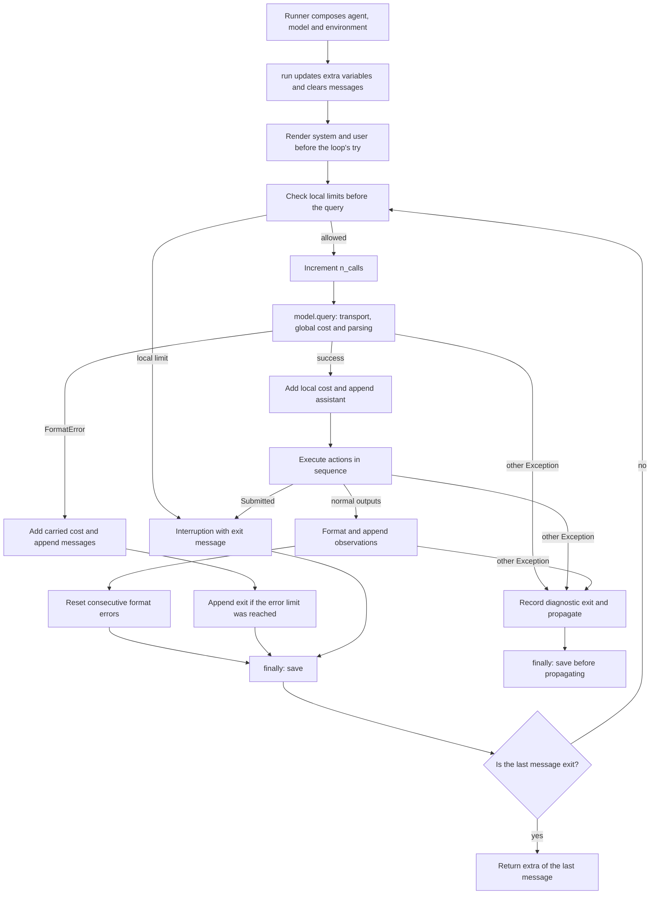
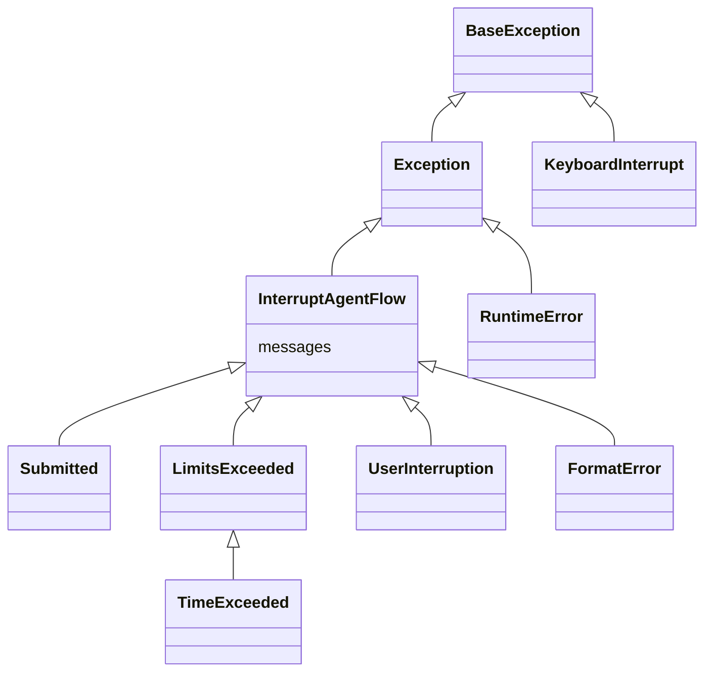
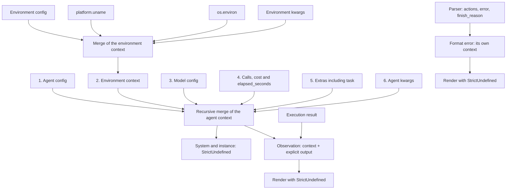

# Study of the Python harness and its implications for Rust

This document checks [PLAN.md](PLAN.md) and [README.md](../README.md) against the local mini-swe-agent implementation, which declares version 2.4.6. It is a static study of the code. It is not a report of executed tests and not a proof of parity. The plan remains the implementation roadmap. This study details the assumptions that must hold for the plan's acceptance criteria to mean anything.

The initial scope is the text-based path: `DefaultAgent`, text-based model, `LocalEnvironment`, configuration and trajectory. Tool-calling and the Responses API are analyzed for contrast, without widening the scope. The upstream provenance still has to be pinned, as step 0 of the plan says; a SHA of the parent Git repository does not identify the upstream version.

## 1. Explicit module separation

The file-by-file catalog is in the README. Here the split is by responsibility, state and test boundary. Paths are relative to `mini-swe-agent/src/minisweagent/`.

| Module/boundary | Own responsibility | State and effects | Proposed Rust boundary |
|---|---|---|---|
| `__init__.py` | Agent, Model and Environment protocols; version and directories | Import creates a directory, shows the startup banner and loads dotenv | Interfaces in the library; explicit initialization in the binary |
| `agents/default.py` | Loop, history, local limits, termination control and save | Messages, cost, calls, consecutive errors, start time | `agent`: coordinator that owns the history |
| `exceptions.py` | Interruptions that carry messages | Carries control flow and messages | `error`: control results kept apart from fatal failures |
| `models/litellm_model.py` | Query, payload preparation, cost, parsing and message assembly | Network, retries, global statistics and raw response | `model`: protocol adapter, not just HTTP transport |
| `models/litellm_textbased_model.py` | Text-based specialization of query, parsing and observation | Inherits `query()` from the base class | Explicit, testable text parser |
| `models/utils/actions_text.py` | Action regex and observation template | Timestamp and error messages | Parsing/rendering functions with a controlled clock |
| `models/utils/actions_toolcall*.py` | Tool parsing and ID matching | Separate chat and Responses formats | Outside M1; separate contracts if added |
| `models/__init__.py` | Factories and GlobalModelStats | Singleton, env vars and lock | Backend selection + explicit shared statistics |
| `models/test_models.py` | Deterministic, already structured responses; special actions `raise`, `/sleep N` and `/warning msg` | Sequence index, sleep/log as side effects and global statistics with `cost_per_call` | Test double with the same special actions; does not replace testing the real parser |
| `environments/local.py` | Process, cwd/env, timeout, output and submission | Child process and external filesystem | `environment`: independent execution per action |
| `config/__init__.py`, YAMLs | Resolve specs and provide prompts/configuration | Reads files and the environment | `config`: parsing, precedence and validation |
| `utils/serialize.py` | Recursive merge with UNSET | No I/O of its own | Compatible merge before conversion to validated types |
| `DefaultAgent.serialize/save` | Trajectory envelope and persistence | File write after each step attempt | `trajectory`: schema and persistence policy |
| `run/mini.py`, factories | Compose components and apply options | Terminal, interactive defaults and global configuration | `main`: composition; explicit defaults in the comparator |
| `agents/interactive.py`, inspector, prompt_user | Human interaction and visualization | Terminal and human decisions | Deferred; do not count as core coverage |
| Other providers, environments and benchmarks | Integrations, batch execution and evaluation | Remote resources, costs, concurrency | Later adapters, each with its own gate |

This split does not line up fully with the Python files: serialization lives in the agent, global statistics live in the models package, and action extraction is spread across the base class, the specialization and a utility module. Porting only the three protocols does not reproduce these responsibilities.

## 2. Main flow: where the effects actually happen

Source: [DefaultAgent](../mini-swe-agent/src/minisweagent/agents/default.py), especially `run`, `query`, `execute_actions` and `save`.



The diagram leaves out failures inside the handlers themselves, to stay readable. If `save()` fails, it can replace the failure that was being propagated. If the initial rendering fails, the loop has not started yet, so its `finally` does not save. So "always saves" is wrong; "tries to save after each step attempt inside the loop" is accurate.

The time limit is a check before the query, based on `int(time.time() - _start_time)`. It does not interrupt a model call in progress. The environment timeout is a separate mechanism. `run()` clears messages, but it does not reset cost, calls, the consecutive format error counter or the start time: calling `run()` again on the same object is not the same as building a new agent. `extra_template_vars` is also accumulated with `|=`, so keys from a previous run survive.

## 3. Action cycle: actions do not come ready-made from the LLM

Concrete sources: [LitellmModel.query](../mini-swe-agent/src/minisweagent/models/litellm_model.py), [LitellmTextbasedModel](../mini-swe-agent/src/minisweagent/models/litellm_textbased_model.py) and [actions_text](../mini-swe-agent/src/minisweagent/models/utils/actions_text.py).

```mermaid
sequenceDiagram
    participant A as DefaultAgent
    participant M as LitellmTextbasedModel
    participant P as Text parser
    participant G as GlobalModelStats
    participant E as LocalEnvironment
    A->>M: query(history)
    Note over M: Remove extra from payload; prepare messages; query with retry
    Note over M: Compute cost of the received response
    M->>G: add(cost), before parsing
    alt Global limit exceeded
        G-->>M: RuntimeError after updating counters
        M-->>A: Fatal failure with no normal message return
    else Global count accepted
        M->>P: content or empty string, regex, finish_reason
        alt Exactly one match
            P-->>M: list with command after strip
            M-->>A: assistant + extra.actions + response + cost + timestamp
            A->>E: execute(action)
            alt Marker and return code zero
                E-->>A: Submitted with exit message
            else Normal execution or error turned into output
                E-->>A: output, returncode, exception_info and extras
                A->>M: format_observation_messages
                M-->>A: user messages with observation and metadata
            end
        else Zero or several matches
            P-->>M: FormatError with user message
            Note over M: Attach cost and raw response to the exception
            M-->>A: Enriched FormatError; agent charges and records it
        end
    end
```

### 3.1 Concrete parser for the text-based scope

`LitellmTextbasedModel` inherits `query()` from the base class, but replaces `_query`, `_parse_actions` and observation formatting. Its default regex is:

````text
```mswea_bash_command\s*\n(.*?)\n```
````

The line above shows the pattern. Execution uses `re.findall(..., re.DOTALL)`, applies `strip()` to each capture and requires **exactly one capture**. The parser does not check that there is exactly one shell command: one capture can hold several lines and chained commands. It also does not require the resulting command to be non-empty. It is neither a Markdown parser nor a shell safety validator.

A null `content` becomes an empty string. A plain `bash` block is not the same as `mswea_bash_command`. Delimiters inside a heredoc, an incomplete block, CRLF, multiple blocks and truncated output are contract cases, not cosmetic details. A configurable regex may use Python features that a Rust engine does not accept; the scope must list the supported patterns and reject incompatible ones explicitly.

When the count is invalid, `FormatError` carries a `user` message with `interrupt_type`, `n_actions` and `model_response`. The template receives `actions`, `error` and `finish_reason`. The base class adds `cost` and the raw `response`, falling back to `repr` if serialization fails. No normal assistant message is returned on this path. The agent then adds the carried cost and records these messages.

**Three different tests are required:** the parser with raw text; the adapter with a controlled provider response and cost; the loop with structured messages. A `DeterministicModel` that already returns `extra.actions` covers only the third.

### 3.2 Why the other classes are not interchangeable

| Path | Source of actions | Observable difference |
|---|---|---|
| LiteLLM text-based | `choices[0].message.content` → regex | Exactly one capture; user observation |
| LiteLLM toolcall | `message.tool_calls` → JSON of the arguments | One or more tools; bash name and presence of command; call IDs |
| Responses | `function_call` items from `output` | name/arguments/call_id fields and function_call_output observations |
| Deterministic | Already structured `config.outputs` | Can bypass every raw-response validation |

The tool parsers examined check that `command` is present, but do not require its value to be a string at that point. A stricter Rust type can reject earlier and change the observed error. That is useful for the design, but it needs a compatibility decision, not a claim of identical translation.

### 3.3 Actual composition: the text-based YAML does not select the text-based model

Sources: [get_model/get_model_class](../mini-swe-agent/src/minisweagent/models/__init__.py), [run/mini.py](../mini-swe-agent/src/minisweagent/run/mini.py), `config/default.yaml` and `config/mini_textbased.yaml`.

Neither `default.yaml` nor `mini_textbased.yaml` sets `model.model_class`. `get_model_class(model_name, "")` returns `LitellmModel`, the **tool-calling** class. So `mini -c mini_textbased.yaml`, as the v2 migration docs suggest, sends text-based prompts but queries the provider with `tools=[BASH_TOOL]` and parses `tool_calls`, not the `mswea_bash_command` block. The text parser only comes into play with an explicit `model_class: litellm_textbased` (or `openrouter_textbased`), or with `deterministic`, which already carries ready-made actions. No test in the suite runs `LitellmTextbasedModel` inside `DefaultAgent` with real prompts; `tests/run/test_local.py` replaces the model class with a `DeterministicModel`.

Consequence for the port: the Python parity oracle must compose `DefaultAgent` + `LitellmTextbasedModel`/`DeterministicModel` + `LocalEnvironment` explicitly, never through `mini` with the plain YAML. In the reference, the text prompt and the text parser are independent choices. Rust can tie them together, but must record that as a decision.

### 3.4 DeterministicModel: the test double's contract

Source: [models/test_models.py](../mini-swe-agent/src/minisweagent/models/test_models.py).

- `query()` advances `current_index` and returns `config.outputs[i]` without copying it. An index past the end of the list raises `IndexError`, which the agent treats as an unexpected error.
- Before returning, `_process_test_actions` inspects `extra.actions`: `{"raise": exc}` raises the object; a `command` starting with `/sleep N` sleeps N seconds, and `/warning msg` calls `logging.warning`. In those two cases the model **recurses** to the next output without recording a global call; the cost and the consumed output do not appear in the trajectory. The port's JSON fixture cannot carry exception objects: it needs an equivalent tag.
- The global cost is `GLOBAL_MODEL_STATS.add(config.cost_per_call)`. The agent's local cost is `message.extra.cost`, set by `make_output` (default 1.0). These are two separate fields that match only by fixture convention.
- `format_message` returns the kwargs unchanged (`expand_multimodal_content` is a no-op with an empty regex). `format_observation_messages` uses the same text utility as `LitellmTextbasedModel`, with its own `observation_template` and no truncation by default.

## 4. Shell state, cwd and filesystem

Source: [LocalEnvironment.execute and _run](../mini-swe-agent/src/minisweagent/environments/local.py).

`effective cwd = cwd of the call or config.cwd or os.getcwd()`. `DefaultAgent.execute_actions()` calls `env.execute(action)` without passing a per-step cwd; in the default composition, the configuration or the host process directory wins. An arbitrary cwd field inside the action is not read as the cwd argument.

| State | Persists from one action to the next? | Example in temporary workspace W |
|---|---|---|
| Child shell cwd | No | `cd subdir` followed by `pwd` runs in W again |
| Variable exported by the child shell | No | `export STUDY_X=abc` followed by a read does not inherit abc |
| Created/edited files | Yes | `printf x > arquivo` followed by `cat arquivo` reads x |
| Host process state | Can change externally | `os.environ` and the default cwd are read on every execution |
| Processes started in the background | Depends on who holds the pipe | `echo hi; sleep 30 &` inherits stdout: `communicate()` only returns at EOF, the command ends as `TimeoutExpired` with partial output `hi`, and the whole group is killed. With `sleep 30 >/dev/null 2>&1 &` the command returns immediately and the child survives with no cleanup. Verified in this session by replicating `_run` |

"No persistent session" does not mean "stateless environment". A persistent shell in Rust can produce results that look better and still break parity. Restoring the whole filesystem after each step also breaks the contract.

**Risk quantified by cases, without inventing production frequencies:** the minimum test set has six scenarios: isolated cd; isolated export; cd and read in the same command; persistent file; precedence of explicit cwd/config/default; two runs on independent copies of the workspace. The first two necessarily tell a persistent shell apart from the reference, as long as the variable does not already exist. A combined case `cd subdir; export STUDY_X=abc; printf x > arquivo` followed by `pwd; printf '%s' "${STUDY_X-unset}"; cat subdir/arquivo` exercises cwd, env and file persistence at once.

Impact: **high**. A later command can edit the wrong path, use the wrong configuration, or fail even though an earlier step succeeded. Probability: **not measured**. Measure, on real tasks, the share of sequences that depend on cd/export and how often corrections occur; do not assign a percentage without data.

Rust must keep one subprocess per action, a compatible shell (`/bin/sh -c` on the reference POSIX system), merged stdout/stderr, UTF-8 with replacement, and group termination on timeout. Do not confuse the subprocess streams, which are already merged, with the CLI's own stdout/stderr. A non-zero return code normally becomes an observation, not a fatal end of the agent.

## 5. Submitted: marker-based termination protocol

The environment applies `output.lstrip().splitlines(keepends=True)`, compares `lines[0].strip()` with `COMPLETE_TASK_AND_SUBMIT_FINAL_OUTPUT` and requires `returncode == 0`. The submission is the concatenation of the remaining lines. The text-based path has no typed termination tool; the protocol depends on the text the process prints.

| Output/condition | Expected result from reading the code |
|---|---|
| Exact marker on the first line, code 0 | Submitted |
| Spaces/blank lines before the marker, code 0 | Submitted after lstrip |
| Spaces around the marker on the first line | Accepted by the line strip |
| Log message before the marker | Normal observation |
| Marker with different case or extra text on the same line | Normal observation |
| Correct marker, non-zero code | Normal observation |
| Marker and following lines | Submitted; following lines kept as the submission |
| Marker only in the LLM's response text | Does not terminate: it must appear in the execution output |

**High parity risk:** changing the prompt, the shell, the merged output or the formatting can prevent termination and cause more calls and costs. Conversely, printing a file whose content starts with the marker can end the agent by accident. The protocol does not authenticate the intent to submit.

Two more cases were verified in this session with the same logic as `_check_finished`: a marker followed by CRLF terminates and the submission keeps `\r\n`; a marker with no trailing newline terminates with an empty submission. Test the eight cases above plus these two. Centralizing the constant in Rust helps, but does not replace checking that the rendered prompt instructs the same string. A more robust termination protocol would be a separate product change; do not introduce it silently in compatible mode.

## 6. Exception hierarchy and result classification

Source: [exceptions.py](../mini-swe-agent/src/minisweagent/exceptions.py).



`RepeatedFormatError` is an `exit_status` value, **not a class** in this hierarchy. The `RuntimeError` from global statistics is not a `LimitsExceeded`. The basic agent's `except Exception` does not catch `KeyboardInterrupt`; the `finally` still runs if the interruption happens inside the try, but the generic handler does not create an exit message for it. Human interaction has extra logic outside this scope.

| Situation | Python | Proposed Rust model |
|---|---|---|
| Completion | Submitted carries exit | Terminal result with messages and submission |
| Local/time limit | LimitsExceeded/TimeExceeded carry exit | Limited terminal result, keeping the status |
| Invalid format | FormatError; may continue | Recoverable result with cost and response kept |
| Consecutive error limit | Agent appends exit RepeatedFormatError | State transition; no new exception type needed |
| Global limit or unexpected failure | Exception → diagnostic exit, save, propagation | Fatal error with partial state and cause |
| Subprocess error caught by the environment | Output with returncode -1 and extras | Failed execution result, still visible to the model |

Enums must not erase the difference between "return normally with a terminal status" and "save and propagate an error". That distinction reaches the CLI's exit code. Avoid panics for every one of these expected situations.

## 7. Template composition: three different contexts

Sources: [DefaultAgent.get_template_vars](../mini-swe-agent/src/minisweagent/agents/default.py), [LocalEnvironment.get_template_vars](../mini-swe-agent/src/minisweagent/environments/local.py), [actions_text](../mini-swe-agent/src/minisweagent/models/utils/actions_text.py) and [recursive_merge](../mini-swe-agent/src/minisweagent/utils/serialize.py).



Numbers show increasing precedence: later values win; objects are merged recursively, lists and scalars are replaced; UNSET is ignored. `null` is not UNSET. In the environment context, the order is configuration → platform → process environment → kwargs. This allows collisions, such as an env var named `system` overriding the platform value and changing the prompt.

The text-based error template **does not automatically receive all agent variables**. It receives actions/error and the parser arguments, such as finish_reason. The observation receives `output=output` and the agent context through kwargs expansion: if that context already holds an output key, Python can fail with a duplicate-argument error; it is not a merge with silent precedence. A similar problem exists if the parser's template_kwargs collide with explicit arguments.

The configurations are Pydantic models with the default `extra='ignore'`: `DefaultAgent(**config["agent"])` silently accepts `mode: confirm` from `mini_textbased.yaml`, a field that only `InteractiveAgentConfig` declares. The same holds for unknown keys in `LocalEnvironmentConfig` and in the models. These keys do not go into `model_dump()`, so they appear neither in the template context nor in `info.config`. `output_path` is `Path | None` and comes out of `model_dump(mode="json")` as a string or `null`. A `deny_unknown_fields` in Rust would change observable behavior.

StrictUndefined does not mean that any missing variable fails right away: an `is defined` test can handle it. It means that a disallowed use of the missing value fails, instead of silently rendering as empty. Compare the real cases, including conditional templates.

| When the template fails | Relevant consequence |
|---|---|
| System/instance before the loop | Does not reach the step's finally; there may be no saved trajectory |
| Observation after running an action | The filesystem effect has already happened; the error is diagnosed and propagated with save |
| Template that should build the FormatError | Can fail before a FormatError exists; the cost/response enrichment in that catch does not happen |

The last row is another blind spot: the provider call may have been billed and the global statistics updated, while the enriched error message and the local charge never happen. Do not generalize "every invalid response keeps its cost" to arbitrary failures while rendering the error.

**Rust gate:** same template inputs, merge order, missing/absent/null, collisions, whitespace, Unicode, slicing and 10,000-character boundaries. Compare the bytes of prompts and observations; the comparator must not normalize away a silent difference.

## 8. GlobalModelStats: a required decision, not an implementation detail

Source: [models/__init__.py](../mini-swe-agent/src/minisweagent/models/__init__.py), class `GlobalModelStats` and singleton `GLOBAL_MODEL_STATS`.

The limits come from `MSWEA_GLOBAL_COST_LIMIT` and `MSWEA_GLOBAL_CALL_LIMIT`, read when the singleton is built at import time. Changing the env vars after that does not reconfigure the instance. The state is per Python process, shared by the models/agents in that process. It is not a budget distributed across workers in different processes.

The order in `add(cost)` is:

1. Under the lock, increment cost and call count.
2. Release the lock.
3. Check `0 < cost_limit < _cost` or `0 < call_limit < _n_calls + 1`.
4. Raise RuntimeError if either condition is true.

| Condition | Agent limit | Global limit |
|---|---|---|
| Timing | Before the query | After receiving the response and computing its cost, before the parser in LiteLLM |
| Cost exactly at the limit | Blocks the next query (`<=`) | Does not fail on cost (`<`) |
| Call limit equal to 1 | First call allowed; next one blocked | The first response already makes add raise, since 1 < 1 + 1 |
| On failure | LimitsExceeded message and normal return | RuntimeError; diagnosis and propagation |
| State | Per agent | Shared per process |

The lock protects the increments, **not the whole increment + check transaction**. Under concurrency, another thread can increment before the check. Do not promise which call gets the exception, and do not promise that spending is prevented before the request.

If the global limit fires in `LitellmModel.query`, `DefaultAgent.n_calls` has already increased, but its local cost has not yet received the response's cost. The history may not contain that response. The trajectory records the local `instance_cost`: on its own it does not fully audit global billing.

**Proposed decision for the port:** keep the feature and make the statistics object explicit in the composition. One instance is shared by the models of a run/process; fixtures get a new instance. Start with sequential parity, including these inequalities and the post-response ordering. If threads are used, share it with proper ownership and synchronization, and document any stronger atomicity as a divergence. Do not remove this behavior or "fix" the call threshold without an ADR and a new contract version.

Test a zero limit, cost below/equal/above, calls 1 and 2, two agents sharing statistics, independent instances, and env mutation after initialization. Capture global statistics in the auxiliary parity report; do not change the legacy envelope just to hide the difference. Concurrency needs its own tests; this analysis does not guarantee deterministic equivalence for it.

## 9. Essential versus accidental

"Accidental" means replaceable in the implementation. It does not mean an observable output may change without being recorded.

| Aspect | Essential to the chosen contract | Accidental/replaceable form |
|---|---|---|
| Loop | Order of events, history and termination conditions | Python class and inheritance |
| Action | Accepted/rejected parsing and the executed command | Parser spread over three files |
| Shell | Independence per call, output, cwd/env and timeout | subprocess API versus Command |
| Submission | Marker, position, return code and remaining content | Exception as the transport mechanism |
| Templates | Context, precedence and rendered text | Jinja as a specific library, if a replacement proves compatible |
| Statistics | Scope, counting, threshold and timing of the failure | Module singleton and threading.Lock |
| Trajectory | Schema, values, message order and save points | Python dicts and `json.dumps(indent=2)`: key insertion order and `ensure_ascii=True`, which escapes non-ASCII as `\uXXXX`; compare the parsed JSON, not the bytes |
| Metadata | Presence and meaning | Real timestamp, temporary paths and class names can have a controlled mapping |
| Extensibility | Backends required by the scope | Dynamic Python class import |
| UI | Not essential to M1 | Typer/Rich/Textual and startup banner |

The magic string is accidental to the concept of an agent, but essential to compatibility with this version. The same distinction applies to the surprising behavior of the global limits. Design improvements must be labeled as improvements, not as parity.

## 10. Comparison with PLAN.md and README.md

| Item in the documents | Verdict after reading the code | Direct consequence |
|---|---|---|
| PLAN steps 1/5/6: parsing separate from the loop | Correct; must include the inherited query, not just the regex | Adapter gate with raw response and charging before parsing |
| README: the model formats actions/observations | Correct, but the diagram summarizes the intermediate effects | Use the detailed cycle in section 3 for review |
| PLAN step 4: independent subprocess | Correct; the filesystem persists, and background processes after success deserve analysis | Six state scenarios and an extra background process test |
| PLAN step 1: submission marker | Correct; tolerates whitespace through the lstrip/strip sequence | Exact termination matrix, not approximate text equivalence |
| PLAN step 5: StrictUndefined and merge | Correct, but does not spell out the three contexts or kwargs collisions | Fixtures for initial, observation and format template errors |
| README: keep global statistics separate | Not enough as an acceptance criterion | The section 8 decision is required before validating costs |
| PLAN step 7: trajectory and snapshots | Needed, but not enough for global/external effects | Record events, global statistics and filesystem diff outside the envelope |
| PLAN step 7: stdout/stderr | Tell the CLI and the subprocess apart | The local subprocess has a combined stream; do not compare streams that do not exist separately |
| PLAN: save after each attempt | Correct inside the loop's try | Test a pre-loop failure and a failure of save itself |
| PLAN: M1 offline, M2 provider | Kept | Do not promote a real call to the main parity oracle |

This study does not retroactively change the status of deliverables in the plan. The new gates should feed `spec/parity.md` and ADRs once those artifacts exist.

### Legacy fixtures: what they actually compare

`tests/test_data/local.traj.json` is a **list of six messages** (`system`, `user`, `assistant`, `user`, `assistant`, `user`), not the `mini-swe-agent-1.1` envelope. Its first two texts come from an earlier version of the templates: the system prompt ends with a "To finish, issue the following command" instruction that `default.yaml` no longer contains, and the instance prompt lacks submission step 6. `tests/run/test_local.py` ignores those two texts: it uses the `assistant` responses as a script and compares only the observations at positions 3, 5, 7…, after `normalize_outputs` (strip per line, removal of `<args>` and of lines containing `root root`). The last expected observation is `""`: it is the submission's `exit` message with no lines after the marker, accepted because the comparator allows the `user` or `exit` roles.

`tests/test_data/update_outputs_local.py` is out of date: it passes strings in `outputs=`, but `DeterministicModelConfig.outputs` requires `list[dict]`. Regenerating the fixture the current way requires `make_output` with parsed actions, as `test_local.py` does. For the port, the fixture serves as a script of responses and expected observations; prompts and the envelope must come from a run of the identified Python oracle.

### Checklist: what must match for the comparison to be valid

Every box represents validation that is still pending, not completed tests.

- [ ] **P01 Reference:** same identified Python files, config, dependencies, OS/shell and initial conditions.
- [ ] **P02 Composition:** DefaultAgent and the text-based model selected explicitly; `mini` uses the interactive agent by default and, without `model_class`, the tool-calling class even with `mini_textbased.yaml` (section 3.3).
- [ ] **P03 Templates:** same contexts/precedence, rendered strings, failures and failure phase; no strip in the comparator.
- [ ] **P04 Payload:** same messages sent to the provider after removing extra and applying the relevant preparation.
- [ ] **P05 Parser:** valid raw text, empty/null, truncated, multiple blocks, empty block, Unicode/CRLF and configured regex.
- [ ] **P06 Format error:** same response/cost kept, messages, counter increment/reset and RepeatedFormatError.
- [ ] **P07 Local limits:** below/equal/above, zero, increment before query and time check before the call.
- [ ] **P08 Global limits:** inequalities, initialization, scope and post-failure statistics reproduced; auxiliary result compared.
- [ ] **P09 Environment:** cwd/env, independent subprocess, persistent filesystem, return code, merged stream, UTF-8 and timeout with descendants.
- [ ] **P10 Termination:** exact marker, tolerated whitespace, position and return code; submission keeps the following lines; no extra query.
- [ ] **P11 Observation:** text user format, raw_output, returncode, exception_info and extras with correct precedence.
- [ ] **P12 Order:** assistant before execution; submission produces no normal observation; no further action after an interruption.
- [ ] **P13 Persistence:** same save points and partial state; pre-loop failures and write failures classified.
- [ ] **P14 Result:** tell a terminal return apart from a propagated error; the CLI has a documented exit code policy.
- [ ] **P15 Normalization:** only authorized paths for time, classes, version and file paths; arrays, absence/null and content without masking; compare the parsed JSON, because Python escapes non-ASCII and Rust does not need to.
- [ ] **P16 Comparator:** mutations of command, cost, order and a missing field fail; only authorized metadata may vary.
- [ ] **P17 Isolation:** two copies of the same workspace, controlled clock, statistics reset per scenario, no real network in the offline proof.
- [ ] **P18 Reuse:** a second call to run on the same object is covered, or its exclusion is recorded explicitly.

Each scenario must map requirement → Python symbol → fixture → Python/Rust run → diff. BDD/Cucumber describes these public behaviors, while smaller tests isolate the parser, merge and limits. A "task finished" scenario does not replace P01–P18.

## 11. Adversarial audit: what this study may still get wrong or omit

| Adversarial question | Current answer | Limit of the evidence / next step |
|---|---|---|
| Who populates actions? | Concrete inherited query + text parser traced | Run adapter fixtures, not just loop mocks |
| Does a stateless shell solve isolation? | No; the filesystem and possible external processes persist | Test process trees, symlinks, permissions and background in a disposable environment |
| Is the marker reliable? | It is fragile and can give false positives/negatives | Measure the section 5 matrix; protocol improvement in a separate contract |
| Does StrictUndefined guarantee the same error? | No; the engine and failure phase matter | Validate real templates and the error context, including collisions |
| Are global statistics solved? | Sequential decision proposed and limits spelled out | Tests and ADR pending; concurrency not proven |
| Does the same final JSON mean the same run? | No | Capture events, external outputs, snapshots and global statistics |
| Do other providers behave the same? | Not shown | Each query/parser/provider needs its own coverage |
| Does Rust typing only improve on the original? | It can change the timing/type of failures and coercions | Tell compatible validation apart from deliberate change |
| Does the default regex cover every accepted YAML? | Not necessarily | Inventory real patterns and engine incompatibilities |
| Does the text-based YAML select the text-based model? | No; a missing `model_class` falls back to tool-calling (section 3.3) | The oracle composes classes explicitly; never trust `mini` with plain YAML |
| Does the deterministic double reproduce the real model? | Only the loop; it carries ready-made actions and has its own special actions (section 3.4) | Fixtures with tags for `raise`/`/sleep`/`/warning`; parser tested separately |
| Does cost always match billing? | No; the calculation can fail, be skipped or diverge from the global one | Test cost_tracking and do not use instance_cost alone as an invoice |
| Is there no leak risk in the artifacts? | The context includes env and the raw response | Sanitized fixtures; redaction must keep the tested contract |
| Are the diagrams the full specification? | No; they simplify handlers and integrations | Identified code and fixtures take precedence; review the diagrams after changes |

No real calls, full Python suite, Docker tests, concurrency validation or graphical rendering of the diagrams were run for this deliverable. The relationships and formulas above were checked by reading the local reference. The cases of background processes, CRLF, empty command and marker without newline were confirmed by running isolated replicas of `_run`, the regex and `_check_finished` with the Python standard library, outside the package. The next step that reduces the most uncertainty is turning P03, P05, P08 and P10 into small oracle fixtures, before implementing the whole Rust loop.
